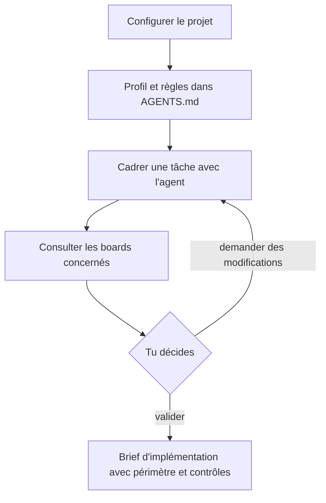

<p align="center">
  
</p>

<p align="center"><a href="README.md">English version</a></p>

OpenGuildKit est un framework open source pour les équipes qui développent avec des agents IA. Tu choisis les règles que tes agents doivent suivre et tu consultes les métiers concernés avant de valider un changement.

Le questionnaire, les commandes et tout ce que la CLI affiche sont en anglais, comme la documentation, sauf celle de l'interface web (`web/`), écrite en français comme ses écrans. Tu peux écrire tes demandes en français : le choix des boards lit le français, et « formulaire de paiement » appelle le design et la finance. L'agent te pose les questions dans ta langue. Le [glossaire](docs/glossary.md) traduit les mots du produit.

https://github.com/user-attachments/assets/d4e4e58d-fa36-41c1-8c8e-2a18d33faa72

## Essayer la démo

Utilise Python 3.11 ou une version plus récente.

```bash
git clone https://github.com/Sandbox-podcast/OpenGuildKit.git
cd OpenGuildKit
python -m pip install -e .
python examples/request-status/replay.py
```

Pour une équipe, installe plutôt sur chaque poste la dernière [release GitHub](https://github.com/Sandbox-podcast/OpenGuildKit/releases). Cette ligne télécharge sa roue, vérifie son empreinte SHA-256 dans le `SHA256SUMS.txt` de la release, puis seulement l'installe avec pipx, ou uv si pipx manque ; pour une autre version, remplace le `sh` final par `sh -s -- --version X.Y.Z` :

```sh
curl -fsSL https://github.com/Sandbox-podcast/OpenGuildKit/releases/latest/download/install.sh | sh
```

OpenGuildKit n'est pas sur PyPI. À la main, la même roue s'installe avec pipx (`pipx install ./openguildkit-X.Y.Z-py3-none-any.whl`) ou uv (`uv tool install ./openguildkit-X.Y.Z-py3-none-any.whl`). [Installer une release GitHub](docs/install.md) donne la ligne pour Windows, le téléchargement et la vérification des empreintes à la main, et les fichiers de l'agent.

La [démo](examples/request-status/) crée un projet temporaire et utilise des avis préparés sur le suivi des demandes support. Lance-la dans un terminal pour comparer les avis, valider le périmètre et lire le brief d'implémentation.

### Interface web

`openguildkit ui` ouvre ton projet dans le navigateur, sur 127.0.0.1 : les tâches par état, la consultation des brains et la passe de chacun, les avis et les blocages, les vérifications et les résultats, les alertes de dépendances, les dossiers de marché, les livrables, les outils et serveurs MCP, l'export de la documentation et ses partages. Chaque action lance une commande de la CLI. Les validations, dérogations et autres décisions qui demandent une personne restent dans ton terminal : la page affiche la commande à taper. [Interface d'un projet](web/docs/interface-projet.md)

La roue d'une release embarque l'interface construite ; dans un clone, construis-la une fois avec `cd web && npm ci --ignore-scripts && npm run build`.

La même interface fonctionne en démo, sans la CLI, depuis un clone (`cd web && npm ci --ignore-scripts && npm run dev`) ; la roue ne l'embarque pas. Explore Atelier Nova, un éditeur de logiciels fictif. Retrouve les règles du projet, compare les avis, valide une décision et suis le livrable jusqu'aux contrôles. Comme dans le produit, « Approuver » et « Refuser » affichent la commande qu'une personne tape dans son terminal ; la démo simule ensuite sa saisie. Ses rôles et ses validations de chaque version de livrable n'existent que dans la démo. La démo simule les services externes et enregistre les modifications dans ton navigateur. [Lancer la démo web](web/README.md).

## Le board des brains

Chaque métier d'un éditeur de logiciels a son brain : développement logiciel, front-end, back-end, sécurité, DevOps, QA, performance, produit, design, données et IA, marketing, communication, vente, partenariats, support client, succès client, finance, achats, juridique et conformité, RH, informatique interne, localisation, relations développeurs et documentation, confiance et sécurité des contenus, gestion de projet, opérations et direction. Un brain apporte des spécialistes avec ce que chacun vérifie, les preuves qu'il demande, les objections qu'il soulève, ses critères de décision, et les méthodes, packs de règles et normes de son métier.

Pour chaque changement, OpenGuildKit réunit les brains concernés. Chacun relit la tâche séparément, les brains répondent aux objections des autres, et tu décides avec leurs verdicts, leurs preuves et les désaccords qui restent. `openguildkit brains` les liste ; `openguildkit brains --id legal` montre ce qu'un brain connaît. Une entreprise complète un brain avec un fichier dans `.openguildkit/catalog/boards/`, ou ajoute le sien avec `openguildkit brains --new ID`. [Brains métier](docs/brains.md)

## Configurer ton projet

Depuis ton dépôt, lance le questionnaire. Il demande ta stack, ton secteur, les métiers concernés et si le projet traite des données personnelles, puis chaque norme qui en découle (RGPD, DORA, NIS 2...) avec la raison pour laquelle elle est proposée, que tu gardes ou refuses une par une ; ensuite les autres patterns, les packs à ajouter aux packs recommandés, les boards, les outils de l'entreprise, l'agent hôte et le garde-fou du board. Chaque question affiche ce que la touche Entrée retient, sauf la question obligatoire sur les données personnelles, qui attend une réponse. Dans un dépôt existant, `openguildkit detect` propose d'abord tes composants et leurs versions, et chaque pattern s'applique au composant qui utilise ses technologies.

```bash
openguildkit detect
openguildkit init
openguildkit preview
openguildkit host apply
openguildkit check
```

Avec Claude Code, Codex ou Gemini CLI comme agent hôte, `check` échoue tant que `host apply` n'a pas installé les réglages et les hooks de l'hôte : lance-le d'abord. Avec un autre agent, passe-le ; il n'écrit rien pour cet hôte. Sans terminal, dans un script ou depuis ton agent, `openguildkit init --questions` imprime le questionnaire en JSON et `openguildkit init --answers reponses.json` lit les réponses dans un fichier. Le fichier doit répondre à `personal_data` (`yes`, `no` ou `unsure`, qui propose les lois sur les données personnelles) : sans cette réponse, `init` n'écrit rien et nomme la question.

Pour configurer un second dépôt comme le premier, lance `openguildkit profile export > answers.json` dans le premier et `openguildkit init --answers answers.json` dans le second : mêmes patterns, packs, boards, garde-fou et conventions. Les noms des personnes, l'historique des changements, le fichier des signataires, les chemins des composants et les commandes de vérification restent dans le premier, et un réglage qui nomme une personne ou abaisse une protection se tape de nouveau au terminal, par la personne, dans le second ; l'export imprime chacun ([reprendre le profil](docs/workflow.md#reuse-the-profile-in-another-repository)).

`init` enregistre ton profil dans `.openguildkit/project.json` et écrit un bloc géré dans `AGENTS.md` : le workflow des tâches, les décisions du projet et chaque pack de règles avec les identifiants de ses règles, dont une passe de board ou `openguildkit task brief ID --pack PACK` imprime le texte. Il ajoute un import dans `CLAUDE.md` pour Claude Code. Les règles en vigueur sont figées dans `.openguildkit/catalog.lock.json` : après une mise à jour d'OpenGuildKit, `openguildkit update` montre la date du catalogue installé (le jour où ses sources ont été vérifiées pour la dernière fois), le nombre d'enregistrements modifiés et ce qui changerait, et `openguildkit update --apply` l'adopte. Il affiche ensuite les étapes suivantes qui s'appliquent, comme `openguildkit host apply` pour ton agent et `openguildkit tools plan ...` pour les outils que le registre connaît. [Installe le skill](integrations/) pour répondre au questionnaire dans Claude Code ou Codex et lancer des tâches depuis la conversation. Pour changer le profil ensuite (adopter ou refuser une réglementation, ajouter un contrôle, changer d'agent ou de garde-fou), utilise `openguildkit profile` : la commande enregistre qui, quand et pourquoi, et réécrit `AGENTS.md` ([patterns](docs/patterns.md#change-the-profile-after-setup)).



Un nouveau projet démarre en `"guard": "observe"` : une fois les hooks installés par `host apply`, le board est rappelé à l'agent à chaque demande et une modification sans tâche approuvée est signalée, sans être bloquée. Les projets créés avant gardent leur mode (`off` quand le profil n'en dit rien). Avec `"guard": "enforce"`, le board n'est plus facultatif : les hooks de l'agent le rappellent à chaque demande, refusent les modifications faites par les outils d'édition de l'agent tant qu'aucune tâche n'est approuvée, et un contrôle CI exige la décision approuvée dans chaque PR. Les écritures par le shell ne passent pas par les hooks ; le contrôle CI les rattrape. Une approbation locale ne détecte que les modifications accidentelles : passe aux approbations signées si l'agent ne doit pas pouvoir approuver à ta place. [Board automatique](integrations/README.md#the-board-before-every-change)

La CLI choisit les boards et enregistre leurs avis en local. Ton agent rédige ces avis et utilise ses outils pour les recherches que tu autorises. Tu valides le périmètre dans ton terminal avant que la CLI affiche le brief d'implémentation.

## Le parcours d'une tâche

Chaque changement suit le même parcours, de la demande à la clôture. L'agent lance les commandes et joue les boards. Tu réponds aux questions, tu décides et tu confirmes en ton nom ce qui te revient, dans ton propre terminal. Le [détail de chaque étape](docs/workflow.md) est en anglais.

**1. Ouvrir et cadrer la tâche.**

```bash
openguildkit task new "Afficher aux clients connectés le statut de leurs demandes" --id statut-demandes
openguildkit task questions statut-demandes
openguildkit task questions statut-demandes --answers reponses.json --follow-ups
openguildkit task route statut-demandes --answers reponses.json
openguildkit task consult statut-demandes --answers reponses.json
```

- `task new` ouvre la tâche avec ta demande, le brief, écrit avec tes mots.
- `task questions` donne le questionnaire : l'agent te demande le type de travail, les zones touchées, les données en jeu et les recherches permises.
- `task questions --answers --follow-ups` donne seulement les questions de suivi qu'appellent tes réponses et les points encore ouverts.
- `task route` montre les boards retenus et pourquoi, sans rien enregistrer. Toi seul ajoutes ou retires un board, avec une raison.
- `task consult` enregistre tes réponses et prépare une consultation courte : la tâche, le périmètre du projet, une ligne par board. Pour consulter de nouveau une tâche avec les réponses qu'elle garde, après une demande de changements, un rebase ou un changement de règles, lance `task consult ID --reuse-answers` : la commande n'a pas besoin de terminal.

Un `reponses.json` minimal donne l'identifiant d'un choix pour chaque question de `task questions`. `concerns` nomme les sujets qui appellent leurs propres spécialistes (argent, IA, décisions sur des personnes, secrets), ou `none` :

```json
{
  "kind": "feature",
  "surface": "customer",
  "data": "personal",
  "research": "local",
  "concerns": ["none"],
  "context": "Les clients connectés voient le statut de leurs propres demandes support."
}
```

Les questions de suivi ajoutent leurs réponses au même fichier, sous leur identifiant : `outcome` (ce qu'on peut voir ou mesurer une fois le travail fini), `affected` (qui remarque le changement) et, pour une décision, `options`.

Les fichiers JSON de ces étapes (les réponses, un avis par board, la délibération, le résultat) sont des fichiers de travail. Écris-les dans `.openguildkit/work/`, pas à la racine du projet : Git ignore ce dossier, et le garde-fou laisse l'agent y écrire avant toute approbation.

**2. Consulter les boards.**

```bash
openguildkit task pass statut-demandes security --mode subagent
openguildkit task submit statut-demandes --file security.json
openguildkit task progress statut-demandes
openguildkit task review statut-demandes --summary "Accords, désaccords et prochaine étape"
openguildkit task deliberate statut-demandes
openguildkit task respond statut-demandes --file deliberation.json
openguildkit task challenge statut-demandes
```

- `task pass` donne à un board, et à lui seul, ce dont il a besoin. L'agent le lance pour chaque board, souvent avec un sous-agent par board.
- `task submit` enregistre l'avis du board. Un avis mal formé est refusé avec la liste de tous ses problèmes.
- `task progress` dit quels boards ont rendu leur avis.
- `task review` rassemble les avis avec le résumé que l'agent écrit.
- `task deliberate` liste les objections entre boards en désaccord. Avec `task respond`, chaque board maintient, amende ou cède. Quand aucun board ne fait d'objection à un autre, `task deliberate` le dit : passe `task respond`.
- `task challenge` imprime la note de décision que l'agent te montre : verdicts, objections, points bloquants et vérifications qui pourraient changer la décision.

**3. Décider.** `task clear`, `task decide` et `task revoke` sont à toi. L'agent te propose les preuves, mais il ne lance jamais ces commandes à ta place.

```bash
openguildkit task blockers statut-demandes
openguildkit task clear statut-demandes security:1 --evidence tests/test_access.py --supports "L'accès à un autre compte est refusé" --by CM
openguildkit task decide statut-demandes --approve --by CM --reason "Périmètre en lecture seule validé"
openguildkit task decide statut-demandes --request-changes --by CM --reason "Ajouter l'écran sans demande"
openguildkit task revoke statut-demandes --by CM --reason "Le portail passe à une autre équipe"
```

- `task blockers` liste les points bloquants posés par les boards, avec leur responsable et ce qui les lève.
- `task clear` lève un point bloquant avec une preuve, un fichier du projet ou un lien. Un point de phase `verification` est une condition de l'approbation : tu approuves avant, et tu le lèves une fois le code écrit.
- `task decide --approve` affiche la note de décision et te demande de taper l'identifiant de la tâche. L'approbation est scellée.
- `task decide --request-changes` renvoie la tâche au cadrage, et l'historique est gardé.
- `task revoke` retire une approbation quand le travail est abandonné ou qu'une condition de l'approbation ne peut pas être remplie : la tâche repasse en changements demandés, et le garde-fou ne couvre plus ses modifications. Si la décision était déjà exportée, relance `task export` et commite l'enregistrement : il porte alors le retrait.
- `--by` prend tes initiales ou ton identifiant d'équipe, pas ton nom complet : il est recopié dans des fichiers que l'équipe commite, et une approbation le garde sous son sceau ([données personnelles](docs/personal-data.md)).

**4. Réaliser et clore.**

```bash
openguildkit task handoff statut-demandes
openguildkit task verify statut-demandes
openguildkit task result statut-demandes --template > result.json
openguildkit task result statut-demandes --file result.json
openguildkit task complete statut-demandes
git add -A && git commit -m "Afficher le statut de chaque demande"
openguildkit task export statut-demandes
git add .openguildkit/decisions && git commit -m "Enregistrement de la décision statut-demandes"
```

- `task handoff` remet à l'agent le brief d'implémentation : le périmètre approuvé et les règles en vigueur. L'agent ne réalise que ce périmètre.
- `task verify` lance les contrôles du projet et enregistre leurs résultats. Avant tout `task result`, il compte les règles à rapporter sans les lister : le modèle les liste.
- `task result --template` ne demande que les règles qui concernent la tâche. Les autres sont listées comme non concernées, avec la raison. Un critère est `met` (atteint) ou `not-met` ; une règle est `passed`, `failed`, `skipped` ou `not-applicable`.
- `task result --file` enregistre le résultat que l'agent a rempli. Un résultat mal formé est refusé avec la liste de tous ses problèmes, chacun sous son entrée (`criteria[1]`, `checks[2]`). Le responsable de chaque pièce justificative (registre des traitements, décision d'AIPD) la fournit : le résultat nomme le document et la personne qui l'a fourni. Quand le résultat déclare non applicable une règle de protection des données, de sécurité ou d'IA que les réponses de la tâche sélectionnent (les règles RGPD pour des données personnelles), `task complete` liste chacune, et la personne qui clôt la tâche les confirme dans son terminal (`--by`, puis l'identifiant de la tâche retapé). Une même preuve citée pour les règles réussies de trois packs ou plus est signalée, et la tâche se clôt alors avec réserves.
- `task complete` clôt la tâche en `done` quand rien ne reste ouvert, ou en `done-with-reservations` (terminée avec réserves) avec les points ouverts, du plus grave au moins grave. `task show --closing` les réaffiche, et `task new --follows` ouvre une tâche liée pour les reprendre.
- Commite le travail avant `task export` : l'enregistrement liste les fichiers suivis par Git qui ont changé depuis l'approbation, et le contrôle de la pull request exige chaque fichier modifié dans cette liste. `task export` nomme les nouveaux fichiers que Git ne suit pas encore, qu'aucun enregistrement ne couvre.
- `task export` écrit l'enregistrement de la décision ; commite-le dans la même pull request. Après `task revoke`, `task export` écrit le retrait dans l'enregistrement, et le contrôle le refuse alors.

## Parcourir le catalogue

```bash
openguildkit catalog
openguildkit references
openguildkit patterns --role project-management
openguildkit patterns --role hr
openguildkit patterns --id python-fastapi-postgresql
openguildkit brains --id product
```

`catalog` liste les packs, les boards et les secteurs, avec les packs que chaque secteur présélectionne (services financiers, assurance, santé, secteur public, e-commerce, éducation, infrastructures critiques). L'index donne accès aux sources et aux méthodes. Chaque pattern indique quand il s'applique et quels packs alimentent `AGENTS.md`. [Références](docs/references.md) · [Choix des patterns](docs/patterns.md)

`openguildkit recommend` propose les packs de règles pertinents pour le projet. `openguildkit guard --ci` et `openguildkit check` contrôlent une pull request en CI ([le board avant chaque changement](integrations/README.md#the-board-before-every-change)). `openguildkit ci-check` est l'exemple d'une règle centrale : il évalue une seule règle, `export-link-expiry`, lue dans un dépôt de politique ([exemple](examples/export-expiry/README.md)).

## Documentation

- [Installer une release GitHub](docs/install.md) et [journal des changements](CHANGELOG.md)
- [Codes de sortie des commandes, pour un job de CI ou un script](docs/exit-codes.md)

- [Vérifier une règle de catalogue en CI](examples/export-expiry/README.md)
- [Coordonner les vérifications de PR avec GitHub Actions et Jenkins](integrations/ci/README.md)
- [Prototype d'origine de la règle d'export et vérificateur de redémarrage sous Windows](integrations/ci/prototype/README.md)

- [Brains métier et notes de décision](docs/brains.md)
- [Dossiers marché et veille concurrentielle](docs/market.md)
- [Alertes de dépendances et veille des vulnérabilités](docs/alerts.md)
- [Analyser les fichiers qu'un agent lit, et lister les outils d'agents et les serveurs MCP d'un projet](docs/host-scan.md)
- [Sortie SARIF de `check` et `guard --ci` pour l'analyse de code](docs/sarif.md)
- [Livrables métier issus des tâches approuvées](docs/deliverables.md)
- [Storybook du projet, design system de l'entreprise et extraction](docs/storybook.md)
- [Documentation du projet et partage avec Documentalist](docs/documentation.md)
- [Outils de la stack d'entreprise, leurs serveurs MCP et leurs simulations](docs/tools.md)
- [Correspondance avec la stack et méthodes de travail](docs/patterns.md)
- [Tests de bout en bout avec ChaosFolk, en option](integrations/chaosfolk/)

- [Glossaire des mots du produit, en anglais et en français](docs/glossary.md)
- [Données personnelles que l'outil enregistre, et comment remplacer un nom](docs/personal-data.md)
- [Architecture](docs/architecture.md) et [parcours d'une tâche](docs/workflow.md)
- [Contribuer](CONTRIBUTING.md), [format du catalogue](docs/catalog-format.md) et [tests](docs/testing.md)
- [Feuille de route](docs/roadmap.md) et [licence MIT](LICENSE)
