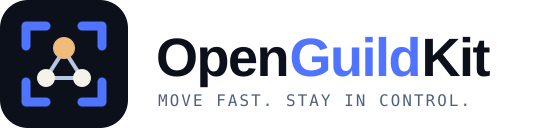
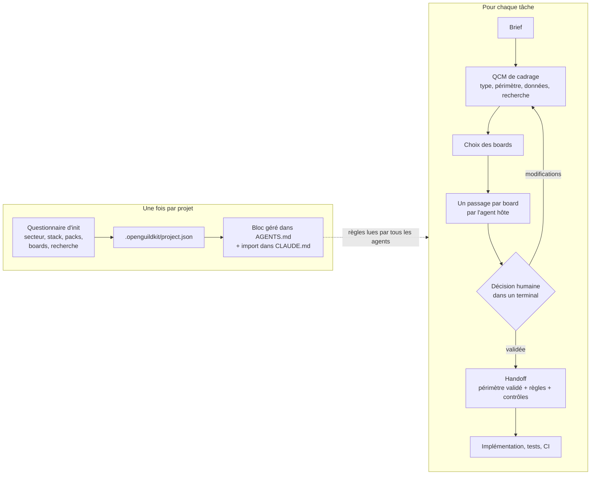
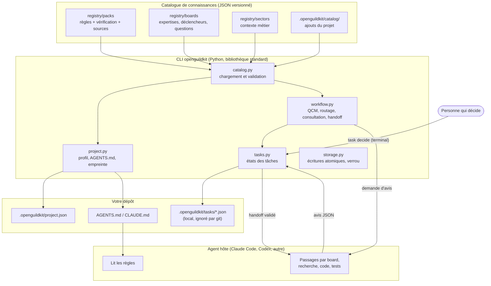
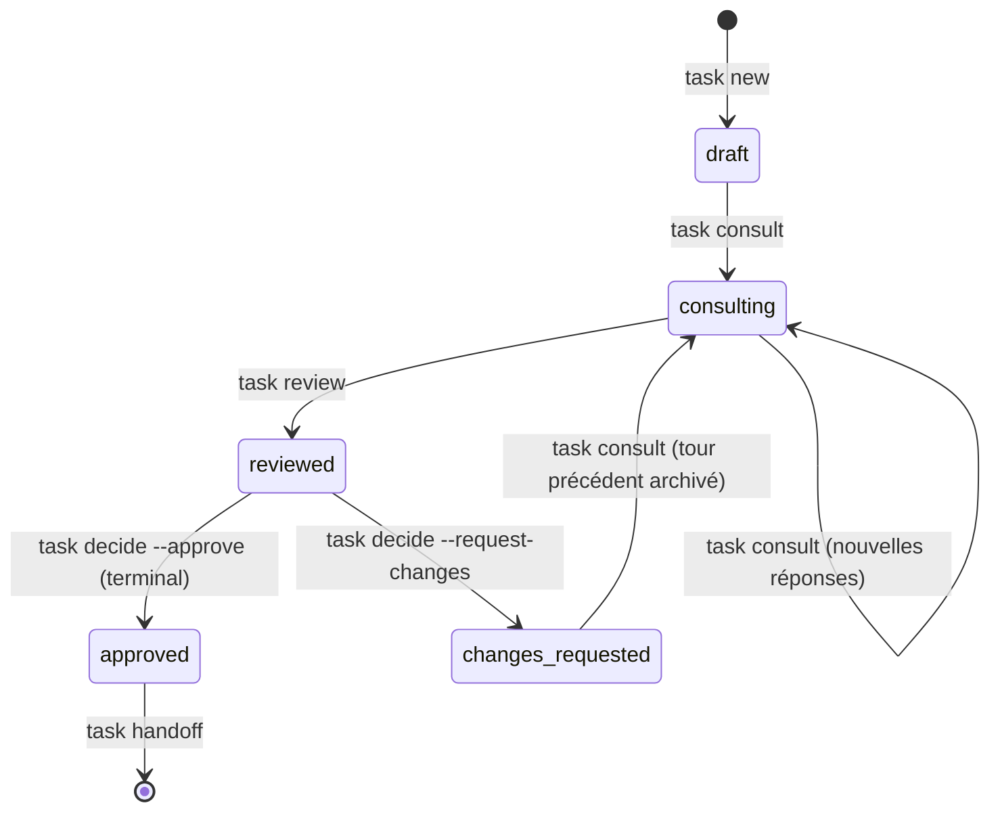

<p align="center">
  <picture>
    <source media="(prefers-color-scheme: dark)" srcset="assets/brand/wordmark-dark.svg">
    
  </picture>
</p>

<p align="center">
  Règles partagées et avis d'experts pour les équipes qui travaillent avec des agents IA.<br>
  <a href="README.md">English version</a>
</p>

---

Quand vous demandez à un agent de modifier un produit, il lui faut deux choses : les règles de l'équipe et l'avis des métiers concernés. OpenGuildKit rassemble les deux dans votre dépôt.

1. **Un catalogue de règles partagé.** Normes, conventions et pratiques de sécurité, écrites comme des instructions qu'un agent suit et des contrôles qu'un relecteur vérifie. Vous choisissez une fois les packs adaptés au projet. OpenGuildKit les écrit dans `AGENTS.md`, le fichier que les agents de code chargent comme consignes du projet, et `openguildkit check` signale quand ce fichier ne correspond plus à vos choix.
2. **Des boards par métier.** Produit, développement, sécurité, design, marketing, finance et d'autres. Avant un changement, l'agent pose des questions de cadrage, soumet la tâche aux boards concernés, enregistre leurs recommandations et attend qu'une personne valide.

Chaque tâche laisse une trace : les réponses de cadrage, la recommandation de chaque board, et qui a validé, pour quelle raison.

## Sommaire

- [Fonctionnement](#fonctionnement)
- [Démarrage rapide](#démarrage-rapide)
- [Architecture](#architecture)
- [Contenu de la V1](#contenu-de-la-v1)
- [Garanties et limites](#garanties-et-limites)
- [Organisation du dépôt](#organisation-du-dépôt)
- [Contribuer](#contribuer)
- [Feuille de route](docs/roadmap.md)

## Fonctionnement



**Initialisation.** `openguildkit init` demande le secteur, la stack, les packs de règles, les boards, la politique de recherche, les conventions de l'équipe et les contrôles à lancer. Le profil est écrit dans `.openguildkit/project.json` et un bloc géré est ajouté à `AGENTS.md`. Codex, Cursor et les autres agents qui suivent la convention `AGENTS.md` le lisent directement. Pour Claude Code, `init` ajoute un import `@AGENTS.md` dans `CLAUDE.md`.

**Chaque tâche.** L'agent ouvre une tâche, vous pose un court QCM et lance `task consult`. La CLI choisit les boards à partir de vos réponses et des mots du brief, puis imprime un brief par board. L'agent étudie la tâche board par board (avec des sous-agents quand l'outil le permet), enregistre les avis et s'arrête. Vous validez ou demandez des modifications dans votre propre terminal. Seule une tâche validée produit un handoff que l'agent peut implémenter.

## Démarrage rapide

Prérequis : Python 3.11 ou plus récent. La CLI n'utilise que la bibliothèque standard.

```bash
git clone https://github.com/loukan42/OpenGuildKit.git
pip install -e ./OpenGuildKit
```

Initialiser un projet :

```bash
cd chemin/vers/votre-projet
openguildkit catalog              # liste les packs, boards et secteurs
openguildkit init                 # questionnaire dans le terminal
# ou : openguildkit init --questions > questions.json, puis init --answers profil.json
openguildkit check                # vérifie que AGENTS.md correspond au profil
```

Traiter une tâche (en pratique, l'agent lance ces commandes et vous pose les questions) :

```bash
openguildkit task new "Permettre aux assurés de suivre l'état d'un sinistre en ligne" --id suivi-sinistre
openguildkit task questions suivi-sinistre          # le QCM de cadrage, en JSON
openguildkit task consult suivi-sinistre --answers reponses.json
openguildkit task template suivi-sinistre > avis.json   # l'agent le remplit
openguildkit task review suivi-sinistre --file avis.json
openguildkit task decide suivi-sinistre --approve --by "Votre nom" --reason "Périmètre validé"
openguildkit task handoff suivi-sinistre            # instructions d'implémentation
```

`task decide --approve` lit un vrai terminal et demande de retaper l'ID de la tâche. Un agent qui envoie du texte par un pipe ne peut pas valider son propre travail.

Un exemple complet et reproductible se trouve dans [`examples/insurance-claims`](examples/insurance-claims). Pour piloter le parcours depuis votre agent, installez le skill du dossier [`integrations`](integrations).

## Architecture



Trois choix structurent le projet :

- **La CLI n'appelle aucun fournisseur d'IA.** Elle lit et écrit des fichiers locaux et imprime du texte : instructions, demandes d'avis, handoffs. Elle n'ouvre aucune connexion réseau. L'agent hôte fait l'analyse avec son modèle, ses outils et ses permissions, selon la politique de données que vous avez fixée pour cet agent.
- **Le catalogue est fait de données, pas de code.** Packs, boards et secteurs sont des fichiers JSON validés par un schéma strict. On contribue un pack sans écrire de Python, et un projet peut ajouter ses packs privés dans `.openguildkit/catalog/`.
- **Une décision est liée aux règles en vigueur.** À la consultation, la CLI enregistre une empreinte du profil et du catalogue. Si le profil ou un pack change ensuite, le handoff est refusé. Une tâche revue repasse par `--request-changes` et une nouvelle consultation. Une tâche déjà validée est remplacée par une nouvelle tâche.

États d'une tâche :



Pour aller plus loin : [architecture](docs/architecture.md), [parcours d'une tâche](docs/workflow.md), [format du catalogue](docs/catalog-format.md). Ces documents sont en anglais, comme le code et le catalogue, pour les contributeurs du monde entier.

## Contenu de la V1

### Packs de règles

| Pack | Contenu | Règles |
|---|---|---|
| `agent-workflow` | Cadrage, avis des boards et validation du travail des agents (toujours actif) | 4 |
| `secure-sdlc` | Frontières de confiance, contrôle d'accès, secrets, dépendances, tri avant livraison | 5 |
| `iso-27001` | Périmètre du SMSI, correspondance des contrôles, preuves de changement (dépend de `secure-sdlc`) | 3 |
| `api-design` | Sémantique HTTP, contrats OpenAPI, migration des clients | 3 |
| `python` | Style, interfaces publiques typées, métadonnées du paquet | 3 |
| `typescript` | Typage strict, validation des entrées à l'exécution, contrats typés | 3 |
| `react` | Rendu pur, réutilisation des composants, états des composants | 3 |
| `web-accessibility` | Clavier, libellés et erreurs, contraste (WCAG 2.2) | 3 |

Chaque règle a une instruction, une étape de vérification et un lien vers la source officielle. Si vous ne choisissez pas les packs, `init` les recommande d'après votre stack, avec `secure-sdlc` en plus. `agent-workflow` est toujours actif, et les dépendances d'un pack sont ajoutées automatiquement.

### Boards

| Board | Ce qu'il étudie |
|---|---|
| `product` | Résultat attendu pour l'utilisateur, preuves, plus petite version utile |
| `engineering` | Frontières du code, dépendances, compatibilité |
| `qa` | Critères d'acceptation transformés en contrôles, régressions |
| `security` | Qui accède à quoi, quelles données, quels contrôles exigent une preuve |
| `design` | Interaction, design system, états traversés par l'utilisateur |
| `performance` | Objectif mesurable comparé à une référence représentative |
| `devops` | Mise en production, détection des pannes, reprise |
| `marketing` | Concurrents et alternatives avant le positionnement |
| `sales` | Acheteur, processus d'achat, ce que les commerciaux peuvent prouver |
| `finance` | Coût de construction et d'exploitation, hypothèses de l'estimation |
| `project-management` | Dépendances, responsables, dates de décision |

### Secteurs

`general` et `insurance`. Un secteur ajoute du contexte métier à chaque consultation. Pour l'assurance : branche, juridiction, rôles (assuré, courtier, assureur), données de test synthétiques, et qui valide les décisions d'éligibilité, de tarification ou de sinistre.

## Garanties et limites

- La CLI n'accède pas au réseau et n'appelle aucune IA. La recherche publique n'a lieu que si le profil l'autorise et que les réponses de la tâche la demandent. C'est alors l'agent hôte qui la fait, avec ses propres permissions.
- La validation exige une personne devant un terminal, qui retape l'ID de la tâche. Une demande de modifications ne l'exige pas.
- Le texte des tâches, les résultats de recherche et les sources du catalogue sont transmis à l'agent comme des données, dans des blocs JSON que leur contenu ne peut pas fermer.
- Les écritures sont atomiques et protégées par un verrou de projet. La CLI refuse d'écrire à travers un lien symbolique.
- OpenGuildKit ne certifie aucune conformité. Le pack `iso-27001` aide une équipe à réunir des preuves et à interroger les bons responsables. Il ne remplace pas un audit. Les packs reformulent les recommandations publiques et renvoient à la source. Ils ne reproduisent pas les normes payantes.
- Un avis de board vaut ce que valent l'agent hôte et les preuves qu'il consulte. La CLI vérifie que chaque board sélectionné a une recommandation. Elle ne peut pas vérifier que la recommandation est juste. C'est pour cela qu'une personne décide.

## Organisation du dépôt

```text
src/openguildkit/
  cli.py, catalog.py, project.py, workflow.py, tasks.py, storage.py
  registry/
    packs/      packs de règles (JSON)
    boards/     boards métiers (JSON)
    sectors/    contexte par secteur (JSON)
tests/          tests unitaires
tests/e2e/      tests de bout en bout de la CLI
examples/       exemples reproductibles
integrations/   skills pour Claude Code et Codex
docs/           architecture, parcours, format du catalogue, feuille de route
assets/brand/   logo et wordmark
```

## Contribuer

Le catalogue grandit grâce aux praticiens : une ingénieure sécurité ajoute un pack, un product manager de l'assurance complète le contexte du secteur, un designer précise le board design. Rien de tout cela ne demande de Python. Commencez par [CONTRIBUTING.md](CONTRIBUTING.md) et le [format du catalogue](docs/catalog-format.md). La gouvernance et les responsables par domaine sont décrits dans [GOVERNANCE.md](GOVERNANCE.md).

## Licence

[MIT](LICENSE)
