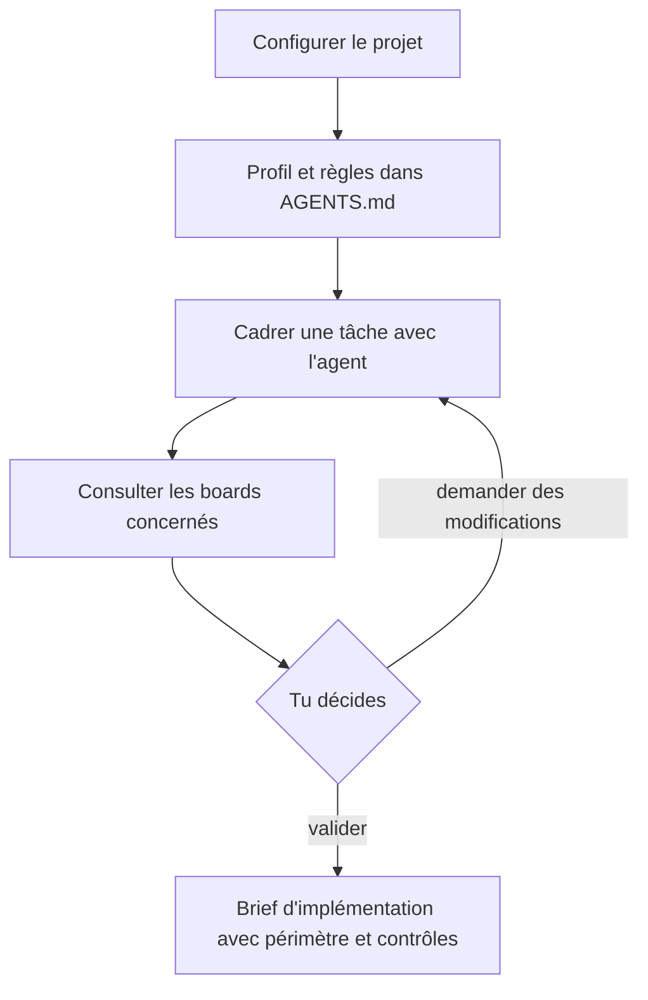

<p align="center">
  
</p>

<p align="center"><a href="README.md">English version</a></p>

OpenGuildKit est un framework open source pour les équipes qui développent avec des agents IA. Tu choisis les règles que tes agents doivent suivre et tu consultes les métiers concernés avant de valider un changement.

## Essayer la démo

Utilise Python 3.11 ou une version plus récente.

```bash
git clone https://github.com/loukan42/OpenGuildKit.git
cd OpenGuildKit
python -m pip install -e .
python examples/insurance-claims/replay.py
```

La [démo assurance](examples/insurance-claims/) crée un projet temporaire et utilise des avis préparés sur une fonctionnalité de suivi de sinistre. Lance-la dans un terminal pour valider le périmètre et lire le brief d'implémentation.

## Configurer ton projet

Depuis ton dépôt, lance le questionnaire interactif. Choisis ta stack, ton secteur, tes packs de règles et tes boards.

```bash
openguildkit init
openguildkit check
```

`init` enregistre ton profil dans `.openguildkit/project.json` et écrit les règles dans un bloc géré de `AGENTS.md`. Il ajoute un import dans `CLAUDE.md` pour Claude Code. [Installe le skill](integrations/) pour répondre au questionnaire dans Claude Code ou Codex et lancer des tâches depuis la conversation.



La CLI choisit les boards et enregistre leurs avis en local. Ton agent rédige ces avis et utilise ses outils pour les recherches que tu autorises. Tu valides le périmètre dans ton terminal avant que la CLI affiche le brief d'implémentation.

## Parcourir le catalogue

```bash
openguildkit catalog
openguildkit references
openguildkit references --family code
openguildkit references "ISO 27001"
openguildkit references --id conventional-commits
```

`catalog` liste les packs, les boards et les secteurs que tu peux utiliser dans un projet. L'[index des références](docs/references.md) donne accès aux résumés et aux sources. Les packs contiennent les consignes et les contrôles que `init` écrit dans `AGENTS.md`.

## Documentation

- [Architecture](docs/architecture.md) et [parcours d'une tâche](docs/workflow.md)
- [Contribuer](CONTRIBUTING.md) et [format du catalogue](docs/catalog-format.md)
- [Feuille de route](docs/roadmap.md) et [licence MIT](LICENSE)
