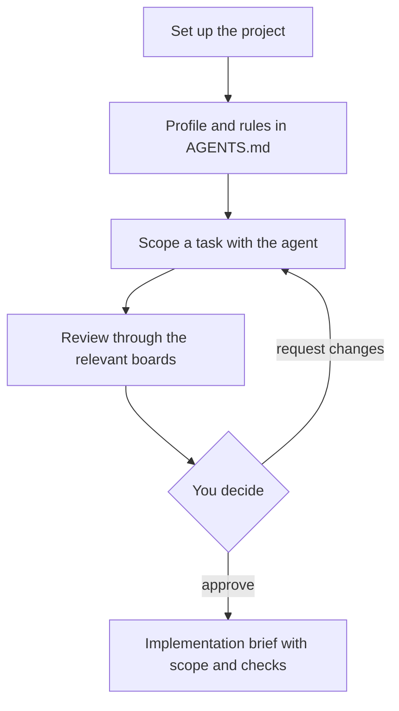

<p align="center">
  
</p>

<p align="center"><a href="README.fr.md">Version française</a></p>

OpenGuildKit is an open source framework for teams that build with AI agents. Choose the rules your agents should follow and get reviews from the disciplines affected by a change before you approve it.

https://github.com/user-attachments/assets/397e93ff-cd9f-455b-a4c0-c1425c8a5200

## Try it

Use Python 3.11 or later.

```bash
git clone https://github.com/Sandbox-podcast/OpenGuildKit.git
cd OpenGuildKit
python -m pip install -e .
python examples/request-status/replay.py
```

The [request status demo](examples/request-status/) creates a temporary project and uses prepared reviews for tracking support requests. Run it in a terminal to compare the findings, approve the scope and see the implementation brief.

## Set up your project

From your own repository, launch the interactive questionnaire. Pick your stack, sector, rule packs and boards.

```bash
openguildkit init
openguildkit check
```

`init` saves the profile in `.openguildkit/project.json` and writes the rules in a managed block in `AGENTS.md`. It adds an import to `CLAUDE.md` for Claude Code. [Install the agent skill](integrations/) to answer the questionnaire in Claude Code or Codex and run tasks from the conversation.



The local CLI selects the boards and records their reviews. Your agent writes the reviews and uses its own tools for any research you authorize. You approve the scope in your terminal before the CLI issues the implementation brief.

## Browse the catalog

```bash
openguildkit catalog
openguildkit references
openguildkit patterns --role project-management
openguildkit patterns --role hr
openguildkit patterns --id python-fastapi-postgresql
```

`catalog` lists the packs, boards and sectors you can use in a project. The [reference index](docs/references.md) provides summaries and source links. Rule packs contain the instructions and checks `init` writes into `AGENTS.md`.

## Documentation

- [Specialist brains and decision briefs](docs/brains.md)
- [Stack matching and work methods](docs/patterns.md)

- [Architecture](docs/architecture.md) and [task workflow](docs/workflow.md)
- [Contributing](CONTRIBUTING.md) and [catalog format](docs/catalog-format.md)
- [Roadmap](docs/roadmap.md) and [MIT license](LICENSE)
