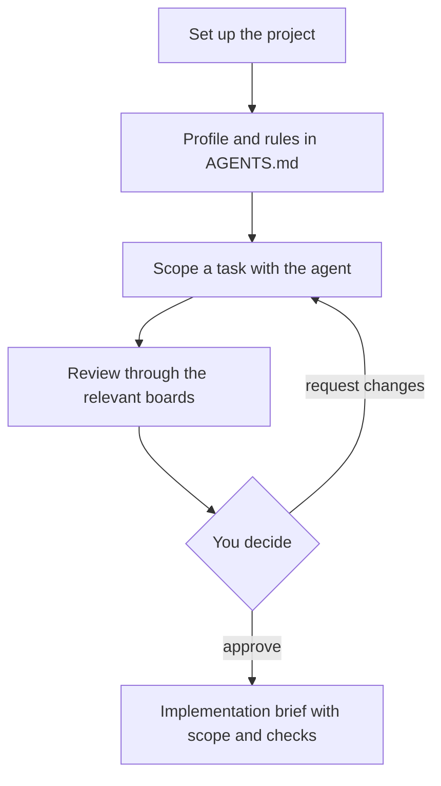

<p align="center">
  
</p>

<p align="center"><a href="README.fr.md">Version française</a></p>

OpenGuildKit is an open source framework for teams that build with AI agents. Choose the rules your agents should follow and get reviews from the disciplines affected by a change before you approve it.

https://github.com/user-attachments/assets/ae3503b5-bae0-4e2b-975c-862af2ee83a6

## Try it

Use Python 3.11 or later.

```bash
git clone https://github.com/Sandbox-podcast/OpenGuildKit.git
cd OpenGuildKit
python -m pip install -e .
python examples/request-status/replay.py
```

For a team, install the wheel of a [GitHub release](https://github.com/Sandbox-podcast/OpenGuildKit/releases) on each workstation instead, with pipx (`pipx install ./openguildkit-X.Y.Z-py3-none-any.whl`) or uv (`uv tool install ./openguildkit-X.Y.Z-py3-none-any.whl`). OpenGuildKit is not on PyPI. [Install a GitHub release](docs/install.md) gives the download, the hash check and the agent files.

The [request status demo](examples/request-status/) creates a temporary project and uses prepared reviews for tracking support requests. Run it in a terminal to compare the findings, approve the scope and see the implementation brief.

### Web interface

`openguildkit ui` opens your project in the browser, on 127.0.0.1: tasks by state, the board consultation and each brain's pass, reviews and blockers, checks and results, dependency alerts, market dossiers, deliverables, tools and MCP servers, documentation exports and shares. Every action runs a CLI command. Approvals, waivers and other decisions that need a person stay in your terminal: the page shows the command to type. The wheel of a release ships the built interface; in a clone, build it once with `cd web && npm ci --ignore-scripts && npm run build`. [Project interface](web/docs/interface-projet.md)

The same interface runs as a demo without the CLI, from a clone (`cd web && npm ci --ignore-scripts && npm run dev`); the wheel does not ship it. Explore Atelier Nova, a fictional software company, and follow a change from project rules and expert reviews through a human decision, a deliverable and its checks. As in the product, Approve and Refuse show the command a person types in their terminal; the demo then simulates it. Its roles and its approvals of each deliverable version exist only in the demo. The demo simulates external services and stores changes in your browser. [Run the web demo](web/README.md).

## The board of brains

Each discipline of a software publisher has a brain: software development, front-end, back-end, security, DevOps, QA, performance, product, design, data and AI, marketing, communication, sales, partnerships, customer support, customer success, finance, procurement, legal and compliance, HR, internal IT, localisation, developer relations and documentation, trust and safety, project management, operations and executive leadership. A brain brings specialist lenses with what an expert of each verifies, the evidence it asks for, the objections it raises, its decision criteria and the methods, rule packs and standards of its discipline.

For every change, OpenGuildKit convenes the brains it concerns. Each one reviews the task separately, the brains answer each other's objections, and you decide with their verdicts, evidence and remaining disagreements in front of you. `openguildkit brains` lists them; `openguildkit brains --id legal` shows what one knows. A company completes a brain with a file in `.openguildkit/catalog/boards/`, or adds its own with `openguildkit brains --new ID`. [Specialist brains](docs/brains.md)

## Set up your project

From your own repository, launch the interactive questionnaire. It asks your stack, sector, roles and personal data, then each norm they imply (GDPR, DORA, NIS 2...) with the reason it is proposed, for you to keep or decline one by one; then the other patterns, extra rule packs (added to the recommended ones), boards, the tools the company works with, the agent host and the board guard. Every prompt shows what Enter keeps, except the required question on personal data, which waits for an answer. In an existing repository, `openguildkit detect` proposes your components and versions first, and each pattern applies to the component where its technologies are used.

```bash
openguildkit detect
openguildkit init
openguildkit preview
openguildkit host apply
openguildkit check
```

With Claude Code or Codex as the agent host, `check` fails until `host apply` has installed the host settings and hooks: run it first. With another agent, skip it; it writes nothing for that host. Without a terminal, as in a script or from your agent, `openguildkit init --questions` prints the questionnaire as JSON and `openguildkit init --answers answers.json` reads the answers from a file. The file must answer `personal_data` (`yes`, `no` or `unsure`, which proposes the laws on personal data): without it, `init` writes nothing and names the question.

`init` saves the profile in `.openguildkit/project.json` and writes a managed block in `AGENTS.md`: the task workflow, the project's decisions and each rule pack with the IDs of its rules, whose text a board pass or `openguildkit task brief ID --pack PACK` prints. It adds an import to `CLAUDE.md` for Claude Code. The catalog records in force are pinned in `.openguildkit/catalog.lock.json`: after upgrading OpenGuildKit, `openguildkit update` shows the date of the installed catalog (the day its sources were last checked), how many records changed and what would change, and `openguildkit update --apply` adopts it. It then prints the next steps that apply, such as `openguildkit host apply` for your agent host and `openguildkit tools plan ...` for the tools the registry knows. [Install the agent skill](integrations/) to answer the questionnaire in Claude Code or Codex and run tasks from the conversation. To change the profile later (adopt or decline a regulation, add a check, change the host or the guard), use `openguildkit profile`: it records who, when and why, and rewrites `AGENTS.md` ([patterns](docs/patterns.md#change-the-profile-after-setup)).



A new project starts with `"guard": "observe"`: once `host apply` has installed the hooks, the board is brought to the agent on every request and an edit without an approved task is flagged, not blocked. Projects created before keep the mode they have (`off` when the profile does not say). With `"guard": "enforce"`, the board is not optional: host hooks remind the agent on every request, refuse file edits through the agent's edit tools until a task is approved, and a CI check requires the approved decision in each pull request. Writes through the shell do not go through the hooks; the CI check catches them. A local approval only detects accidental edits: use signed approvals when the agent must not be able to approve for you. [Board guard](integrations/README.md#the-board-before-every-change)

The local CLI selects the boards and records their reviews. Your agent writes the reviews and uses its own tools for any research you authorize. You approve the scope in your terminal before the CLI issues the implementation brief.

## A task from request to closing

Every change follows the same path, from the request to the closing. The agent runs the commands and plays the boards. You answer the questions, decide, and confirm in your own name what is yours to confirm, in your own terminal. The [task workflow](docs/workflow.md) details each step, and the [glossary](docs/glossary.md) explains the product's words in English and French.

**1. Open and scope the task.**

```bash
openguildkit task new "Show signed-in customers the status of their support requests" --id request-status
openguildkit task questions request-status
openguildkit task questions request-status --answers answers.json --follow-ups
openguildkit task route request-status --answers answers.json
openguildkit task consult request-status --answers answers.json
```

- `task new` opens the task with your request, the brief, in your own words.
- `task questions` prints the questionnaire: the agent asks you the kind of work, the areas it affects, the data involved and the research allowed.
- `task questions --answers --follow-ups` gives only the follow-up questions your answers call for and the points still open.
- `task route` shows the boards it would select and why, without recording anything. Only you add or remove a board, with a reason.
- `task consult` records your answers and prepares a short consultation: the task, the project scope, one line per board. To consult a task again with the answers it already holds, after a change request, a rebase or a change of rules, run `task consult ID --reuse-answers`: it needs no terminal.

A minimal `answers.json` gives one choice ID per question of `task questions`. `concerns` names the topics that bring their own specialists (money, AI, decisions about people, credentials), or `none`:

```json
{
  "kind": "feature",
  "surface": "customer",
  "data": "personal",
  "research": "local",
  "concerns": ["none"],
  "context": "Signed-in customers see the status of their own support requests."
}
```

The follow-up questions add their answers to the same file under their own IDs: `outcome` (what someone can see or measure once the work is done), `affected` (who notices the change) and, for a decision, `options`.

The JSON files these steps name (the answers, one entry per board, the deliberation, the result) are working files. Write them in `.openguildkit/work/`, not at the project root: Git ignores that folder, and the board guard lets the agent write there before any approval.

**2. Consult the boards.**

```bash
openguildkit task pass request-status security --mode subagent
openguildkit task submit request-status --file security.json
openguildkit task progress request-status
openguildkit task review request-status --summary "Where the boards agree, where they differ, and the next step"
openguildkit task deliberate request-status
openguildkit task respond request-status --file deliberation.json
openguildkit task challenge request-status
```

- `task pass` gives one board, and only that board, what it needs. The agent runs it for each board, often with one subagent per board.
- `task submit` records the board's review. A malformed review is refused with the list of all its problems.
- `task progress` says which boards have returned their review.
- `task review` assembles the reviews with the summary the agent writes.
- `task deliberate` lists the objections between boards that disagree. With `task respond`, each board maintains, amends or concedes. When no board objects to another, `task deliberate` says so: skip `task respond`.
- `task challenge` prints the decision brief the agent shows you: verdicts, objections, blockers and the checks that could change the decision.

**3. Decide.** `task clear`, `task decide` and `task revoke` are yours. The agent proposes the evidence, but it never runs these commands for you.

```bash
openguildkit task blockers request-status
openguildkit task clear request-status security:1 --evidence tests/test_access.py --supports "Cross-account access is refused" --by CM
openguildkit task decide request-status --approve --by CM --reason "Read-only scope agreed with support"
openguildkit task decide request-status --request-changes --by CM --reason "Include the empty state in scope"
openguildkit task revoke request-status --by CM --reason "Support moves the portal to another team"
```

- `task blockers` lists the blockers the boards set, with their owner and what clears them.
- `task clear` clears a blocker with evidence, a project file or a link. A blocker of phase `verification` is a condition of approval: you approve first, and clear it once the code exists.
- `task decide --approve` shows the decision brief and asks you to type the task ID. The approval is sealed.
- `task decide --request-changes` sends the task back to scoping, and its history is kept.
- `task revoke` withdraws an approval when the work is abandoned or a condition of the approval cannot be met: the task goes back to changes requested, and the guard stops covering its edits. When the decision was already exported, run `task export` again and commit the record: it then carries the withdrawal.
- `--by` takes your initials or your team handle, not your full name: it is copied into files the team commits, and an approval keeps it under its seal ([personal data](docs/personal-data.md)).

**4. Deliver and close.**

```bash
openguildkit task handoff request-status
openguildkit task verify request-status
openguildkit task result request-status --template > result.json
openguildkit task result request-status --file result.json
openguildkit task complete request-status
git add -A && git commit -m "Show each request's status"
openguildkit task export request-status
git add .openguildkit/decisions && git commit -m "Decision record of request-status"
```

- `task handoff` gives the agent the implementation brief: the approved scope and the rules in force. The agent delivers that scope only.
- `task verify` runs the project's checks and records their results. Before any `task result`, it counts the rules to report rather than listing them: the template lists them.
- `task result --template` asks only the rules that concern the task. The others are listed as not concerned, with the reason. A criterion is `met` or `not-met`; a rule is `passed`, `failed`, `skipped` or `not-applicable`.
- `task result --file` records the result the agent filled in. The owner of each named evidence (record of processing activities, DPIA decision) provides it: the result names the document and who provided it. When the result declares not applicable a data protection, security or AI rule that the task's answers select (the GDPR rules for personal data), `task complete` lists each one and the person who closes the task confirms them at a terminal (`--by`, then retyping the task ID). One evidence cited for the passed rules of three packs or more is flagged, and the task then closes with reservations.
- `task complete` closes the task as `done` when nothing is left open, or as `done-with-reservations` with the open points, the most serious first. `task show --closing` prints them again, and `task new --follows` opens a linked task to take them up.
- Commit the work before `task export`: the record lists the files Git tracks that changed since the approval, and the pull request check requires each changed file in it. `task export` names the new files Git does not track yet, which no record covers.
- `task export` writes the decision record; commit it in the same pull request. After `task revoke`, `task export` writes the withdrawal into the record, and the check then refuses it.

## Browse the catalog

```bash
openguildkit catalog
openguildkit references
openguildkit patterns --role project-management
openguildkit patterns --role hr
openguildkit patterns --id python-fastapi-postgresql
```

`catalog` lists the packs, boards and sectors you can use in a project, with the packs each sector preselects (financial services, insurance, healthcare, public sector, e-commerce, education, critical infrastructure). The [reference index](docs/references.md) provides summaries and source links. Rule packs contain the instructions and checks that `AGENTS.md` names by rule ID and a task prints in full.

`openguildkit recommend` suggests relevant project rule packs. `openguildkit ci-check` checks a project in CI.

## Documentation

- [Install a GitHub release](docs/install.md) and [changelog](CHANGELOG.md)

- [Run an executable catalog rule in CI](examples/export-expiry/README.md)
- [Coordinate pull request checks across GitHub Actions and Jenkins](integrations/ci/README.md)
- [Original export-expiry prototype and Windows restart verifier](integrations/ci/prototype/README.md)

- [Specialist brains and decision briefs](docs/brains.md)
- [Market dossiers and competitor watch](docs/market.md)
- [Dependency alerts and vulnerability watch](docs/alerts.md)
- [Scan the files an agent reads for hidden characters and risky commands](docs/host-scan.md)
- [Business deliverables from approved tasks](docs/deliverables.md)
- [Project Storybook, company design system and extraction](docs/storybook.md)
- [Project documentation and sharing with Documentalist](docs/documentation.md)
- [Tools of the company stack, their MCP servers and mocks](docs/tools.md)
- [Stack matching and work methods](docs/patterns.md)
- [Optional ChaosFolk end-to-end replays](integrations/chaosfolk/)

- [Glossary of the product's words, in English and French](docs/glossary.md)
- [Personal data the tool records, and how to replace a name](docs/personal-data.md)
- [Architecture](docs/architecture.md) and [task workflow](docs/workflow.md)
- [Contributing](CONTRIBUTING.md), [catalog format](docs/catalog-format.md) and [testing](docs/testing.md)
- [Roadmap](docs/roadmap.md) and [MIT license](LICENSE)
