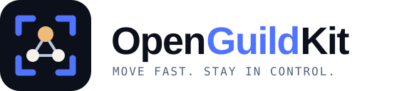
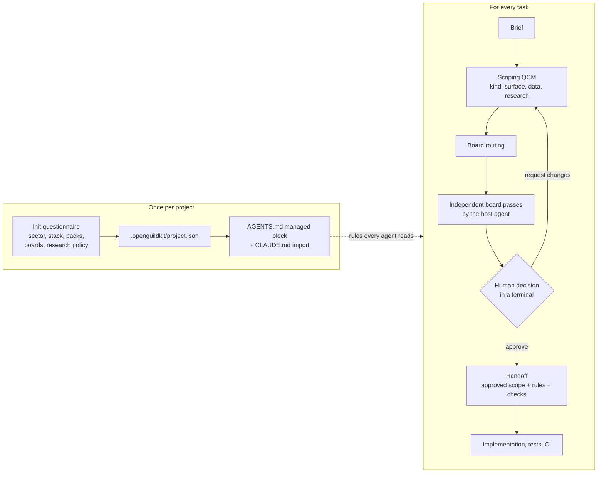
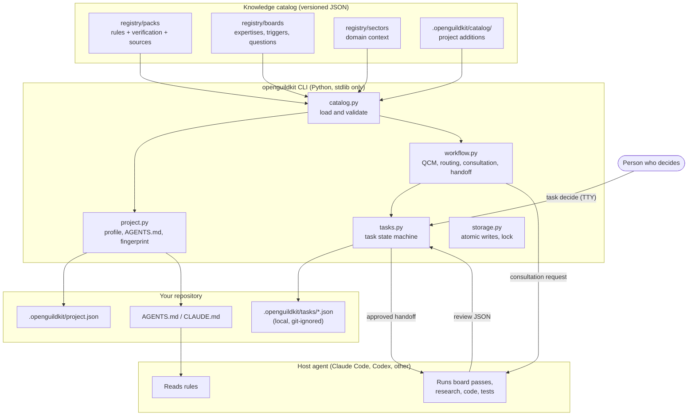
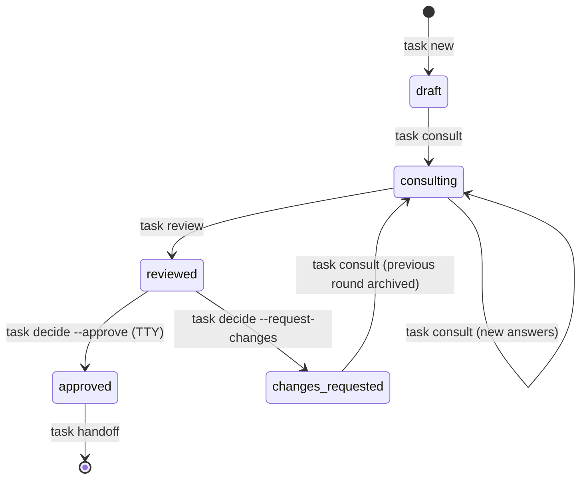

<p align="center">
  <picture>
    <source media="(prefers-color-scheme: dark)" srcset="assets/brand/wordmark-dark.svg">
    
  </picture>
</p>

<p align="center">
  Open source rules and specialist reviews for teams that build with AI agents.<br>
  <a href="README.fr.md">Version française</a>
</p>

---

When you ask an agent to change a product, it needs two things: your team's rules and the advice of the disciplines the change touches. OpenGuildKit keeps both in your repository.

1. **A shared catalog of rules.** Standards, conventions and security practices, written as instructions an agent can follow and checks a reviewer can verify. You pick the packs that fit your project once. OpenGuildKit writes them into `AGENTS.md`, the file coding agents load as project instructions, and `openguildkit check` tells you when that file drifts from your choices.
2. **Guild boards.** One board per discipline: product, engineering, security, design, marketing, finance and more. Before a change, the agent asks scoping questions, sends the task to the boards it concerns, records their recommendations, and waits for a person to approve.

Each task leaves a record: the scoping answers, each board's recommendation, and who approved it and why.

## Contents

- [How it works](#how-it-works)
- [Quick start](#quick-start)
- [Architecture](#architecture)
- [What ships in V1](#what-ships-in-v1)
- [Guarantees and limits](#guarantees-and-limits)
- [Repository layout](#repository-layout)
- [Contributing](#contributing)
- [Roadmap](docs/roadmap.md)

## How it works



**Setup.** `openguildkit init` asks about your sector, stack, rule packs, boards, research policy, team conventions and checks. It writes the profile to `.openguildkit/project.json` and a managed block in `AGENTS.md`. Codex, Cursor and other agents that follow the `AGENTS.md` convention read it directly. For Claude Code, `init` adds an `@AGENTS.md` import to `CLAUDE.md`.

**Every task.** The agent opens a task, asks you a short multiple-choice questionnaire, and runs `task consult`. The CLI picks the boards from your answers and the words in the brief, then prints one brief per board. The agent reviews the task through each board separately (with subagents when the host supports them), records the review, and stops. You approve or request changes in your own terminal. Only an approved task produces a handoff the agent can implement.

## Quick start

Requirements: Python 3.11 or later. The CLI uses the standard library only.

```bash
git clone https://github.com/loukan42/OpenGuildKit.git
pip install -e ./OpenGuildKit
```

Set up a project:

```bash
cd path/to/your-project
openguildkit catalog              # list packs, boards and sectors
openguildkit init                 # answer the questionnaire in the terminal
# or: openguildkit init --questions > questions.json, then init --answers profile.json
openguildkit check                # confirm AGENTS.md matches the profile
```

Run a task (normally your agent runs these commands and asks you the questions):

```bash
openguildkit task new "Let policyholders follow the status of a claim online" --id claim-status
openguildkit task questions claim-status          # the scoping QCM, as JSON
openguildkit task consult claim-status --answers answers.json
openguildkit task template claim-status > review.json   # the agent fills it in
openguildkit task review claim-status --file review.json
openguildkit task decide claim-status --approve --by "Your Name" --reason "Scope agreed"
openguildkit task handoff claim-status            # instructions for implementation
```

`task decide --approve` reads from a real terminal and asks you to type the task ID. An agent piping input cannot approve its own work.

A complete, reproducible run lives in [`examples/insurance-claims`](examples/insurance-claims). To drive the flow from your agent, install the skill in [`integrations`](integrations).

## Architecture



Three choices shape the design:

- **The CLI never calls an AI provider.** It reads and writes local files and prints instructions, consultation requests and handoffs as text. It opens no network connection. The host agent does the analysis with its own model, tools and permissions, under whatever data policy you set for that agent.
- **The catalog is data, not code.** Packs, boards and sectors are JSON files validated by a strict schema. Anyone can contribute a pack without touching Python, and a project can add private packs in `.openguildkit/catalog/`.
- **Decisions are bound to the rules in force.** When a task is consulted, the CLI stores a fingerprint of the resolved profile and catalog. If someone changes the profile or a pack afterwards, the handoff is refused. A reviewed task goes back through `--request-changes` and a new consultation; an approved task is replaced by a new task.

Task states:



More detail: [architecture](docs/architecture.md), [task workflow](docs/workflow.md), [catalog format](docs/catalog-format.md).

## What ships in V1

### Rule packs

| Pack | Covers | Rules |
|---|---|---|
| `agent-workflow` | Scoping, board review and approval for agent work (always active) | 4 |
| `secure-sdlc` | Trust boundaries, access control, secrets, dependencies, release triage | 5 |
| `iso-27001` | ISMS scope, control mapping, change evidence (depends on `secure-sdlc`) | 3 |
| `api-design` | HTTP semantics, OpenAPI contracts, consumer migrations | 3 |
| `python` | Style, typed public interfaces, package metadata | 3 |
| `typescript` | Strict type checking, runtime input validation, typed contracts | 3 |
| `react` | Pure rendering, component reuse, component states | 3 |
| `web-accessibility` | Keyboard access, labels and errors, contrast (WCAG 2.2) | 3 |

Each rule has an instruction, a verification step and links to the official source. When you do not pick packs yourself, `init` recommends them from your stack, plus `secure-sdlc`. `agent-workflow` is always active, and a pack's dependencies are added automatically.

### Boards

| Board | Reviews |
|---|---|
| `product` | User outcome, evidence, smallest version worth shipping |
| `engineering` | Code boundaries, dependencies, compatibility |
| `qa` | Acceptance criteria turned into checks, regressions |
| `security` | Who can reach what, which data, which controls need evidence |
| `design` | Interaction, design system, states the user goes through |
| `performance` | Measurable target against a representative baseline |
| `devops` | How it ships, how failures are detected and recovered |
| `marketing` | Competitors and substitutes before positioning |
| `sales` | Buyer, purchase process, what Sales can substantiate |
| `finance` | Build and run cost, assumptions behind the estimate |
| `project-management` | Dependencies, owners, decision dates |

### Sectors

`general` and `insurance`. A sector adds domain context to every consultation: for insurance, the line of business, jurisdiction, roles (policyholder, broker, insurer), synthetic test data, and who approves eligibility, pricing or claims decisions.

## Guarantees and limits

- No network access and no AI calls from the CLI. Public research happens only when the project profile allows it and the task answers ask for it, and the host agent does it under its own permissions.
- Approval needs a person at a terminal who types the task ID. Requesting changes does not.
- Task text, research results and catalog sources are passed to the agent as data inside JSON blocks the content cannot close.
- Writes are atomic and guarded by a project lock. The CLI refuses to write through symbolic links.
- OpenGuildKit does not certify compliance. The `iso-27001` pack helps a team gather evidence and ask the right owners; it does not replace an audit. Packs paraphrase public guidance and link to the source; they do not reproduce paid standards.
- Board reviews are as good as the host agent and the evidence it inspects. The CLI checks that every selected board has a recommendation; it cannot check that the recommendation is right. That is why a person decides.

## Repository layout

```text
src/openguildkit/
  cli.py, catalog.py, project.py, workflow.py, tasks.py, storage.py
  registry/
    packs/      rule packs (JSON)
    boards/     guild boards (JSON)
    sectors/    sector context (JSON)
tests/          unit tests
tests/e2e/      end-to-end CLI tests
examples/       reproducible walkthroughs
integrations/   skills for Claude Code and Codex
docs/           architecture, workflow, catalog format, roadmap
assets/brand/   logo and wordmark
```

## Contributing

The catalog grows through contributions from practitioners: a security engineer adds a pack, an insurance product manager improves the sector context, a designer sharpens the design board. No Python needed for any of that. Start with [CONTRIBUTING.md](CONTRIBUTING.md) and the [catalog format](docs/catalog-format.md). Governance and domain stewards are described in [GOVERNANCE.md](GOVERNANCE.md).

## License

[MIT](LICENSE)
