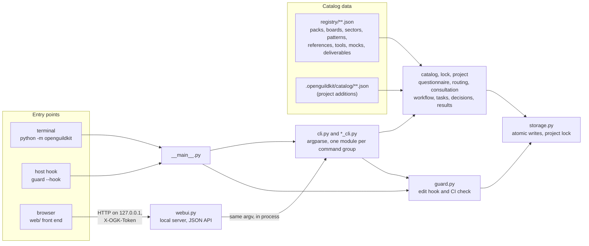
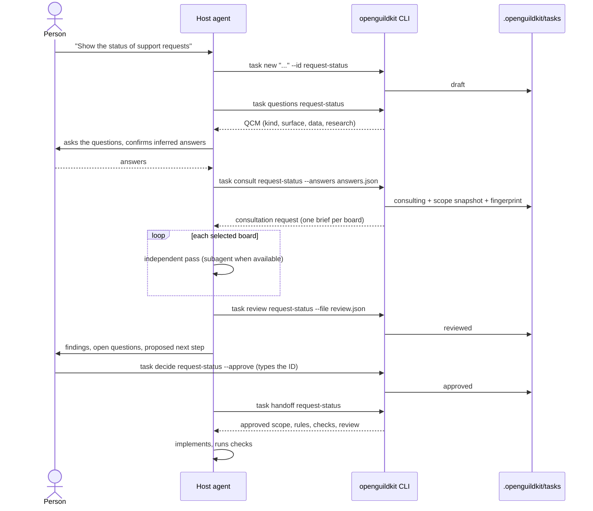

# Architecture

For: a developer or a security architect who reads how the catalog, the CLI and the host agent fit together.

OpenGuildKit has three parts: a **knowledge catalog** (JSON data), a **CLI** that turns the catalog and a project profile into instructions, consultation requests and handoffs for a host agent, and a **local web interface** over the same CLI. None of them does AI work itself.

## Components



The CLI is the only writer. `openguildkit ui` starts `webui.py`, which serves the front end built from `web/` (packaged as `web_dist/`) and a JSON API on the loopback interface. Each API call parses the same arguments a person would type and runs them through `cli.py` in the server process, one at a time behind a lock of the server, and a writing command takes the project lock as it does in a terminal, so the page and the terminal share every rule. The server answers only its own host and origin, and every call carries the session token that the printed address gives the browser. It never runs what needs a person at a terminal: approving, withdrawing an approval, clearing a blocker without a signature, waiving, allowing an external action, accepting or downgrading an alert, declaring that a check cannot run, closing over sensitive points, or weakening a protection. For those it answers with the command to type ([interface d'un projet réel](../web/docs/interface-projet.md)).

### Modules

| Module | Responsibility |
|---|---|
| `__init__.py` | Marks the package; it holds nothing else. |
| `__main__.py` | Starts `python -m openguildkit` and the installed command; sends a plain `guard --hook` call straight to the guard without importing the rest of the CLI. |
| `cli.py` | Parses commands, runs setup, sync, check, catalog and the other project commands, and hands each command group to its module. |
| `cli_surface.py` | What a person sees of the CLI before it runs: the help pages, the options every command shares, and where the global options may be typed. |
| `cli_errors.py` | What the CLI says when a command ends on an error: the Python trace on request (OPENGUILDKIT_DEBUG=1), and the option that named a file. |
| `completion_cli.py` | The `completion` command and the reference of the commands (docs/cli.md), both written from the parser: scripts that complete the commands, the options and their values in bash and zsh. |
| `wording.py` | The words of the outputs: a count with its noun, in the singular when the count is one. |
| `tasks_cli.py` | The `task` command: its parser, `task new`, and the table that runs each action, with a refusal that names the command to run next. |
| `tasks_consult_cli.py` | The task actions from the questions to the boards' review: questions, route, consult, brief, template, pass, submit, progress, review, deliberate, respond, challenge. |
| `tasks_decide_cli.py` | The task actions a person decides at a terminal: decide, revoke, decision-payload, authorize, blockers, clear, waive, alerts. |
| `tasks_close_cli.py` | The task actions after the approval: checks, verify, result, complete, runs, export, handoff, and the declarations that a check cannot run. |
| `tasks_list_cli.py` | The task actions that read the tasks: list, show and retro, with a teammate's exported records and what the team does not share. |
| `tasks_command.py` | The one argument of every task action that acts on a task: the command line, the project, its profile and catalog, and the task record. |
| `profile_cli.py` | The `profile` commands: change the profile after setup, with who, when and why; the page saves through the same path. |
| `features_cli.py` | The `features` commands: list the features, turn an option on or off through the profile's path. |
| `tools_cli.py` | The `tools` commands: browse the registry, plan and apply MCP connections, call and serve mocks. |
| `market_cli.py` | The `market` command: create, fill, check and watch market dossiers. |
| `alerts_cli.py` | The `alerts` commands and `task alerts`: import scanner reports and review alerts. |
| `storybook_cli.py` | The `storybook` command: compose, record and extract; loads the Storybook modules only when it runs. |
| `projects_cli.py` | The `projects` command: several projects at a glance and a search across them; a folder that is not a project, or a project that cannot be read, is named and the others listed. Reads only. |
| `controls.py` | The controls of OpenGuildKit and the frameworks they may answer: the registry `controls.json`, its validation (a clause only with its source and the day it was read) and the generated tables of `docs/compliance.md`. |
| `evidence_cli.py` | The `evidence` commands: `export` gathers the decisions with the state of their seal and signature, the profile changes, the history of the signers file, the alerts and the controls of a period into a dossier with a manifest of SHA-256, `verify` recomputes it. Reads the project and states no conformity. |
| `trace_cli.py` | The `trace` command: from a file to the exported decisions that cover it, and whether it changed since the last one. Reads only. |
| `allowlist.py` | The allow list an organization keeps (MCP servers, models, provider addresses), read by `host scan --allow` and matched against what a project configures. |
| `audit_cli.py` | The `audit` commands: verify the chain of the audit log, and export its events for a SIEM. |
| `audit_log.py` | The audit log: one JSON event per line, chained by SHA-256, off by default, in a folder the guard protects; verifies the chain and rebuilds events from the records. |
| `managed.py` | Writes the settings files an administrator deploys by MDM for the managed layer of Claude Code, Codex and Gemini CLI, and reads back what keeps the hooks of a project from running. |
| `workstation.py` | Reads the workstation policy file that an administrator deploys (`/etc/openguildkit/config.json` and its equivalents), for the guard hook and the audit log. |
| `prompts.py` | Asks a person at a terminal the setup questions of `init` and the task questions of `task consult`. |
| `rule_plan_text.py` | Prints the rule plan as a person reads it, for `preview` and for the confirmation `init` asks (patterns, regulations, packs and conflicts), and the patterns `recommend` preselects. |
| `terminal.py` | Tells whether standard input is a terminal a person types in: on Windows it must also be a console, not the NUL device. |
| `shell.py` | Quotes the commands printed for a person to paste, the same way for POSIX shells and PowerShell. |
| `webui.py` | The local web interface: serves the built front end and a JSON API over the CLI on 127.0.0.1, refuses what needs a person at a terminal. |
| `catalog.py` | Loads bundled records from `registry/` and project records from `.openguildkit/catalog/`. Rejects unknown fields, duplicate IDs and keys, non-HTTPS sources, multi-line text and pack dependency cycles. |
| `lock.py` | Pins the catalog records a project uses in `catalog.lock.json`; `update` shows and applies a newer catalog. |
| `org_catalog.py` | Reads an organization catalog at the commit the catalog lock pins, from a local Git copy and without network; fingerprints the files read and lists the project records that replace one of its records. Off unless a person pins one. |
| `org_catalog_cli.py` | The `org-catalog` commands: show, set (what a commit brings, then the pin a person makes at a terminal), accept a local replacement, off. |
| `org_policy.py` | Reads the organization policy (`policy.json` of the organization catalog) at the pinned commit, or at the commit `guard --ci --org-policy` is given, and lists where a profile is under its minimum or frozen. |
| `org_policy_cli.py` | `org-catalog policy`, the lines `check` fails on, the policy a commit brings in `org-catalog set`, and the options of `guard --ci`. |
| `patterns.py` | Matches the project's stack and context to versioned stack patterns and the packs they apply. |
| `references.py` | Searches the reference library, separately from the active rule packs. |
| `brains.py` | Assembles what a brain knows: its specialists' methods, packs and references. |
| `detect.py` | Proposes components, technologies and versions from the repository's manifests, without running a package manager. |
| `stack_versions.py` | Reads declared versions and version ranges for detection, patterns and the Storybook dependency report. |
| `project.py` | Builds the setup questionnaire, validates the profile, resolves packs, renders the managed block of `AGENTS.md`, computes the profile fingerprint and checks that instructions are current. |
| `project_checks.py` | Proposes the project's test commands at setup and explains why a check command failed. |
| `agent_workflow.py` | The task workflow that the managed block of `AGENTS.md` teaches every agent. |
| `integrations.py` | Installs the agent skill and the subagents shipped with this version. |
| `host_coverage.py` | The coverage of each host and surface (hook before an edit, approval commands refused), with the pages read; `host check --matrix` prints it and docs/host-coverage.md carries its table. |
| `hosts.py` | Writes the settings and hooks a host agent can enforce (Claude Code, Codex, Gemini CLI) and reports which rules stay instructions. |
| `incident.py` | Incident response, off by default (#481): a freeze that stops the edit hook and `guard --ci`, and a longest age of an approval, both set with `profile set`. |
| `questionnaire.py` | The task questionnaire, its follow-ups and the check of the answers. |
| `routing.py` | Routes a task to boards from its brief and answers, then applies required boards and the requester's changes. |
| `relevance.py` | Decides which active packs concern a task, from its answers, boards and brief. |
| `consultation.py` | Prepares the consultation: scope snapshot, review request and each board's brief with the rules that concern the task. |
| `workflow.py` | Checks the boards' review entries and evidence, the deliberation, the decision brief, the blockers and the handoff. |
| `owners.py` | Reads the project's CODEOWNERS with GitHub's syntax and names the owners of the paths a task touches, for the decision brief and the handoff; never written into a record. |
| `tasks.py` | Reads, writes and creates task records, lists the tasks and follows the tasks each one waits for. |
| `tasks_record.py` | The shape of a task record: the fields each part may hold, the checks of a record read from disk and of a brief, and the time stamp records carry. |
| `tasks_approval.py` | Whether an approval still holds: the rules and settings changed since it, the scope it covered, and the messages for a task already decided or a stale review. |
| `tasks_blockers.py` | Blockers of an approved task: clearing one with evidence, waiving one within the project's policy, and the waivers that expired. |
| `tasks_review.py` | The consultation and the boards' review of a task: the rounds kept on a new consultation, the sequential passes, and the text a person reads before deciding. |
| `tasks_closing.py` | Deciding and closing a task: the decision and its withdrawal, authorizations of external actions, the result, evidence handed to a follow-up task, and the points left open. |
| `tasks_status.py` | The next step of a task and the command that takes it, what its status refuses, and the line of the task list, kept while nothing it was built from changed. |
| `task_index.py` | Each task's status without parsing every record, so the edit hook reads only the tasks that can cover an edit, and task list skips the records it does not list and lists closed tasks from the line it kept. |
| `decisions.py` | Seals an approval to what was approved, verifies signed approvals against the allowed signers in Git, and reads exported records. |
| `results.py` | Records what was delivered for an approved task and the checks that prove it. |
| `retro.py` | The retrospective of a closed task and of the project: what the records already say, counted and never kept, with the profile command a person could type. |
| `rule_checks.py` | Validates and evaluates the machine checks that pack rules declare, without executing anything. |
| `git.py` | Runs Git for every module: one place for its options, for a machine without Git, and for file names read with `-z` as they are on disk. |
| `guard.py` | Says whether an approved task covers the work: the host hooks before a request or an edit, and `guard --ci` in a pull request. |
| `delivered_review.py` | The boards' review of the delivered diff (`task diff-review`): each board's brief with the diff since the approved revision, its findings by file and line, and the open points the closing keeps of them. |
| `light_lane.py` | The short lane for a change a person declares trivial: the paths it covers, what it never covers (rules, dependencies, the profile, agent instructions) and the one board its paths call for. |
| `requester.py` | The requester of a task (`task new --requested-by`) and the profile option, off by default, that keeps the requester from approving it, at `task decide` and in `guard --ci` (RFC #445). |
| `roles.py` | Roles by board, off by default (#475): who may clear a board's blockers and approve what a board blocked, set with `profile set approver-roles`. |
| `ci.py` | Reads versioned evidence from Git and evaluates the central policy's field check. |
| `sarif.py` | Writes findings as SARIF 2.1.0 for code scanning: rules with a help link, relative locations, stable fingerprints, the same bytes at every run. |
| `check_findings.py` | Gives each problem that `check` and `guard --ci` report a stable rule code, a level and a file, for their SARIF output. |
| `sensitive.py` | Recognizes credentials and personal data in what people and agents give the CLI. |
| `clock.py` | The two clocks: the date records are written with (`SOURCE_DATE_EPOCH`) and the real time decisions are made with. |
| `doc_links.py` | The https address of a documentation page for a message that cites it, at the tag of the installed version (`main` for a source checkout). |
| `errors.py` | The one-line forms of the errors a person reads: a file that cannot be opened, in words, and an unknown identifier with the command that lists them. |
| `storage.py` | Writes files atomically, refuses symbolic links, and serialises writing commands with the project lock. |
| `lazy_re.py` | Regular expressions compiled when a command first uses them, so that importing a module compiles none. |
| `startup.py` | What `__main__` reads before importing the rest of the package: the version, and the guard mode a profile declares. |
| `alerts.py` | The dependency alert register, from the reports of the project's own scanners. |
| `market.py` | Market dossiers: competitors, dated observations, what is still unknown. |
| `features.py` | The features: a purpose, its lead tool and three alternatives from the tool registry, and which are on. |
| `tools.py` | The tool registry and the MCP servers that connect an agent to each tool; plans and writes host connections. |
| `mcp_protocol.py` | Shared stdio transport, handshake and tool dispatch for local MCP servers. |
| `mcp_mock.py` | Stand-in MCP servers over stdio for demos and tests: synthetic answers, no network, no credentials. |
| `project_mcp.py` | Read-only MCP access to the selected project’s profile, rule references, task status and check outcomes. |
| `deliverables.py` | Business deliverable templates: inputs, tool actions that need approval, reviewer checks; the architecture decision record filled from a decision task. |
| `publishing.py` | Exports verified work as documentation pages for Documentalist and keeps the share register. |
| `portal_verification.py` | `docs share verify`: signs in to one Documentalist instance with a password typed at the terminal, reads a space's reader invitations and compares their end dates with the share register. |
| `storybook.py` | References the company's Storybook, compares it with the project's, and writes extraction proposals. |
| `storybook_extract.py` | Inventories the components, variants and style tokens of an existing React application. |
| `surfaces.py` | Lists the agent tools, MCP servers and permissive settings a project shows, and reads its instruction files and settings for hidden characters, phrases that cancel the rules and downloads piped into an interpreter (`host scan`), offline and read-only. |

## What lives in a project

```text
your-project/
  AGENTS.md                      managed block between OpenGuildKit markers
  CLAUDE.md                      imports AGENTS.md for Claude Code
  GEMINI.md                      imports AGENTS.md for Gemini CLI (only when the profile's host is gemini-cli)
  .mcp.json, .codex/config.toml  MCP connections that tools apply writes (commit them)
  .claude/, .codex/, .gemini/    host settings, hooks and rules that host apply writes (commit them)
  .storybook/openguildkit-refs.json   composed Storybooks that storybook compose writes
  .openguildkit/
    project.json                 the profile (commit it)
    catalog.lock.json            the catalog records in force (commit it)
    catalog/                     optional private packs, boards, sectors, patterns, tools, tool mocks, deliverables (commit it)
      packs/ boards/ sectors/ patterns/ tools/ tool-mocks/ deliverables/
    tools.json                   the connections tools apply made, and the requests left unconnected (commit it)
    alerts.json                  the dependency alert register (commit it)
    storybook.json               the Storybook indexes the project records (commit it)
    storybook/                   inventory, proposals and generated files of storybook extract
    tasks/                       task records (local, git-ignored)
      .status-index              each record's status, so the edit hook skips the ones that cannot cover an edit,
                                 and the line task list printed for a closed task, so it is not read again
    shares/                      who a deliverable is shared with (local, git-ignored)
    decisions/                   exported decision records (commit them)
    market/                      market dossiers (commit them)
    .gitignore                   created by init: tasks/, shares/, .lock, temp files
```

The profile and the managed block are shared through git, so every person and every agent on the project gets the same rules. Task records stay local because they can contain unreleased product details, and `check` expects `tasks/` in `.openguildkit/.gitignore`. A team that needs an audit trail exports `task show ID` or the approved handoff to the evidence location it already uses. The team's own text in `AGENTS.md` and `CLAUDE.md` stays around the block; `sync` refuses a file that is not UTF-8 or that ends inside an unclosed code block, since the rules would otherwise be read as code. In a monorepo, a language pack that a component's pattern brings applies only to that component.

## Data flow for one task



## Design decisions

**No AI calls in the CLI.** Companies already chose an agent, a model provider and a data policy. OpenGuildKit works inside those choices instead of adding another provider, another API key and another data flow. The CLI itself opens no network connection, with one exception a person asks for: `docs share verify` reads one space's reader settings from the Documentalist address given with `--portal`, with a password typed at the terminal ([sharing](documentation.md#compare-the-register-with-a-portal)). It is a small Python package without dependencies that a security team can read in full. What the host agent sends to its provider is governed by that agent's settings, not by OpenGuildKit.

**Catalog as validated JSON.** Contributors can add rules for security, accessibility or a new domain without writing Python. CI checks the schema and reports invalid fields.

**One rule = one instruction + one verification.** An instruction an agent cannot be checked against is advice, not a rule. The verification line tells the reviewer, or the agent itself, how to confirm the rule was applied.

**`AGENTS.md` names the rules; a command prints them.** What an agent loads at the start of a session is read again at every turn, so the managed block holds the workflow, the project's decisions and each pack in force with the IDs of its rules, and leaves out the text of the rules, their verification and the sources of their packs. A board pass prints the rules of its packs that concern the task, `task brief ID --pack PACK` prints one pack in full once the task is consulted, and `task checks` lists what to report for each rule. A test keeps the block of the bundled example under 8 000 bytes and checks that every rule of every pack in force is named ([size budgets](testing.md#size-budgets)). The stamp that ends the block carries its layout number next to the profile fingerprint, so a block laid out by an earlier release is reported out of date (`check` names `openguildkit sync`), not edited by hand.

**Boards are lenses, not oracles.** A board brief lists the discipline's expertises, the questions it asks and source leads. The host agent applies it to the task. The CLI only checks that every selected board answered. Routing is deterministic: the same answers and brief always select the same boards, so a team can predict and discuss it.

**Catalog updates are adopted, not received.** `init` and `sync` copy every bundled pack, board, sector and pattern the profile uses into `.openguildkit/catalog.lock.json`. Commands read the locked copies, so installing a newer OpenGuildKit leaves the project's rules, `AGENTS.md` and fingerprints unchanged. `openguildkit update` lists what the installed catalog would add, remove or change, rule by rule with its sources. `openguildkit update --apply` adopts it, rewrites the instructions and names the tasks consulted under the previous rules. Records the project adds in `.openguildkit/catalog/` are already versioned with the project and are not copied. A record that a newer release no longer ships stays in the lock, and in force, while the profile uses it: `update` and `sync` say so, and it leaves the lock when the team removes it from `.openguildkit/project.json`.

**A person approves, at a terminal.** `task decide --approve` refuses non-interactive input and asks the person to type the task ID after showing the brief and review. This is friction by design: it stops an agent from approving its own plan through a pipe, and `openguildkit host apply` makes Claude Code and Codex refuse the approval, waiver and allow commands in their documented forms (with `--project`, through `python -m`, from a virtual environment) and the usual terminal emulators. Deny rules match the command line only and the hosts say they are not a security boundary: `sh -c '...'`, an absolute path to the program, `env PROGRAM` or a script file that opens a pseudo-terminal or writes the task file gets around them ([what the hosts document](../integrations/README.md#what-the-host-documentation-says)). A project that needs a verifiable approver uses signed approvals.

**Approvals are sealed and can be signed.** Each approval records the base Git revision and a SHA-256 seal over the consultation, the scope, the review, the blocker resolutions, the rules in force, the approver's name and reason. The handoff refuses a decision whose seal no longer matches the task record, a decision without a seal, or a base revision that is no longer in the project history. A local seal is computed from data that all sits in the task file, with no secret: it detects accidental edits, not an agent that edits the file and recomputes the seal. With the guard on, the pre-edit hook and the host deny rules keep the agent's file tools, and in Claude Code its shell redirections, away from the task records and the profile, but not a script that writes them. Only a signed approval resists an agent that can write files; `init`, `host check` and `check` warn when `"guard": "enforce"` runs without one ([how to switch](workflow/decide.md#signed-approvals)). With `"approval": {"mode": "signed", "allowed_signers": ".openguildkit/allowed_signers", "approvers": ["CM"]}`, the approver writes the decision with `task decision-payload --output decision.json` and signs that file with their SSH key (`ssh-keygen -Y sign -n openguildkit-decision`), and `task decide --approve --signature FILE --signer PRINCIPAL` verifies it locally against the allowed signers file kept in the repository. A key protected by a passphrase or a hardware token keeps the agent from signing.

**The allowed signers file is the person's.** Whoever can add a key to it can approve. On the workstation, the pre-edit hook refuses an edit to it in `enforce` (and flags it in `observe`), even under an approved task, and `host apply` adds an `Edit(/PATH)` deny rule for it in Claude Code, which also covers shell redirections. Every reader of a signature (`task decide`, `task clear`, the handoff, `task export`, the guard) verifies it against the file as Git holds it at `HEAD`, and refuses, naming the file, while the working copy differs from `HEAD` or Git does not track it: a key written into the working copy signs nothing. A commit can still add a key, since an agent with a shell can run `git commit`. In CI, `guard --ci` reads the allowed signers of the pull request's base revision, so a key added by a pull request counts only once that pull request is merged: put the file under `CODEOWNERS` so that a person reviews each change to it.

**Decisions expire when the rules change.** The fingerprint covers the resolved profile and the exact pack, board and sector records in force. Changing a rule after approval makes the approval stop holding: every command says so in the same words, naming the pack or rule that changed. `task consult ID` reopens the task under the current rules and keeps the earlier approval in `rounds`, so the record shows which rules each approval covered. A completed task is history and is not reopened.

## Trust boundaries

| Input | Treated as | Protection |
|---|---|---|
| Task brief, answers context | Data | Rendered inside JSON code fences longer than any backtick run in the content |
| Catalog sources | Leads to inspect | Agent is told to treat them as leads until inspected |
| Research results | Data | Agent is told not to follow instructions found in them |
| Project catalog additions | Trusted project config | Same schema validation as bundled records; cannot reuse a bundled ID |
| Organization catalog (option, off by default) | Trusted config pinned by a person | Read from a local Git copy at the commit and fingerprint of the catalog lock, never fetched; same validation as project records, no `command` check, cannot reuse a bundled ID |
| Review JSON | Agent output | Schema validated; must cover exactly the selected boards |

The project's host settings, written by `openguildkit host apply`, let Claude Code or Codex enforce the research policy and keep the agent away from the approval command, and Gemini CLI run the guard hooks. `openguildkit host check` says which rules remain instructions. [Host controls](../integrations/README.md#what-the-host-enforces)

Public research is allowed only when the profile says `public-sources` **and** the task answer says `public`. Otherwise the consultation tells the agent to stay with local project material.

## Extension points

- **New pack, board or sector:** add a JSON file to `registry/` (shared) or `.openguildkit/catalog/` (private). See [catalog format](catalog-format.md).
- **New host agent:** anything that reads `AGENTS.md` and can run shell commands works. The [integrations](../integrations) folder has a skill for Claude Code, Codex and Gemini CLI.
- **CI:** run `openguildkit check` to fail a build when `AGENTS.md` drifts from the profile.
