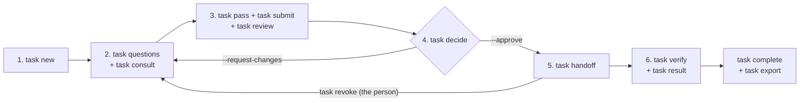

# Task workflow

Every change in an OpenGuildKit project goes through the same six steps, from the request to the closing. The host agent runs the commands; the person answers the questions, makes the decision and confirms what is theirs to confirm.



## 1. Open a task

```bash
openguildkit task new "Show signed-in users the status of their support requests" --id request-status
openguildkit task new --file brief.md          # multi-line brief
```

Without `--id`, the CLI generates `task-` followed by 12 hex characters. IDs use lowercase letters, digits and single hyphens, up to 64 characters. The command fails if `AGENTS.md` is out of date: run `openguildkit sync` first.

A brief is kept in the task record, shown to the boards and exported with the decision. A credential in it, such as an access key or `password=...`, is replaced with a placeholder before the brief is written, and `task new` says so without repeating the value; an email address, a phone number or a bank account number gives a warning. [tools.md](tools.md#credentials) lists the shapes recognized.

## 2. Scope the task

`task questions ID` prints a JSON object: `questions`, the questionnaire; `follow_ups`, the follow-up questions still to ask, each with its `id` and `prompt` (and its `choices` for `concerns`); and `open_points`. Without `--answers` the last two are empty. With `--answers FILE --follow-ups`, it prints only `follow_ups` and `open_points`, without the questionnaire again: about 300 bytes for a small bug instead of 5 KB. The agent asks the person, in their language, and confirms any answer it inferred from the brief.

| Key | Question | Choices |
|---|---|---|
| `kind` | What are you asking the team to do? | `feature`, `bug`, `maintenance`, `decision`, `other`, `unsure` |
| `surface` | Which areas will this task affect? Several can apply. | `customer`, `service`, `infrastructure`, `business`, `other`, `unsure` |
| `data` | What is the most sensitive data this task may access or change? | `none`, `internal`, `personal`, `regulated`, `unsure` |
| `research` | What evidence can the boards consult? | `local`, `public`, `unsure` |
| `concerns` | Does the task involve any of these? Several can apply. | `money`, `ai`, `people-decisions`, `credentials`, `none`, `unsure` |
| `context` | What acceptance criteria, constraints or other context should the boards know? | Free text |

`context` is optional, except when any answer is `other`. `concerns` is required for every new consultation: `money` covers prices, payments, invoices, payroll or spending; `ai` an AI model or LLM that produces answers or content; `people-decisions` software that scores, ranks or decides about individual people, such as hiring, credit or a price per person; `credentials` secrets, keys, tokens or passwords; `none` none of these. `none` and `unsure` stand alone. `unsure` keeps the rules of every topic open, and the boards of every topic (legal, data, security, finance and devops) review the task, so that the rules asked and the boards consulted say the same thing. Without `concerns`, `task questions ID --answers FILE` lists it in `follow_ups` with its choices, and `task consult` and `task route` refuse the answers and name the choices. A task consulted before the question was required keeps its recorded answers: `task route ID` without `--answers` and its passes still work, and its rules read the missing answer as open, like `unsure`. `surface` takes a list, for example `["customer", "service"]` for a change to a screen and the service behind it; a single value is still accepted.

### Follow-up questions and open points

Save the first answers and run `task questions ID --answers answers.json --follow-ups`. The CLI names the questions that these answers call for and lists the points still open:

| Key | Asked when | Question |
|---|---|---|
| `outcome` | feature, bug, maintenance, other, unsure | The observable result, the expected behaviour and how to reproduce a defect, or what must keep working |
| `affected` | feature, decision, other or unsure work, customer or business areas, personal or regulated data | Who is affected: users, customers, teams or partners |

| `options` | decision | The options on the table and what would make you choose one |

In a project with components, `answers.json` can include `"components": ["web"]`, with the IDs from the project profile. It limits the task to those components and to what is project-wide: the packs and patterns brought for other components leave the scope, the stack shown is theirs, and a check command that runs from another component's folder (`cd services/api && python3 -m pytest -q`, as `init` proposes it, or a folder inside that component) leaves the scope, `task verify` and the closing. A command without a leading `cd FOLDER &&` stays asked of every task. The board of each declared role whose subjects the component's stack names joins the consultation with the reason, such as `frontend` for a component on React. A path of the brief inside a component's folder (`apps/web/src/price.ts`) brings that board too and puts that component's packs first in each pass, but only the answer narrows the scope and the checks. Leave `components` out to consult for the whole project.

A question is essential for the cases where the boards cannot review without it: the outcome of a feature or a bug, who is affected by a customer-facing change, the options of a decision. A short brief, an `unsure` answer or an unanswered essential question is an **open point**. Open points do not block the consultation: they appear in it, each board says how they affect its recommendation, and the decision brief repeats them. A well-described local bug gets no question about customers or options.

```json
{
  "kind": "feature",
  "surface": "customer",
  "data": "personal",
  "research": "local",
  "concerns": ["none"],
  "context": "Signed-in users see the status and next step of their own support requests."
}
```

`task consult ID --answers answers.json` validates the answers, selects the boards and prints the consultation request in Markdown. Without `--answers`, the CLI asks the questions in the terminal. `task brief ID` prints the same request again later. To correct the brief, pass `--brief "REVISED BRIEF"` or `--brief-file FILE` to the next consultation: on a draft, during the consultation (the passes start over, as at every new consultation), or after a request for changes. After a request for changes, the task keeps its previous brief and decision in the round history, and the next decision brief and approval prompt show why changes were requested.

The consultation stays short so that an agent can keep it in context: the task and its answers, the project scope once (stack, components, packs named with their number of rules, conventions, checks, host controls), the open points, and one line per board with why it was selected. It does not repeat the rule texts, which are in the agent's instructions (`AGENTS.md`), nor each board's brief, which its pass prints. What it leaves out stays available: `task brief ID --scope` prints the whole scope as JSON with every rule text, `task brief ID --board BOARD` prints a board's pass, and `openguildkit brains --id BOARD` the board's full reading list. For a bug, when the brief names a file or a function (`src/export.js`, `exportCsv()`, `` `toRow` ``) that the project does not contain, the consultation says so in one line, so that the boards check the brief before reviewing code that is not there.

### How boards are selected

Answers route to boards first:

| Answer | Boards |
|---|---|
| `kind: feature` | product, engineering, qa |
| `kind: bug` | engineering, qa |
| `kind: maintenance` | engineering, qa |
| `kind: decision` | product |
| `kind: unsure` | project-management |
| `surface: customer` | product, design, marketing |
| `surface: service` | engineering, performance |
| `surface: infrastructure` | devops, performance |
| `surface: business` | project-management |
| `data: internal`, `personal`, `regulated` or `unsure` | security |
| `data: personal` or `regulated` | legal |
| `concerns: money` | finance |
| `concerns: ai` | data, security, legal |
| `concerns: people-decisions` | legal, data, security |
| `concerns: credentials` | security, devops |
| `concerns: unsure` | legal, data, security, finance, devops: every topic stays open |

Then each board's `triggers` are matched as whole words in the brief and context. Matching ignores case, accents and the kind of apostrophe, accepts a regular plural on each word (`jalon` matches "jalons") and does not look inside hyphenated words ("e-commerce" does not contain `commerce`). When triggers overlap, the longest phrase wins: "performance budget" selects `performance`, not `finance` through `budget`, and "DORA metrics" selects `devops`, not `security` through `dora`. Boards that share the exact same phrase are all selected. A board's own shorter phrase never cancels its longer one, so "DORA lead time for changes" stays with `devops` through `dora lead time` and `lead time for changes`, and `legal` does not read it as the DORA regulation. A few job titles, such as "backend engineer", claim their words for no board: "Hire three backend engineers" selects `hr`, not `engineering`. "Reduce checkout latency" adds `performance`; "RGPD" adds `security`.

A trigger preceded in its clause, within five words, by a negation selects nothing: "no payments", "without personal data", "sans paiement", "aucune donnée personnelle", "pas de changement d'interface utilisateur", "it does not touch the API", "nothing to do with payments". The negating words are `no`, `not`, `without`, `never`, `nor`, `neither`, `none`, `nothing`, `cannot`, any word ending in "n't", `sans`, `pas`, `aucun`, `aucune`, `ni`, `jamais`, `non` and `rien`; "avoid" or "éviter" counts when a change follows ("avoid any changes to the pricing page"). A negation written after the subject counts too: "payments are out of scope", "paiements hors périmètre". The items of a negated list are all excluded: "without touching personal data or secrets". A clause ends at punctuation, a line break or "but"/"mais". These are not read as negations, so the board stays: "not only ... but also", "no more than", "sans doute", a double negation ("not without payments", "pas sans paiement"), and a negated verb of omission ("do not forget payments", "don't skip the payment step", "ne pas oublier les paiements"). An imperative "ignore" at the start of its clause sets its object aside: "Also ignore the competitors", "Ignorez les concurrents". A short clause that opens with "without" or "sans" and goes on after a comma depends on what follows. When the next clause starts with an instruction ("Sans les concurrents, ajouter le calcul des prix", "Without competitors, add the price calculation"), the subject is set aside. When the next clause starts with anything else, a subject or a statement ("Sans paiement, la commande n'est pas validée", "Sans paiement, impossible de valider"), the subject may be what is needed: the board stays and its reason says so. An instruction is a French infinitive or imperative after "sans", or a common English imperative (add, fix, update, change and the like) after "without". When the reading is uncertain, the board is kept. The same rule applies to the subjects below. Each reason quotes the passage that selected the board, as written, from the brief or from one answer at a time: `finance: Brief mentions 'payment': "Adyen for card payments"`.

When the profile declares roles (`roles` at `init`), the stack selects their boards too: `frontend` for a task whose surface is `customer` when the project's stack names React, Vue, Angular, Svelte or Next.js; `backend` for a `service` task when it names Django, Rails, Laravel, Spring Boot or FastAPI; and, for a component the task names or whose path its brief cites, each declared role whose subjects the component's stack names (`devops` for Terraform). The words compared are the board's triggers. When the task names the people it serves, that board is selected too. The `affected` answer names them anywhere ("Support managers who paste the weekly numbers"); the brief and the `context` name them within eight words after "for", "audience", "read by", "pour" or "public", so that every role of a list counts ("a ticket report for our support agents", "Audience: support team and customer-success managers").

Some subjects are recognised from the words of the brief as a whole, the same way as the `concerns` answers: an AI model or algorithm applied to applicants, employees, loans or credit adds legal, data and security; an LLM, chatbot or AI assistant adds data, security and legal; spending or a bill from a cloud or SaaS vendor adds finance. When such a subject calls for a pattern the project has not selected, `task route` names it, for example `eu-ai-act-system` for software that ranks job applicants.

Only boards enabled in the profile are selected. If nothing matches, the route says that no discipline was recognised and asks the requester to add the boards that apply with `--add`; `product` reviews the scope meanwhile, or the first enabled board by ID when `product` is disabled.

### Preview and adjust the boards

`task route ID --answers answers.json` shows the boards a consultation would select and why, without recording anything. Under each board it lists the project's tools that board can query, connected or only listed in the profile. When the brief names one of the project's tools, a line says which boards can query it. Then come the boards the brief mentions as excluded, with the passage ("Mentioned as excluded: finance (no payments)"); the consultation repeats that line. The boards the team expects (its declared roles, or the boards its profile lists) that were not selected each get a line with the reason and examples of the words that would select them. The other enabled boards are counted on one line (`openguildkit brains` lists them). Last come two commands: `task route` with `--add`, `--remove` and `--reason` to preview a change, and the complete `task consult` command that applies the options and answers file given to this `task route`. A word that needs quoting goes between single quotes, in which neither a POSIX shell nor PowerShell (the form printed on Windows) expands `$` or a backtick, so the pasted command records the reason as typed; the commands `tools plan` and the web interface print are quoted by the same function. `--json` gives the same under `excluded`, `not_selected` and `expected_not_selected`. The requester can then change the list for this task:

```bash
openguildkit task consult ID --answers answers.json --add finance --remove marketing --reason "Exports are billed per page"
```

Each addition or removal needs a reason; the consultation records it under `adjustments`. Only boards enabled in the profile can be added. Only the requester decides to remove a board, and the decision brief and the approval prompt list every change with its reason. A board selected by a `personal`, `regulated` or `unsure` data answer (security, and legal for regulated data) can be removed only with the approver's confirmation: the removal stays pending until the person approving types the board's name at the prompt, and approval is refused without it.

A project can make some reviews mandatory with `openguildkit profile add required-board security --by NAME --reason WHY`, which writes `"required_boards": ["security"]` in its profile. These boards join every consultation and cannot be removed; `AGENTS.md` lists them under "Required reviews". When a required board is not enabled for the project, the consultation stops and names it. The requester can then name the person who will review instead, with `--delegate security=AM`: the brief tells the agent to prepare the review for that person, and the review entry carries that identifier in `reviewer`.

Each selected board gets a brief with its purpose, the routing reasons, its expertises, its questions and its source leads. The request also carries a snapshot of the project scope: sector context, stack, resolved rule packs, conventions, checks and the research policy for this task.

## 3. Review through each board

`task template ID` prints the review skeleton with the `consultation_id` and one entry per selected board. Keep that ID to tie the review to the current scope. Each [brain](brains.md) has a set of specialist lenses. The agent records their separate findings, challenges the proposed change, then reconciles the boards and preserves disagreements in the summary. The [request status example](../examples/request-status/review.json) shows a complete review.

### One pass per board

The host agent can run each board as a separate pass, with a subagent or one after the other:

```bash
openguildkit task pass ID security --mode subagent    # prints the task, the security brief, its rules and the entry to return
openguildkit task brief ID --board security          # prints the same pass again, without starting it
openguildkit task submit ID --file security.json     # records that board's entry
openguildkit task progress ID                         # done, failed, started or missing, per board
openguildkit task review ID --summary "Where the boards agree and disagree, and the next step"
```

`task pass` gives each board, in this order: the task and its answers, with the components it touches and their paths; its own brief (questions, the lenses to fill with their focus, the evidence to inspect, the challenge and decision criteria); how to fill the entry and the entry to return; a reading list of five sources; then the rules of its own packs that concern the task. Which packs concern the task is decided as for the results (`relevance.py`): from how each pack reached the project and from the task's answers, not from shared words. The pass, the handoff and `task checks` decide rule by rule with the same function (`relevance.judge_rules`): a pass prints only the rules the closing will ask, and a pack in force that a board's packs depend on, such as `incident-notification` for `gdpr`, is printed with them. They are printed most specific first (the stack of the components the task names in its answers or in a path of its brief, the other stacks, regulations, the board's methods, then the baseline), as long as the pass stays under 10 KB; the packs that do not fit are named, and `task brief ID --pack PACK` prints one pack's rules with how each is verified. The board's packs and rules that do not concern the task are named in the pass with their reason, grouped, so that the pass needs no other command to say why. A decision task delivers no implementation: its passes ask no rule, and `task brief ID --pack PACK` still prints a pack's rules when a board weighs an option against them. Nothing from the other boards is printed, and the shared project scope is named by one line with the command that prints it. What each lens verifies, the whole reading list and the board's methods: `openguildkit brains --id BOARD`. A test keeps every pass under 10 KB and the consultation under 30 KB, on the bundled example and on a monorepo with every role. Running `task pass` again for a pass already started prints it again without counting an attempt. On a pass whose entry is already submitted, `task pass` only prints it, says so and keeps the entry; `task pass ID BOARD --again` redoes it on purpose and counts an attempt, as does starting a failed pass again. `task submit` refuses an entry whose pass was not started on the current consultation. It validates the entry against the template and reports every problem at once, each with its key path (such as `marketing.challenge.verdict`), the value received and the accepted values; an invalid entry is recorded as a failed pass with the reasons, and sending the corrected file again with `task submit` records it. A recorded entry prints `done`, then, on standard error, how many passes are left and the command that comes next (`task review --summary` once none is left). A pass that was started and never submitted shows as `started`: treat it as interrupted; `task list` names it apart from the passes still to run. Run `task pass` again for that board only; the other boards keep their entries. When one agent runs the passes one after the other (`--mode sequential`, the default), the first pass of the consultation prints how to fill an entry and the shapes of an evidence item and a blocker, and each later pass names that first pass instead of printing them again, about 1.5 KB less each; it prints the same rules. `task brief ID --board BOARD` always prints a pass whole, and each pass run with `--mode subagent` is whole, since a subagent reads only its own. Once every board is done, `task review --summary` assembles the review and records whether the passes ran as subagents, in sequence or both (`execution`). A new consultation starts the passes again. Passes can run at the same time: each `task pass` and `task submit` waits its turn for the project lock, up to 10 seconds by default. Set `OPENGUILDKIT_LOCK_TIMEOUT` to another number of seconds (0 to 3600) when a slow disk or many boards need longer. Writing the whole review in one file with `task review --file` still works.

Rules enforced by `task review ID --file review.json`:

- `consultation_id` must match the current consultation.
- `summary` and every `recommendation` must contain text.
- There must be exactly one entry per selected board, and no other board.
- `open_questions` is a list of non-empty strings and `evidence` a list of evidence items in the shape of the template's `evidence_item` (both can be empty lists). A `project-file` or `test` item must name a file or folder of the project, and a `date` must be a real day, not in the future.
- The refusal names the file and lists the problems of every board at once.
- For a brain, each specialist needs exactly one finding with an evidence basis (`observed`, `assumption` or `missing`). An observed finding cites `evidence_refs`: positions in that entry's own `evidence` list, counted from 1, so `[1, 3]` cites its first and third items. A board records its verdict (`proceed`, `revise`, `block` or `insufficient-evidence`), confidence (`low`, `medium` or `high`), alternative, failure mode, verification and blockers. The template shows the accepted values of each choice in place of the value to write.
- A lens of the catalog can name the surfaces it applies to (`"applies_to": ["customer"]`). When none of them is among the task's surfaces, the board's pass lists the lens as not concerned and the entry does not ask for it. A task whose surface is `unsure` or `other` keeps every lens. A lens can also name the concerns it needs (`"applies_to_concerns": ["money"]`, among `money`, `ai`, `people-decisions` and `credentials`): the pay lens of HR is not asked of an onboarding checklist whose concerns are `none`. A missing, `unsure` or `other` answer keeps the lens.

A well-formed review is recorded, but the CLI adds `warnings` to it when the boards do not look independent: two boards with the same recommendation word for word, the same finding in several lenses, or a board whose every finding is an assumption or missing. The decision brief and the approval prompt list them.

Run `openguildkit task challenge ID` to show how the verdicts differ, what each board recommends and which checks can change the decision. It starts with plain lines: the count of verdicts and a warning when boards say revise, block or insufficient-evidence, the review warnings, the boards added or removed with their reason, the open points of the scoping, the objections never deliberated or, after `task respond`, each objection once as resolved or left open with the rule that resolves one, the verdicts that differ without any objection between them and why, the boards whose advice is addressed to no other board, and each blocker with how it was resolved and the evidence given. The agent shows this brief to the person before implementation.

## 4. Decide

The person runs the command in their own terminal:

```bash
openguildkit task decide request-status --approve --by CM --reason "Read-only scope agreed with support"
```

`--by` takes the person's initials or team handle, here `CM`, rather than their full name: the record and the seal keep it, and it cannot be replaced afterwards without breaking the approval ([personal data](personal-data.md)).

The CLI prints the same lines as the decision brief (starting with the verdict count), then the task brief, the review summary with each board's verdict, recommendation, verification, blockers and open questions, the command that prints the full decision brief (`task challenge ID`), the verdict count again, and asks the person to type the task ID, then the name of each sensitive board the agent removed. One function writes the lines of the decision brief, so the prompt, `task challenge` and `task decision-payload` show the same ones:

- the verdicts, and the review warnings: two boards or more that give the same recommendation or finding once each board's name is taken out (advice written once and pasted from board to board), a board whose every finding cites one and the same evidence item, a board with no observed finding;
- the conditions of approval, blockers and their resolutions, board removals, open points and objections;
- each check command `task verify` will run as a shell command after the approval, then each command added or removed since the last approval of the project, with who changed it, when and why from the profile's history (or a note that the profile was edited by hand);
- each confirmed critical dependency alert of the task that an import resolved since its last decision, with the report that resolved it ([dependency alerts](alerts.md#a-report-that-analyzed-nothing)).

`task review` and `task submit` print the same warnings on copied advice as they record it. The approval records the base Git revision and a seal over what was approved; a project that requires signed approvals verifies the approver's SSH signature instead of the typed ID ([details](architecture.md#design-decisions)). Approval fails when stdin is not a terminal, when the typed ID does not match, when the task changed during the decision, when the profile or catalog changed since the consultation, or when `AGENTS.md` is out of date.

A blocker names the finding, its `owner` and `clears_when`, the condition that would clear it. Use a condition you can verify before implementation. If the evidence requires code or a test result from the implementation, set `"phase": "verification"` in the blocker. Approval can proceed while verification blockers are open. The handoff lists them, `task verify` reports them, and `task complete` waits for their resolution.

Use these commands to list and resolve blockers.

```bash
openguildkit task blockers ID
openguildkit task clear ID security:1 --evidence tests/test_access.py --supports "Cross-account access is refused" --by AM
openguildkit task waive ID security:2 --by CM --reason "Internal pilot only" --scope "Internal users" --until 2026-12-15
```

Clearing is the person's act: the agent proposes the evidence, and the person runs `task clear` in their own terminal and types the task ID to confirm (in a project with signed approvals, their signature replaces the typed ID). Without a terminal the command checks the evidence and is refused. Clearing records who cleared, the evidence and what it establishes. Use an existing project file or folder, or an HTTPS link. A second attempt to resolve the same blocker is refused and the first resolution stays in place. The decision brief and the approval prompt show each blocker of phase `verification` as a condition of the approval, and the handoff lists the open ones first. A waiver requires a project waiver policy (`openguildkit profile set waivers allowed --allowed-by NAME --max-days DAYS`, typed by a person), the named person at a terminal, a reason, a scope and an end date within the limit. The handoff lists each waiver with its scope and end date. A waiver holds through its end date, by the real clock (`SOURCE_DATE_EPOCH` does not change it); the next day its blocker is open again: `task blockers` shows `[waiver expired on DATE]`, a reviewed task cannot be approved until the blocker is cleared or waived again, and for an approved task `task list` names what the person can do. A condition of approval is cleared with its evidence, waived anew (the new waiver keeps the expired one under `replaces`) or the approval withdrawn; a blocker the approval rested on is under the approval's seal, so the person withdraws the approval and the task is consulted again. `task complete` refuses a task with an expired waiver, and `guard --ci` refuses the record of a task not completed whose waiver expired; a completed task's record is history. Without a waiver policy, `task waive` names the steps the task can still take: clear the blocker with its evidence, or, before the decision, request changes; for a condition of an approved task, withdraw the approval (`task revoke`, below) when it cannot be met. `task list` says so for an approved task whose condition is still open.

In a project with signed approvals, `task clear` follows the rule of `task decide`: `--by` names the person, and the signature must verify for `--signer`, an approver of the project; the record keeps both. Run the command with `--payload clearance.json`, sign that file with `ssh-keygen -Y sign -n openguildkit-decision -f KEY clearance.json`, then rerun the same command with `--signature clearance.json.sig --signer PRINCIPAL` in place of `--payload`. The signature covers the blocker, its consultation, the person named by `--by`, the evidence and what it establishes.

After upgrading the board catalog, `openguildkit update` names the tasks the change touches before `--apply`, and `update --apply` and the `sync` after it name the same ones, each with what to do: consult a consulting task again, request changes on a reviewed task and consult it again, consult an approved one again with `task consult ID --reuse-answers`, which keeps the passes of unchanged boards when the approval's seal holds and none for an approval without a valid seal (or open a linked task with `--follows`). A completed task keeps its record as history and is not listed.

To send the task back:

```bash
openguildkit task decide request-status --request-changes --by CM --reason "Include the empty state in scope"
```

This works without a terminal. The next `task consult` (`task consult ID --reuse-answers` keeps the recorded answers) archives the previous brief, answers, consultation, review and decision in `rounds`, so the history of the task is kept. When the change request changes the scope, revise the brief at that consultation, so the approval shows what is approved:

```bash
openguildkit task consult request-status --answers answers.json --brief "Show the status and the empty state of each request"
```

The revised brief is checked like the brief of `task new`. The approval prompt and `task challenge` of the new round open on one line that recalls the previous round's decision, who made it, when and why, and whether the brief was revised since.

### When an approval no longer holds

One function judges an approval, and every reader prints its answer: `task list`, `check`, `task consult`, `handoff`, `verify`, `result`, `complete`, `export` and the guard. An approval holds while its seal matches the record, its signature verifies (in a project with signed approvals), the rules, checks and boards of the profile are those it was given under, and the Git revision it was approved at is still in the project history.

Only a change of the rules, the checks or the boards voids an approval: packs and their rules, the sector, the stack, components and patterns, the check commands, the boards, roles and required reviews, the personal-data and people-decision answers, and `ask_every_rule`. A new convention or tool, the guard mode, the host, the research setting, the approval mode or the waiver policy leave approvals standing (the approval mode and the allowed signers are read again by every reader, through the signature). An approval recorded by a release older than sealed decisions (0.16.1 and earlier) has no seal, so it no longer holds: until the task is consulted again, `check` exits 1 on it and `handoff`, `verify`, `export` and `complete` refuse it. Consulting it again keeps no pass, and a completed task keeps its record as history.

After a rebase, a squash or an amended commit, the approved revision leaves the history: every reader says so and names the same command, `task consult ID --reuse-answers`, which consults the task again with the answers it holds and needs no terminal (`--answers FILE` with it replaces the answers the file gives; a task consulted before the `concerns` question existed is asked it at a terminal, and without one is consulted as `unsure`, which keeps every topic's rules open, with a line that says so). The task is consulted again under the same ID: `task consult` keeps the earlier approval in `rounds` with the reason, and keeps as done the passes of the boards whose brief, rules and entry template did not change, so only the others review again (`task pass ID BOARD --again` redoes a kept one). The decision brief lists the kept passes, and the person approves again. The same applies when the rules changed: the boards whose rules changed review again. A broken or missing seal keeps no pass.

### Withdrawing an approval

The person withdraws an approval in their own terminal, as they gave it, and types the task ID to confirm:

```bash
openguildkit task revoke request-status --by CM --reason "The test account the condition needs cannot be created"
```

The task goes back to `changes-requested`: the approval goes to `rounds` with who withdrew it, when and why, and the guard no longer counts the task in `covered_by`. An exported record of that approval still says approved, and `guard --ci` would keep accepting it: `task revoke` names the file, and `check` (exit 1) and `task list --decisions` report it until `task export ID` writes the withdrawal into it (`withdrawn`, with who, why and when; the approval stays as it was and `record_sha256` is computed again). Commit the record: `guard --ci` refuses it, and once it is on the base revision, refuses a copy of the same approval made before the withdrawal. `task list --decisions` shows it as withdrawn, a note that does not fail `check`. `task export` of a withdrawn task without a record writes nothing and says so. Then consult the task again, or close the work in a linked task with `--follows`. Without a terminal the command is refused, and `host apply` adds it to the agent's deny rules, like `task decide`; the web interface never runs it. A completed task keeps its approval as history. The guard puts no time limit on an approval: withdrawing it is how an abandoned task stops covering edits, and `task list` names the command for an approval older than 14 days with no result recorded.

### Signed approvals

A local approval is sealed with a SHA-256 of data that all sits in the task file. The seal detects an accidental edit; it does not prove who approved, because anyone who can write the file can recompute it. With `"guard": "enforce"`, `init`, `host check` and `check` say so in one line until a person requires signed approvals at their terminal, with `openguildkit profile set approval signed --signers .openguildkit/allowed_signers --approver CM --by NAME --reason WHY`. The profile then holds:

```json
"approval": {"mode": "signed", "allowed_signers": ".openguildkit/allowed_signers", "approvers": ["CM"]}
```

The allowed signers file uses the `ssh-keygen` format, one line per approver: `CM ssh-ed25519 AAAA...`. The principal, here `CM`, is any word: initials keep an email address out of a file the team commits, and a record stays verifiable only while its principal remains listed ([when an approver leaves](personal-data.md#when-an-approver-leaves)). Commit it: a signature is verified against the file as Git holds it at `HEAD`, never against a working copy ([what protects it](architecture.md#design-decisions)). The approver then decides in three steps:

```bash
openguildkit task decision-payload request-status --by CM --reason "Read-only scope agreed" --output decision.json
ssh-keygen -Y sign -f ~/.ssh/id_ed25519 -n openguildkit-decision decision.json
openguildkit task decide request-status --approve --by CM --reason "Read-only scope agreed" --signature decision.json.sig --signer CM
```

`task decision-payload` prints on stderr the lines of the approval prompt (verdicts, warnings, conditions of approval, removals, check commands), and the file to sign carries the brief and the review summary in clear next to the digests, so the approver reads what they sign. `task decide` with a signature prints the same lines. Approvals signed over the payload of earlier releases, without the brief and summary, still verify.

A key protected by a passphrase or a hardware token keeps the agent from signing. The handoff, `task export`, the guard and the CI check refuse an approval without a valid signature; CI verifies it against the allowed signers of the pull request's base revision.

What signed mode is worth depends on where the check runs:

- **In CI** (`guard --ci`), the approvers and the signers file come from the base revision, which the pull request cannot change: a key the change adds signs nothing there, and a record the base revision does not carry is verified against today's approvers only. This is the check that holds against an agent that can write files and commit.
- **In a local copy** (`task list`, `check`, the edit hook, `handoff`), a signature is verified against the signers file committed at `HEAD`. An agent that commits its own key to that file and to `approvers` can sign an approval that holds locally while the key is there; the pull request then shows the change to the signers file, and CI refuses the approval. When the key is gone from `HEAD` again, the approval holds only through the revision it was signed at, and that revision counts only when the merged branch contains it: `origin/HEAD` (the remote's default branch, which `git clone` sets; `git remote set-head origin --auto` sets it otherwise), or else the branch's upstream. A key committed and reverted on a local branch therefore approves nothing, and `task list` names the signer and the revision of every approval that holds this way. Local Git references can still be rewritten by whoever has a shell in the repository: locally, signed mode stops an edited file and a key that was never reviewed, and CI on the base revision is what decides.

## 5. Hand off

```bash
openguildkit task handoff request-status
```

The handoff exists only for approved tasks whose approval still holds: its seal matches the record and its rules are the current ones. Otherwise it fails with the same message as `task list`, `task show`, `check`, `task export` and `guard --ci`, which names what changed (`pack gdpr added`, `rule secure-sdlc/threat-model changed`) and the next command: `task consult ID` reopens the task under the current rules, keeping the earlier approval in `rounds` with the reason, or `task new "BRIEF" --follows ID` opens a linked task. It contains the approval (who and why), the approved scope snapshot, the rules to apply and the board review. The rules to apply are the ones `task checks` asks, pack by pack, then one line names the packs and rules that do not concern the task, with how many of each; `task checks ID` gives each reason. The handoff of a decision task has no rules to apply. The agent implements that scope, runs the project checks and brings any scope change back to the person.

On a completed task, `task handoff` shows the same handoff for reference, headed with the task's status and saying that nothing is left to implement. On a task already decided, `task decide` says so, with the status, who decided and when, and the one command that fits next: `task handoff` for an approved task, `task new "BRIEF" --follows ID` for a completed one, `task consult ID` after a change request. Once the review is recorded, `task progress` shows each board as `done (in review)`.

A task answered with `kind: decision` asks for a recommendation. Its handoff contains the approved decision, scope and review. `task result --template` lists its acceptance criterion when the answers name an outcome. The approval already records the process evidence, so the decision has no implementation checks to fill in. After recording the criterion, run `task complete`. When the answers give no outcome, you can complete the task directly.

If tracked project files differ from the approved Git revision, the CLI asks for the delivery revision or pull request. It ignores the exported decision records. `task complete` gives the `task new --follows` command so that applying the decision gets its own review and approval.

## 6. Report the results

After implementing an approved task, the agent proves what was delivered:

```bash
openguildkit task checks ID            # the checks that concern the task, then what is not asked and why
openguildkit task verify ID            # runs the check commands and the rules' machine checks, with their evidence
openguildkit task result ID --template > result.json   # JSON only: the criteria, rules and named evidence to report
openguildkit task result ID --file result.json
openguildkit task complete ID
```

### Only the rules that concern the task

A project can carry dozens of packs. A task answers only the rules that concern it; the others are listed as not concerned, with the reason, in `task checks`, in the template's `not_concerned` and in the closed task's record, and need no answer.

Each bundled pack has a subject, the task answers that call for it, and for a few packs the boards the task consults or the words of its brief. A pack concerns the task when its subject meets the task's `kind`, `surface`, `data` and `concerns`, and the way it reached the project still holds. Having a board of its role, or personal data, does not bring a pack by itself. For each regulatory pack, `relevance.LEGAL_BASIS` gives the subject retained and its legal reason.

| Subject | Called for by | Packs |
|---|---|---|
| Every change | always | `agent-workflow`, `secure-sdlc` |
| The project's code | surface `service`, `customer` or `infrastructure` | language and framework packs (`python`, `typescript`, `fastapi`, `django`, `postgresql`...) |
| The user interface | surface `customer` | `react`, `vue`, `nextjs`, accessibility, web performance, mobile, i18n, `playwright`... |
| A new customer feature | kind `feature` and surface `customer` | design, user research, experiments, product discovery, SEO, support readiness, release communication |
| A backend service | surface `service` | `backend-data-safety`, `public-api-docs`, and `service-reliability` (also `infrastructure`) |
| Infrastructure and delivery | surface `infrastructure` | containers, Kubernetes, Terraform, AWS IAM, CI security, incident response, release management, supply chain |
| Cloud and vendor spending | surface `infrastructure`, or surface `business` with concern `money` when `finance` or `devops` reviews the task | `finops-cost-management` |
| Personal data | data `personal` or `regulated` | `gdpr`, `minors-data-protection`, `health-data-protection` |
| Security-sensitive changes | data `regulated`, concern `credentials`, surface `infrastructure`, or data `personal` on surface `customer` or `service` | `threat-modeling`, `owasp-asvs`, `iso-27001` |
| The ICT systems of a regulated entity | data `regulated`, surface `infrastructure`, or a `feature` or `maintenance` with data `personal` on surface `customer` or `service` | `dora`, `nis2` |
| Security incidents and vulnerabilities | surface `infrastructure` or concern `credentials` | `cyber-resilience-act`, `incident-notification` (each of its rows also follows its regulation, below) |
| AI | concern `ai` or `people-decisions` | `llm-evaluations`, `nist-ai-risk`, `eu-ai-act` |
| Money | concern `money` | revenue, SaaS metrics, VAT, financial planning, deal approval |
| Payment card data | data `regulated`, or concern `money` when the brief names cards or payments (card, payment, checkout, Stripe...) | `pci-dss` |
| Pay and recruitment | concern `people-decisions`; or the `hr` board with concern `money` (pay) or a brief that names hiring (interview, candidate, job posting...) | `pay-transparency`; `structured-hiring` without the pay case |
| A business process | surface `business` | sales, partners, campaigns, HR processes, procurement, governance and delivery methods |
| Selling to consumers or insurance | surface `customer` with concern `money` | `online-consumer-sales`, `insurance-distribution` |
| Content users publish | the `trust-and-safety` board reviews the task (the brief speaks of reports, moderation or illegal content) | `notice-and-action` |

An answer left open (`unsure`, `other`, or not given) calls for the packs of that subject. On top of the subject, a pack brought by a method pattern needs a board of the role that brought it (the pattern's roles the profile lists) among the task's boards, and a pack brought for some components needs a file changed since the approved revision in them; files changed in a component other than the whole project bring its packs even when the answers do not. A component at the project root (path `.`) holds every file, so there the subject decides. A pack of the project's own catalog has no subject: a regulation pack concerns tasks on personal or regulated data, a pack needed by another (`depends_on`) follows the packs that need it, and the others concern every task. A pack or rule listed in `required_rules` is always asked.

A brief names a subject the way it routes a board: whole words, a regular plural, and a negated mention ("no card payments") names nothing. `incident-notification` holds one row per regulation: each row is asked when the pack of its regulation (`gdpr`, `nis2`, `dora`, `cyber-resilience-act`, `eu-ai-act`) concerns the task, and the pack, with its matrix rule, concerns the task when one of its rows does or when its own subject does.

Inside a data protection pack that concerns the task, the rules about creating or changing a processing are left out of a task of kind `bug` or `maintenance`, which fixes or maintains a processing the project already runs: in `gdpr`, the record of processing and the DPIA decision (with their named evidence), the lawful basis of a new purpose, the retention of new data, and rights over new data; the age of consent, parental consent, the DPIA for pupils and the default protections of a new flow in `minors-data-protection`; the Art. 9 condition, the DPIA and the medical device qualification and planning in `health-data-protection`. The rules on minimising what the change touches, protecting health data, advertising to minors, notices for children and documenting a changed component stay asked. The `gdpr` rules on a new processor (Art. 28) and a transfer outside the EEA (Chapter V) are left out of a `bug` only: a migration to a hosted service often adds one, a fix almost never. A feature, or any other kind, keeps every rule; `required_rules`, `--all` and `ask_every_rule` keep them too. Each rule left out says why.

A named evidence with a condition on the task's `data` is asked only when the data meets it. To see or answer every rule, run `task checks ID --all` or `task result ID --template --all`; to ask every rule on every task, run `openguildkit profile set ask-every-rule yes --by NAME --reason WHY`.

### The result file

`task verify` runs the commands listed in the profile's `checks`, in the project root, and records each exit code with its log under `.openguildkit/tasks/`. It also evaluates the machine checks of the rules that concern the task (a file that exists, a text present or absent, a field of a JSON or TOML file, a file within a size in bytes, or a command from the project's own catalog; see [catalog format](catalog-format.md#machine-checks-and-named-evidence)) and records what it found, such as `export.json: downloadLinkMinutes = 90 (above 60).`; `task result` cannot report these checks. The template writes nothing but JSON on standard output; it lists the checks `task verify` records under `recorded_by_verify`. `result.json` names the delivered `revision` or `pull_request`: the template fills in the revision `task verify` read from Git (or `working tree` outside a repository), and a report that leaves it out keeps the one already recorded; the acceptance `criteria` (`met` or `not-met`, with evidence) and an outcome for each rule: `passed` or `failed` with evidence, or `skipped` or `not-applicable` with a reason and an owner. An entry left with an empty status is not answered yet. Later reports update earlier outcomes check by check. Only `task verify` records the command checks (`command:N`) and only `task verify --chaosfolk` the replays (`chaosfolk:*`): `task result` refuses them, and refuses a `passed` check with a non-zero `exit_code`. When the task's answers name an `outcome`, the result needs at least one criterion. Each refusal names the file, the accepted values and `task result ID --template`. `task verify`, `task result` and `task complete` refuse a task whose approval no longer holds, as the handoff does. Before any `task result`, `task verify` counts the rules and named evidence still to report in one line instead of listing them, since the template lists them; once a report answered one, it lists those left one by one.

The owner of a `skipped` or `not-applicable` answer is the person who decides it, and the reason is theirs: the agent proposes, the person confirms, and the agent never writes a name it was not given. One answer can cover every rule of a pack: the template lists under `packs` each pack whose rules can be answered together (none is required, records a value, is selected by the task's data or concerns, or protects data, security or AI), with its rules, so the file stays short. A pack entry takes the statuses of a rule: `passed` or `failed` with evidence, `skipped` or `not-applicable` with a reason and an owner, for example `{"pack": "react", "status": "not-applicable", "reason": "No interface changes.", "owner": "CM"}`. It stands for each of its rules not reported one by one; to answer one of them apart, add it to `checks`. It never covers a rule of `required_rules`, a machine check or evidence that must be supplied. Any other pack can be answered the same way. When the task's data or concerns select a pack declared not applicable as a whole (personal data and GDPR, for example), the result records a warning, and so it does when rules they select are declared not applicable with the same reason as other answers. It warns too when one evidence item is cited for the passed rules of three packs or more: a warning on the result is an open point, so the task then closes with reservations. A data protection, security or AI pack declared not applicable as a whole is an open point that only a person closes over (`task complete --by`). Each report that gives `packs` replaces the earlier pack answers, and a pack whose rules a later report answers one by one loses its answer: the warnings describe the result as it stands. A criterion can name `verified_by`: a check command such as `command:1` or a test file of the project. The output counts the met criteria tied to a check or a test, those tied to a check command that has not passed (the exported record says so too), and those only declared, and warns when a met criterion's evidence says it was not run.

### Named evidence belongs to its owner

A rule can name evidence kept outside the code, such as the record of processing activities or the DPIA decision of the GDPR pack. These documents belong to the data controller (in practice the data protection officer or the person accountable for the processing), not to the task: keep them where the organisation keeps its compliance records (an intranet page, or a folder such as `docs/privacy/` that the owner maintains), and cite the same record from every task it covers. The handoff lists first the evidence the closing will ask for and who provides each. The template marks each one with the statuses it accepts: `"requirement": "passed"` (it cannot be declared not applicable: the profile's `required_rules` lists it, or it applies to the task's `data`) or `"passed-or-not-applicable"`; `task checks` prints the same word. A supplied evidence is `passed` with a project path that exists or an `https://` link, and `owner`: the person who provided or confirmed it. OpenGuildKit checks that the path exists; it never reads the document, and says so in `task complete` and in the exported record, with the name of the person who confirmed it. It warns when one file is cited for several different evidences, and when a file looks like configuration, code or an image (a `Dockerfile`, a `.py` or `.png` file).

A result that lacks only named evidence is recorded: an evidence that is missing, declared not applicable where it must be supplied, or cited at a path that does not exist is held back with the reason (`Not recorded: ...`), and the task waits. `task result` and `task list` name the evidence and who provides it, and `task show` and the exported record carry `waiting_for` next to the status. When an answer is not recorded, the output says whether an earlier answer for the same check stays recorded, and does not call the task ready. The person can hand the missing evidence to a follow-up task that the owner will close: open it with `task new "BRIEF" --follows ID`, then run `task complete ID --defer EVIDENCE=FOLLOW-UP --by NAME` at a terminal. The task closes with that reservation visible.

### Closing the task

Every project command is mandatory. A profile can make rules mandatory too with `openguildkit profile add required-rule secure-sdlc python/run-tests --by NAME --reason WHY`, which writes `"required_rules": ["secure-sdlc", "python/run-tests"]`. `task complete` refuses while a mandatory check has not passed, an asked check is not reported, a criterion is not met or a required evidence is awaited, and lists what is missing. Otherwise it closes the task:

- `done` when nothing is left open: a single line on standard output;
- `done-with-reservations` when points stay open, listed one per line, grouped by nature and the most serious first: data protection, security or AI rules skipped or failed (or such a pack declared not applicable as a whole); board blocks not lifted (a `block` whose blockers were waived rather than cleared); project checks that could not run in this environment; blockers waived rather than cleared; disagreements between boards left open, each with its point, its two boards and the decision the person must take; named evidence handed to a follow-up task; other rules skipped or failed; warnings on the result; and, for the record, the board verdicts that asked for changes at approval. It gives the command for a linked follow-up: `openguildkit task new "BRIEF" --follows ID`.

Closing over a data protection, security or AI rule that concerns the task and is skipped or failed, or over such a pack declared not applicable as a whole, needs the person: `task complete ID --by NAME`, at a terminal, typing the task ID. The open points are shown once, before the person types the ID. When only such a point is left, `task verify` and `task result` say the task is ready to close with the person at a terminal rather than plain `Ready`. The handoff of a closed task speaks of its checks in the past. `task export --output /dev/stdout` prints the record: an output reached through a link to a device is written to, while a link to a regular file is refused. `check` warns about evidence a reviewer cannot open (ignored by git, or under `.openguildkit/tasks/`) wherever the result cites it: named evidence, rule and pack answers, criteria and their `verified_by`, and blocker clearings; the logs `task verify` keeps for the check commands are left out. When the profile lists no check command, `task complete` says that no project command ran. Notes on what was not run or not read go to standard error. `task list`, `task show`, `task export`, `docs export`, `deliverable` and the guard read both closed statuses. `task export` adds the evidence supplied and who confirmed it, the evidence declared not applicable, the pack answers, the warnings, the deferred evidence, the criteria with what verified them and the open points.

### Project checks

`init` proposes the test command each component of the repository shows: `npm test` for a `test` script in `package.json` (not the `npm init` placeholder), and `npm run lint` too when it has a `lint` script, `python -m pytest` when the Python manifests name pytest, `python -m unittest discover -s tests` for a `tests/test_*.py` folder without pytest, `python -m unittest discover` for `test_*.py` files in the component's own folder, `go test ./...`, `cargo test`, `mvn test` (or `./mvnw test`), `gradle test` (or `./gradlew test`) and `dotnet test`. A command of a component outside the root runs from its folder, as in `cd apps/web && npm test`. `init --questions` lists them under `proposed` in the `checks` question; nothing is kept until the person says yes to each one, and `init` names the commands found but not kept.

Every project check is mandatory: the task cannot be done while one fails. When a command fails, `task verify` prints its cause (exit code, command not found, a missing dependency or network, a time-out), its last three lines of output, the next step and the path of its log under `.openguildkit/tasks/ID-checks/`; `task complete` repeats it. Install the project's dependencies before `task verify` (`npm ci`, `pip install -e .`, ...). The handoff lists the commands `task verify` will run and recalls this. After running them, `task verify` lists every point that still keeps the task from being done, one per line, then their count; when the profile lists no check command it says so and how to add one. A rule's machine check prints what it found or did not find, such as `Found SECURITY.md.` or `Not found: none of SECURITY.md exists.`

When a command cannot run in this environment for this task (no network, a missing service), the person records it at a terminal, with their initials and the reason:

```bash
openguildkit task verify ID --cannot-run command:1 --by CM --reason "The sandbox has no network for npm ci."
```

The command runs first: one that passes here cannot be declared. The reason takes at least three words, and a declaration is not combined with `--chaosfolk`. `task verify` prints the command as `skipped`, with who declared it and why. The command then no longer blocks completion, and the task closes as `done-with-reservations` with that point listed. A later `task verify` runs the command again and keeps the declaration while it still fails, saying so; the declaration ends when the command passes, or when the person who made it withdraws it with `task verify ID --withdraw command:1 --by NAME` at a terminal, which runs the command and records its outcome.

`task verify` exits with status 1 when a mandatory check command failed, so a script or a CI job can tell; it exits with 0 when only answers remain to give (the listed points say which). When a command fails, the message starts with the first line of its output that names the error ("Cannot find module 'express'") and ends with its last lines, then the log path.

A check that cannot run on the team's workstations, because it needs the network, a service or credentials, does not belong in `checks`: leave it out at setup, or ask the person to run `openguildkit profile remove check 'COMMAND' --by NAME --reason WHY` at their terminal (a check removed weakens a protection), then run it in CI and name it under `conventions` (for example "The integration tests run in CI: tests/integration needs the payment sandbox") so the agent and the reviewers know where its result comes from.

## Dependency alerts

The CLI does not scan dependencies. It reads the JSON report of a scanner the project already uses into the project's alert register, `.openguildkit/alerts.json`, and links the report's alerts to the task:

```bash
npm audit --json > npm-audit.json          # or: pip-audit -f json, osv-scanner --format json, gh api --paginate (see docs/alerts.md)
openguildkit task alerts ID --import npm-audit.json
openguildkit alerts set npm:semver:ghsa-c2qf-rxjj-qqgw --status dismissed --by AM --reason "Only used at build time"
openguildkit task alerts ID
```

The register keeps one entry per package and advisory across scanners, with a status: `open`, `confirmed`, `dismissed` with a reason, or `resolved` once the scanner's next report no longer lists it. `task consult` carries the task's open and confirmed alerts to the boards. A confirmed critical alert blocks the task's approval and completion until it is resolved or a person records why it is accepted. A fix is a change like any other: open a task for it, for example with `--follows`. [Dependency alerts](alerts.md) describes the register, the `dependency-watch` agent and the scheduled watch.

## Following the project's work

```bash
openguildkit task list                              # every task, its status, decision owner and next open point
openguildkit task list --status approved --owner CM --since 2026-11-01
openguildkit task new "Add request history" --follows request-status
openguildkit task export request-status --output shared/request-status.json
```

`task list` names who took each task's current decision and, when a person closed it with `--by`, who closed it (`[done-with-reservations, approved by CM, closed by AM]`): `changes requested by AM` after a change request, `withdrawn by AM (approved by CM)` after a withdrawal, and `approved by CM, approval no longer holds` when the approval no longer holds. `--owner NAME` keeps the tasks whose current decision that person took: the approval, the change request or the withdrawal. An approval that holds through the approvers and signers file of the revision it was signed at, its signer having left since, shows a `note:` line with the signer and the revision, which `check` prints too ([signed approvals](#signed-approvals)). It gives each task's next step, from its real state: results to record, a failing check to fix, evidence awaited from its owner. An approved task whose approval no longer holds (rules, checks or boards changed since, seal broken or missing, signature that fails, approved revision gone from the history after a rebase) shows why and what to run instead, in the same words as `task verify`: it is an error, so `check` names it and exits 1, and `handoff`, `export`, `verify`, `result` and `complete` refuse it ([when an approval no longer holds](#when-an-approval-no-longer-holds)). A completed task whose rules changed afterwards is history: `task list` and `task show` say so, `task export` still writes its record, and `check` stays quiet. An approval written by a release older than sealed decisions counts as missing its seal until the task is consulted again, unless the task was completed. `check` also names exported records that no longer hold. `task list` marks an unreadable task record so the team can restore it from a backup.

`task export` writes the brief, the board recommendations and verdicts, the sealed approval, and the decisions from earlier review rounds. It includes the recorded reasons and owners for checks marked skipped or not applicable, and each blocker of the review (`blockers`) with its phase and, once resolved, who cleared or waived it, when, the evidence and what it establishes, or the waiver's reason, scope and end date: teammates and CI see only the record, so the conditions of the approval travel with it. It lists in `files` the files Git tracks that changed since the approved revision, committed or not (the decision records left out), which `guard --ci` compares with the pull request; a task approved before the project had a Git revision lists none. A new file Git does not track yet is not in the list: `task export` names those files, so `git add` them, or commit the work, before exporting. Review the file before sharing it. Detailed evidence and specialist findings stay in the local task record.

What the record shows is checked by every reader (`check`, `task list --decisions`, `task show` of a task known only by its record, `guard --ci`, `guard --json`). The approval's seal covers a digest of the brief, the review summary, each board's verdict and recommendation and the earlier rounds; a second digest, `record_sha256`, covers the whole record as exported, completion and results included. A record whose content, file name or digests no longer match is refused, with the command to export it again or the advice to restore it from git. What the digests prove, and what they do not:

- The seal's digest proves that the brief, summary, verdicts, recommendations and earlier rounds are those the approval was given on, as long as nobody recomputed the seal. In a project with signed approvals, the approver's signature covers it, so it cannot be recomputed without their key.
- `record_sha256` only proves that the file was not edited by someone who did not recompute it. Anyone can recompute it.
- The list of `files` is written by `task export` after the approval and sealed by nobody: it stops a record from being copied as it is into another change, and a reviewer compares it with the diff, but whoever rewrites it and recomputes `record_sha256` passes. The person's signature covers the approval, never the files. Two checks of `guard --ci` limit what a rewritten list can reach: a new approval must have been given on a revision of the pull request's history (an approval from an abandoned branch is refused, as `task list` refuses it locally), and an approval already on the base revision covers only the files its base record listed, wherever below `.openguildkit/decisions/` that record sits. A record outside the folder itself is refused.
- The completion state (`completed`, `completed_at`, the result and its closing) is written by `task complete` and sealed by nobody. Readers only check that it is consistent: a record that says completed carries a completion time and the closing `task complete` writes, its status is `done` when the closing lists no open points and `done-with-reservations` when it does, and a record that does not say completed carries none of them. A completion forged consistently passes; the task record in the copy that completed it, and the delivered revision, are what show it. A record exported by an earlier release carries neither: it still loads, is shown as not verified with the command to export it again, does not make `check` fail, and is refused by `guard --ci` when a pull request adds it.

### What git shares and what stays local

| Shared through git | Local to each copy (`.openguildkit/.gitignore`) |
|---|---|
| `project.json`, `catalog.lock.json`, the project catalog, `AGENTS.md` and `CLAUDE.md` | `tasks/`: task records, board passes, check logs |
| `decisions/`: the records written by `task export` | `shares/`, the project lock and temporary files |

A task lives in the copy where it was opened. What a teammate sees of it is its exported record, so export a task once its work is committed, to open the pull request, and again after `task complete`, then commit the record (the order is: commit the work, `task export`, commit the record): a record exported before completion says `"completed": false`, `task export` warns on screen, and `task complete` gives the command to export again and commit the record. `guard --ci` accepts that last export in the pull request of the work, or in a pull request of its own once the first record is merged: a record of an approval the base revision already holds (same seal, same consultation) may add the completion, the result and a longer list of files, and covers only the files its base version listed. A new approval under an ID the base revision already used is refused: new work needs a new task. `task new --id ID` refuses an ID that an exported decision of the repository already uses, and `task export` never replaces a record written by another task: a record is this task's own when it names the same task and the same creation time (for a record from an earlier release, one of the task's consultations).

```bash
openguildkit task list --decisions          # the exported decisions, teammates' included, with status and rule match
openguildkit task show status-filter        # a task known here only by its exported record prints that record
```

`task list --decisions` (with `--json`) shows each record of `.openguildkit/decisions/` with its status, its approver, whether the task was completed, whether it was approved under the current rules, and whether the task record exists in this copy. `check` adds two warnings, without changing its exit code: exported records naming tasks absent from this copy (normal for a teammate's task; after a deleted `tasks/` folder, the records are what remains), and evidence a task cites (named evidence, a cleared blocker) that git ignores or that sits under `.openguildkit/tasks/`, where a reviewer cannot open it.

`guard --json` reports in `covered_by` the approved tasks of this copy that cover new edits: a teammate's approval does not authorize your agent's edits, so a pulled record never fills it. `exported_decisions` lists the exported records that match the current rules; in CI, `guard --ci` checks the records the pull request adds, and that each changed file is in the `files` of one of them ([the CI check](../integrations/README.md#the-board-before-every-change)).

### When two copies use the same task ID

Task IDs are chosen in each copy. When two people open a task with the same ID before pulling, both export `.openguildkit/decisions/ID.json` and git reports a conflict in that file. `check` and `task list --decisions` then name the file as a git merge conflict, with each side's label and approver. Keep the teammate's side (`git checkout --theirs .openguildkit/decisions/ID.json`, then `git add`), open your own work under another ID with `openguildkit task new "BRIEF" --id NEW-ID`, and take it through consultation and approval again: an approval is bound to its task ID. Until then, `check` and `task list` say that your local task and the record of the same ID are different tasks, and `task export` refuses to replace the teammate's record.

One file per task means two people never edit the same record. When a pull brings a conflict in the code, read the pulled records of the tasks that touch the same files (`task list --decisions`, then `task show ID`): their brief, review summary and board recommendations say what the other change was approved to do (the full approved scope stays in the teammate's task record), and a merge that goes beyond either needs its own task.

## Inspecting a task

`task show ID` prints the full task record as JSON: status, answers, consultation, review, decision, fingerprint and previous rounds. For a task that exists here only as an exported record, it prints that record and says so on stderr. `task show ID --closing` prints only what a completed task left open (its status, who closed it and the open points, grouped), which `task list` names for a task done with reservations: a few hundred bytes, where the whole record of a task with five boards passes 100 KB.

## Exit codes

| Code | Meaning |
|---|---|
| 0 | Success, also when the reader of the output stops early, as `head` does in a pipe: the command ends without a message |
| 1 | Validation or state error (message on stderr, prefixed `OpenGuildKit:`). A command refused in the task's status, such as `task pass` on a draft or `task decide` during the consultation, says what it refuses, the status, and the command that runs next in it |
| 2 | Command-line usage error |
| 130 | Cancelled with Ctrl+C |
