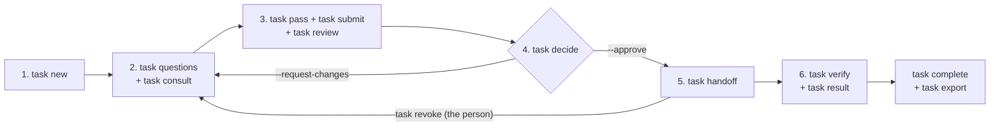

# Task workflow

Every change in an OpenGuildKit project goes through the same six steps, from the request to the closing. The host agent runs the commands; the person answers the questions, makes the decision and confirms what is theirs to confirm. A project can opt in to a [short lane](#short-lane) for a change a person declares trivial; it is off until a person turns it on.



## 1. Open a task

```bash
openguildkit task new "Show signed-in users the status of their support requests" --id request-status
openguildkit task new --file brief.md          # multi-line brief
```

`--lane light --paths GLOB...` opens the task in the [short lane](#short-lane), in a project that has turned it on. Without `--id`, the CLI generates `task-` followed by 12 hex characters. IDs use lowercase letters, digits and single hyphens, up to 64 characters. The command fails if `AGENTS.md` is out of date: run `openguildkit sync` first.

A brief is kept in the task record, shown to the boards and exported with the decision. A credential in it, such as an access key or `password=...`, is replaced with a placeholder before the brief is written, and `task new` says so without repeating the value; an email address, a phone number or a bank account number gives a warning. [tools.md](tools.md#credentials) lists the shapes recognized.

## 2. Scope the task

`task questions ID` prints a JSON object: `questions`, the questionnaire; `follow_ups`, the follow-up questions still to ask, each with its `id` and `prompt` (and its `choices` for `concerns`); and `open_points`. Without `--answers` the last two are empty. With `--answers FILE --follow-ups`, it prints only `follow_ups` and `open_points`, without the questionnaire again: about 300 bytes for a small bug instead of 5 KB. The agent asks the person, in their language, and confirms any answer it inferred from the brief.

| Key | Question | Choices |
|---|---|---|
| `kind` | What are you asking the team to do? | `feature`, `bug`, `maintenance`, `decision`, `other`, `unsure` |
| `surface` | Which areas will this task affect? Several can apply. | `customer`, `service`, `infrastructure`, `business`, `other`, `unsure` |
| `data` | What is the most sensitive data this task may access or change? | `none`, `internal`, `personal`, `regulated`, `unsure` |
| `research` | What evidence can the boards consult? | `local`, `public`, `unsure` |
| `concerns` | Does the task involve any of these? Several can apply. | `money`, `ai`, `people-decisions`, `credentials`, `none`, `unsure` |
| `context` | What acceptance criteria, constraints or other context should the boards know? | Free text |

`context` is optional, except when any answer is `other`. `concerns` is required for every new consultation: `money` covers prices, payments, invoices, payroll or spending; `ai` an AI model or LLM that produces answers or content; `people-decisions` software that scores, ranks or decides about individual people, such as hiring, credit or a price per person; `credentials` secrets, keys, tokens or passwords; `none` none of these. `none` and `unsure` stand alone. `unsure` keeps the rules of every topic open, and the boards of every topic (legal, data, security, finance and devops) review the task, so that the rules asked and the boards consulted say the same thing. Without `concerns`, `task questions ID --answers FILE` lists it in `follow_ups` with its choices, and `task consult` and `task route` refuse the answers and name the choices. A task consulted before the question was required keeps its recorded answers: `task route ID` without `--answers` and its passes still work, and its rules read the missing answer as open, like `unsure`. `surface` takes a list, for example `["customer", "service"]` for a change to a screen and the service behind it; a single value is still accepted.

### Follow-up questions and open points

Save the first answers and run `task questions ID --answers answers.json --follow-ups`. The CLI names the questions that these answers call for and lists the points still open:

| Key | Asked when | Question |
|---|---|---|
| `outcome` | feature, bug, maintenance, other, unsure | The observable result, the expected behaviour and how to reproduce a defect, or what must keep working |
| `affected` | feature, decision, other or unsure work, customer or business areas, personal or regulated data | Who is affected: users, customers, teams or partners |

| `options` | decision | The options on the table and what would make you choose one |

In a project with components, `answers.json` can include `"components": ["web"]`, with the IDs from the project profile. It limits the task to those components and to what is project-wide: the packs and patterns brought for other components leave the scope, the stack shown is theirs, and a check command that runs from another component's folder (`cd services/api && python3 -m pytest -q`, as `init` proposes it, or a folder inside that component) leaves the scope, `task verify` and the closing. A command without a leading `cd FOLDER &&` stays asked of every task. The board of each declared role whose subjects the component's stack names joins the consultation with the reason, such as `frontend` for a component on React. A path of the brief inside a component's folder (`apps/web/src/price.ts`) brings that board too and puts that component's packs first in each pass, but only the answer narrows the scope and the checks. Leave `components` out to consult for the whole project.

A question is essential for the cases where the boards cannot review without it: the outcome of a feature or a bug, who is affected by a customer-facing change, the options of a decision. A short brief, an `unsure` answer or an unanswered essential question is an **open point**. Open points do not block the consultation: they appear in it, each board says how they affect its recommendation, and the decision brief repeats them. A well-described local bug gets no question about customers or options.

```json
{
  "kind": "feature",
  "surface": "customer",
  "data": "personal",
  "research": "local",
  "concerns": ["none"],
  "context": "Signed-in users see the status and next step of their own support requests."
}
```

`task consult ID --answers answers.json` validates the answers, selects the boards and prints the consultation request in Markdown. Without `--answers`, the CLI asks the questions in the terminal. `task brief ID` prints the same request again later. To correct the brief, pass `--brief "REVISED BRIEF"` or `--brief-file FILE` to the next consultation: on a draft, during the consultation (the passes start over, as at every new consultation), or after a request for changes. After a request for changes, the task keeps its previous brief and decision in the round history, and the next decision brief and approval prompt show why changes were requested.

The consultation stays short so that an agent can keep it in context: the task and its answers, the project scope once (stack, components, packs named with their number of rules, conventions, checks, host controls), the open points, and one line per board with why it was selected. It does not repeat the rule texts (`AGENTS.md` names each rule by its ID and leaves its text out, as it leaves out the verification and the sources of the packs: a pass prints the rules that concern the task), nor each board's brief, which its pass prints. What it leaves out stays available: `task brief ID --pack PACK` prints one pack in full, `task brief ID --scope` prints the whole scope as JSON with every rule text, `task brief ID --board BOARD` prints a board's pass, and `openguildkit brains --id BOARD` the board's full reading list. For a bug, when the brief names a file or a function (`src/export.js`, `exportCsv()`, `` `toRow` ``) that the project does not contain, the consultation says so in one line, so that the boards check the brief before reviewing code that is not there.

### Assumptions not confirmed

What scoping takes for granted without anyone confirming it goes in `assumptions`, a list of sentences, apart from the answers the person gave (#436):

```json
{
  "kind": "feature",
  "surface": "customer",
  "data": "personal",
  "research": "local",
  "concerns": ["none"],
  "assumptions": ["Requests are linked to accounts by the customer ID.", "Support agents keep their current view."]
}
```

- **Asking.** While `outcome` or `affected` is asked and still empty, `task questions ID --answers FILE --follow-ups` lists `assumptions` in `follow_ups`: what is assumed in their place is worth writing down. At the terminal, `task consult` asks it after the other follow-ups; Enter skips it.
- **Checking.** Anything other than a list of non-empty sentences is refused with the shape to write. An empty list records nothing.
- **The boards.** The consultation, each board pass and the handoff list them, numbered, under `Assumptions not confirmed (N)`. A pass's entry has `"contested_assumptions": []`: a board that disputes one adds `{"assumption": 2, "reason": "..."}`, with the number of a listed assumption. Another number, or the key in a task without assumptions, is refused.
- **The person.** `task challenge`, `task decision-payload` and the approval prompt of `task decide --approve` print `Assumptions not confirmed (N)` apart, before the request to type the task ID, the contested ones first with the boards that contest them and why. The JSON of `task challenge` has them under `assumptions`. Nothing blocks: approving accepts them as they are.
- **What does not change.** Answers without `assumptions`, and every task recorded before, read and print as before.

### How boards are selected

Answers route to boards first:

| Answer | Boards |
|---|---|
| `kind: feature` | product, engineering, qa |
| `kind: bug` | engineering, qa |
| `kind: maintenance` | engineering, qa |
| `kind: decision` | product |
| `kind: unsure` | project-management |
| `surface: customer` | product, design, marketing |
| `surface: service` | engineering, performance |
| `surface: infrastructure` | devops, performance |
| `surface: business` | project-management |
| `data: internal`, `personal`, `regulated` or `unsure` | security |
| `data: personal` or `regulated` | legal |
| `concerns: money` | finance |
| `concerns: ai` | data, security, legal |
| `concerns: people-decisions` | legal, data, security |
| `concerns: credentials` | security, devops |
| `concerns: unsure` | legal, data, security, finance, devops: every topic stays open |

Then each board's `triggers` are matched as whole words in the brief and context. Matching ignores case, accents and the kind of apostrophe, accepts a regular plural on each word (`jalon` matches "jalons") and does not look inside hyphenated words ("e-commerce" does not contain `commerce`). When triggers overlap, the longest phrase wins: "performance budget" selects `performance`, not `finance` through `budget`, and "DORA metrics" selects `devops`, not `security` through `dora`. Boards that share the exact same phrase are all selected. A board's own shorter phrase never cancels its longer one, so "DORA lead time for changes" stays with `devops` through `dora lead time` and `lead time for changes`, and `legal` does not read it as the DORA regulation. A few job titles, such as "backend engineer", claim their words for no board: "Hire three backend engineers" selects `hr`, not `engineering`. "Reduce checkout latency" adds `performance`; "RGPD" adds `security`.

A trigger preceded in its clause, within five words, by a negation selects nothing: "no payments", "without personal data", "sans paiement", "aucune donnée personnelle", "pas de changement d'interface utilisateur", "it does not touch the API", "nothing to do with payments". The negating words are `no`, `not`, `without`, `never`, `nor`, `neither`, `none`, `nothing`, `cannot`, any word ending in "n't", `sans`, `pas`, `aucun`, `aucune`, `ni`, `jamais`, `non` and `rien`; "avoid" or "éviter" counts when a change follows ("avoid any changes to the pricing page"). A negation written after the subject counts too: "payments are out of scope", "paiements hors périmètre". The items of a negated list are all excluded: "without touching personal data or secrets". A clause ends at punctuation, a line break or "but"/"mais". These are not read as negations, so the board stays: "not only ... but also", "no more than", "sans doute", a double negation ("not without payments", "pas sans paiement"), and a negated verb of omission ("do not forget payments", "don't skip the payment step", "ne pas oublier les paiements"). An imperative "ignore" at the start of its clause sets its object aside: "Also ignore the competitors", "Ignorez les concurrents". A short clause that opens with "without" or "sans" and goes on after a comma depends on what follows. When the next clause starts with an instruction ("Sans les concurrents, ajouter le calcul des prix", "Without competitors, add the price calculation"), the subject is set aside. When the next clause starts with anything else, a subject or a statement ("Sans paiement, la commande n'est pas validée", "Sans paiement, impossible de valider"), the subject may be what is needed: the board stays and its reason says so. An instruction is a French infinitive or imperative after "sans", or a common English imperative (add, fix, update, change and the like) after "without". When the reading is uncertain, the board is kept. The same rule applies to the subjects below. Each reason quotes the passage that selected the board, as written, from the brief or from one answer at a time: `finance: Brief mentions 'payment': "Adyen for card payments"`.

When the profile declares roles (`roles` at `init`), the stack selects their boards too: `frontend` for a task whose surface is `customer` when the project's stack names React, Vue, Angular, Svelte or Next.js; `backend` for a `service` task when it names Django, Rails, Laravel, Spring Boot or FastAPI; and, for a component the task names or whose path its brief cites, each declared role whose subjects the component's stack names (`devops` for Terraform). The words compared are the board's triggers. When the task names the people it serves, that board is selected too. The `affected` answer names them anywhere ("Support managers who paste the weekly numbers"); the brief and the `context` name them within eight words after "for", "audience", "read by", "pour" or "public", so that every role of a list counts ("a ticket report for our support agents", "Audience: support team and customer-success managers").

Some subjects are recognised from the words of the brief as a whole, the same way as the `concerns` answers: an AI model or algorithm applied to applicants, employees, loans or credit adds legal, data and security; an LLM, chatbot or AI assistant adds data, security and legal; spending or a bill from a cloud or SaaS vendor adds finance. When such a subject calls for a pattern the project has not selected, `task route` names it, for example `eu-ai-act-system` for software that ranks job applicants.

Only boards enabled in the profile are selected. If nothing matches, the route says that no discipline was recognised and asks the requester to add the boards that apply with `--add`; `product` reviews the scope meanwhile, or the first enabled board by ID when `product` is disabled.

### Preview and adjust the boards

`task route ID --answers answers.json` shows the boards a consultation would select and why, without recording anything. Under each board it lists the project's tools that board can query, connected or only listed in the profile. When the brief names one of the project's tools, a line says which boards can query it. Then come the boards the brief mentions as excluded, with the passage ("Mentioned as excluded: finance (no payments)"); the consultation repeats that line. The boards the team expects (its declared roles, or the boards its profile lists) that were not selected each get a line with the reason and examples of the words that would select them. The other enabled boards are counted on one line (`openguildkit brains` lists them). Last come two commands: `task route` with `--add`, `--remove` and `--reason` to preview a change, and the complete `task consult` command that applies the options and answers file given to this `task route`. A word that needs quoting goes between single quotes, in which neither a POSIX shell nor PowerShell (the form printed on Windows) expands `$` or a backtick, so the pasted command records the reason as typed; the commands `tools plan` and the web interface print are quoted by the same function. `--json` gives the same under `excluded`, `not_selected` and `expected_not_selected`. The requester can then change the list for this task:

```bash
openguildkit task consult ID --answers answers.json --add finance --remove marketing --reason "Exports are billed per page"
```

Each addition or removal needs a reason; the consultation records it under `adjustments`. Only boards enabled in the profile can be added. Only the requester decides to remove a board, and the decision brief and the approval prompt list every change with its reason. A board selected by a `personal`, `regulated` or `unsure` data answer (security, and legal for regulated data) can be removed only with the approver's confirmation: the removal stays pending until the person approving types the board's name at the prompt, and approval is refused without it.

A project can make some reviews mandatory with `openguildkit profile add required-board security --by NAME --reason WHY`, which writes `"required_boards": ["security"]` in its profile. These boards join every consultation and cannot be removed; `AGENTS.md` lists them under "Required reviews". When a required board is not enabled for the project, the consultation stops and names it. The requester can then name the person who will review instead, with `--delegate security=AM`: the brief tells the agent to prepare the review for that person, and the review entry carries that identifier in `reviewer`.

Each selected board gets a brief with its purpose, the routing reasons, its expertises, its questions and its source leads. The request also carries a snapshot of the project scope: sector context, stack, resolved rule packs, conventions, checks and the research policy for this task.

## 3. Review through each board

`task template ID` prints the review skeleton with the `consultation_id` and one entry per selected board. Keep that ID to tie the review to the current scope. Each [brain](brains.md) has a set of specialist lenses. The agent records their separate findings, challenges the proposed change, then reconciles the boards and preserves disagreements in the summary. The [request status example](../examples/request-status/review.json) shows a complete review.

### One pass per board

The host agent can run each board as a separate pass, with a subagent or one after the other:

```bash
openguildkit task pass ID security --mode subagent    # prints the task, the security brief, its rules and the entry to return
openguildkit task brief ID --board security          # prints the same pass again, without starting it
openguildkit task submit ID --file security.json     # records that board's entry
openguildkit task progress ID                         # done, failed, started or missing, per board
openguildkit task review ID --summary "Where the boards agree and disagree, and the next step"
```

`task pass` gives each board, in this order: the task and its answers, with the components it touches and their paths; its own brief (questions, the lenses to fill with their focus, the evidence to inspect, the challenge and decision criteria); how to fill the entry and the entry to return; a reading list of five sources; then the rules of its own packs that concern the task. Which packs concern the task is decided as for the results (`relevance.py`): from how each pack reached the project and from the task's answers, not from shared words. The pass, the handoff and `task checks` decide rule by rule with the same function (`relevance.judge_rules`): a pass prints only the rules the closing will ask, and a pack in force that a board's packs depend on, such as `incident-notification` for `gdpr`, is printed with them. They are printed most specific first (the stack of the components the task names in its answers or in a path of its brief, the other stacks, regulations, the board's methods, then the baseline), as long as the pass stays under 10 KB; the packs that do not fit are named, and `task brief ID --pack PACK` prints one pack in full: each rule with how it is verified, the check `task verify` runs and the evidence the result asks, then the sources of the pack. The board's packs and rules that do not concern the task are named in the pass with their reason, grouped, so that the pass needs no other command to say why. A decision task delivers no implementation: its passes ask no rule, and `task brief ID --pack PACK` still prints a pack's rules when a board weighs an option against them. Nothing from the other boards is printed, and the shared project scope is named by one line with the command that prints it. What each lens verifies, the whole reading list and the board's methods: `openguildkit brains --id BOARD`. A test keeps every pass under 10 KB and the consultation under 30 KB, on the bundled example and on a monorepo with every role. Running `task pass` again for a pass already started prints it again without counting an attempt. On a pass whose entry is already submitted, `task pass` only prints it, says so and keeps the entry; `task pass ID BOARD --again` redoes it on purpose and counts an attempt, as does starting a failed pass again. `task submit` refuses an entry whose pass was not started on the current consultation. It validates the entry against the template and reports every problem at once, each with its key path (such as `marketing.challenge.verdict`), the value received and the accepted values; an invalid entry is recorded as a failed pass with the reasons, and sending the corrected file again with `task submit` records it. A recorded entry prints `done`, then, on standard error, how many passes are left and the command that comes next (`task review --summary` once none is left). A pass that was started and never submitted shows as `started`: treat it as interrupted; `task list` names it apart from the passes still to run. Run `task pass` again for that board only; the other boards keep their entries. When one agent runs the passes one after the other (`--mode sequential`, the default), the first pass of the consultation prints how to fill an entry and the shapes of an evidence item and a blocker, and each later pass names that first pass instead of printing them again, about 1.5 KB less each; it prints the same rules. `task brief ID --board BOARD` always prints a pass whole, and each pass run with `--mode subagent` is whole, since a subagent reads only its own. Once every board is done, `task review --summary` assembles the review and records whether the passes ran as subagents, in sequence or both (`execution`). A new consultation starts the passes again. Passes can run at the same time: each `task pass` and `task submit` waits its turn for the project lock, up to 10 seconds by default. Set `OPENGUILDKIT_LOCK_TIMEOUT` to another number of seconds (0 to 3600) when a slow disk or many boards need longer. Writing the whole review in one file with `task review --file` still works.

Rules enforced by `task review ID --file review.json`:

- `consultation_id` must match the current consultation.
- `summary` and every `recommendation` must contain text.
- There must be exactly one entry per selected board, and no other board.
- `open_questions` is a list of non-empty strings and `evidence` a list of evidence items in the shape of the template's `evidence_item` (both can be empty lists). A `project-file` or `test` item must name a file or folder of the project, and a `date` must be a real day, not in the future.
- The refusal names the file and lists the problems of every board at once.
- For a brain, each specialist needs exactly one finding with an evidence basis (`observed`, `assumption` or `missing`). An observed finding cites `evidence_refs`: positions in that entry's own `evidence` list, counted from 1, so `[1, 3]` cites its first and third items. A board records its verdict (`proceed`, `revise`, `block` or `insufficient-evidence`), confidence (`low`, `medium` or `high`), alternative, failure mode, verification and blockers. The template shows the accepted values of each choice in place of the value to write.
- A lens of the catalog can name the surfaces it applies to (`"applies_to": ["customer"]`). When none of them is among the task's surfaces, the board's pass lists the lens as not concerned and the entry does not ask for it. A task whose surface is `unsure` or `other` keeps every lens. A lens can also name the concerns it needs (`"applies_to_concerns": ["money"]`, among `money`, `ai`, `people-decisions` and `credentials`): the pay lens of HR is not asked of an onboarding checklist whose concerns are `none`. A missing, `unsure` or `other` answer keeps the lens.

A well-formed review is recorded, but the CLI adds `warnings` to it when the boards do not look independent: two boards with the same recommendation word for word, the same finding in several lenses, or a board whose every finding is an assumption or missing. The decision brief and the approval prompt list them.

Run `openguildkit task challenge ID` to show how the verdicts differ, what each board recommends and which checks can change the decision. It starts with plain lines: the count of verdicts and a warning when boards say revise, block or insufficient-evidence, the review warnings, the boards added or removed with their reason, the open points of the scoping, the objections never deliberated or, after `task respond`, each objection once as resolved or left open with the rule that resolves one, the verdicts that differ without any objection between them and why, the boards whose advice is addressed to no other board, and each blocker with how it was resolved and the evidence given. The agent shows this brief to the person before implementation.

## 4. Decide

The person runs the command in their own terminal:

```bash
openguildkit task decide request-status --approve --by CM --reason "Read-only scope agreed with support"
```

`--by` takes the person's initials or team handle, here `CM`, rather than their full name: the record and the seal keep it, and it cannot be replaced afterwards without breaking the approval ([personal data](personal-data.md)).

The CLI prints the same lines as the decision brief (starting with the verdict count), then the task brief, the review summary with each board's verdict, recommendation, verification, blockers and open questions, the command that prints the full decision brief (`task challenge ID`), the verdict count again, and asks the person to type the task ID, then the name of each sensitive board the agent removed. One function writes the lines of the decision brief, so the prompt, `task challenge` and `task decision-payload` show the same ones:

- the verdicts, and the review warnings: two boards or more that give the same recommendation or finding once each board's name is taken out (advice written once and pasted from board to board), a board whose every finding cites one and the same evidence item, a board with no observed finding;
- the conditions of approval, blockers and their resolutions, board removals, open points and objections;
- each check command `task verify` will run as a shell command after the approval, then each command added or removed since the last approval of the project, with who changed it, when and why from the profile's history (or a note that the profile was edited by hand);
- each confirmed critical dependency alert of the task that an import resolved since its last decision, with the report that resolved it ([dependency alerts](alerts.md#a-report-that-analyzed-nothing)).

`task review` and `task submit` print the same warnings on copied advice as they record it. The approval records the base Git revision and a seal over what was approved; a project that requires signed approvals verifies the approver's SSH signature instead of the typed ID ([details](architecture.md#design-decisions)). Approval fails when stdin is not a terminal, when the typed ID does not match, when the task changed during the decision, when the profile or catalog changed since the consultation, or when `AGENTS.md` is out of date.

A blocker names the finding, its `owner` and `clears_when`, the condition that would clear it. Use a condition you can verify before implementation. If the evidence requires code or a test result from the implementation, set `"phase": "verification"` in the blocker. Approval can proceed while verification blockers are open. The handoff lists them, `task verify` reports them, and `task complete` waits for their resolution.

Use these commands to list and resolve blockers.

```bash
openguildkit task blockers ID
openguildkit task clear ID security:1 --evidence tests/test_access.py --supports "Cross-account access is refused" --by AM
openguildkit task waive ID security:2 --by CM --reason "Internal pilot only" --scope "Internal users" --until 2026-12-15
```

Clearing is the person's act: the agent proposes the evidence, and the person runs `task clear` in their own terminal and types the task ID to confirm (in a project with signed approvals, their signature replaces the typed ID). Without a terminal the command checks the evidence and is refused. Clearing records who cleared, the evidence and what it establishes. Use an existing project file or folder, or an HTTPS link. A second attempt to resolve the same blocker is refused and the first resolution stays in place. The decision brief and the approval prompt show each blocker of phase `verification` as a condition of the approval, and the handoff lists the open ones first. A waiver requires a project waiver policy (`openguildkit profile set waivers allowed --allowed-by NAME --max-days DAYS`, typed by a person), the named person at a terminal, a reason, a scope and an end date within the limit. The handoff lists each waiver with its scope and end date. A waiver holds through its end date, a UTC day, by the real clock (`SOURCE_DATE_EPOCH` does not change it); the next UTC day its blocker is open again: `task blockers` shows `[waiver expired on DATE]`, a reviewed task cannot be approved until the blocker is cleared or waived again, and for an approved task `task list` names what the person can do. A condition of approval is cleared with its evidence, waived anew (the new waiver keeps the expired one under `replaces`) or the approval withdrawn; a blocker the approval rested on is under the approval's seal, so the person withdraws the approval and the task is consulted again. `task complete` refuses a task with an expired waiver, and `guard --ci` refuses the record of a task not completed whose waiver expired; a completed task's record is history. Without a waiver policy, `task waive` names the steps the task can still take: clear the blocker with its evidence, or, before the decision, request changes; for a condition of an approved task, withdraw the approval (`task revoke`, below) when it cannot be met. `task list` says so for an approved task whose condition is still open.

In a project with signed approvals, `task clear` follows the rule of `task decide`: `--by` names the person, and the signature must verify for `--signer`, an approver of the project; the record keeps both. Run the command with `--payload clearance.json`, sign that file with `ssh-keygen -Y sign -n openguildkit-decision -f KEY clearance.json`, then rerun the same command with `--signature clearance.json.sig --signer PRINCIPAL` in place of `--payload`. The signature covers the blocker, its consultation, the person named by `--by`, the evidence and what it establishes.

After upgrading the board catalog, `openguildkit update` names the tasks the change touches before `--apply`, and `update --apply` and the `sync` after it name the same ones, each with what to do: consult a consulting task again, request changes on a reviewed task and consult it again, consult an approved one again with `task consult ID --reuse-answers`, which keeps the passes of unchanged boards when the approval's seal holds and none for an approval without a valid seal (or open a linked task with `--follows`). A completed task keeps its record as history and is not listed.

To send the task back:

```bash
openguildkit task decide request-status --request-changes --by CM --reason "Include the empty state in scope"
```

This works without a terminal. The next `task consult` (`task consult ID --reuse-answers` keeps the recorded answers) archives the previous brief, answers, consultation, review and decision in `rounds`, so the history of the task is kept. When the change request changes the scope, revise the brief at that consultation, so the approval shows what is approved:

```bash
openguildkit task consult request-status --answers answers.json --brief "Show the status and the empty state of each request"
```

The revised brief is checked like the brief of `task new`. The approval prompt and `task challenge` of the new round open on one line that recalls the previous round's decision, who made it, when and why, and whether the brief was revised since.

### When an approval no longer holds

One function judges an approval, and every reader prints its answer: `task list`, `check`, `task consult`, `handoff`, `verify`, `result`, `complete`, `export` and the guard. An approval holds while its seal matches the record, its signature verifies (in a project with signed approvals), the rules, checks and boards of the profile are those it was given under, and the Git revision it was approved at is still in the project history.

Only a change of the rules, the checks or the boards voids an approval: packs and their rules, the sector, the stack, components and patterns, the check commands, the boards, roles and required reviews, the personal-data and people-decision answers, and `ask_every_rule`. A new convention or tool, the guard mode, the host, the research setting, the approval mode, the waiver policy or the paths of the short lane leave approvals standing (the approval mode and the allowed signers are read again by every reader, through the signature). An approval recorded by a release older than sealed decisions (0.16.1 and earlier) has no seal, so it no longer holds: until the task is consulted again, `check` exits 1 on it and `handoff`, `verify`, `export` and `complete` refuse it. Consulting it again keeps no pass, and a completed task keeps its record as history.

After a rebase, a squash or an amended commit, the approved revision leaves the history: every reader says so and names the same command, `task consult ID --reuse-answers`, which consults the task again with the answers it holds and needs no terminal (`--answers FILE` with it replaces the answers the file gives; a task consulted before the `concerns` question existed is asked it at a terminal, and without one is consulted as `unsure`, which keeps every topic's rules open, with a line that says so). The task is consulted again under the same ID: `task consult` keeps the earlier approval in `rounds` with the reason, and keeps as done the passes of the boards whose brief, rules and entry template did not change, so only the others review again (`task pass ID BOARD --again` redoes a kept one). The decision brief lists the kept passes, and the person approves again. The same applies when the rules changed: the boards whose rules changed review again. A broken or missing seal keeps no pass.

### Withdrawing an approval

The person withdraws an approval in their own terminal, as they gave it, and types the task ID to confirm:

```bash
openguildkit task revoke request-status --by CM --reason "The test account the condition needs cannot be created"
```

The task goes back to `changes-requested`: the approval goes to `rounds` with who withdrew it, when and why, and the guard no longer counts the task in `covered_by`. An exported record of that approval still says approved, and `guard --ci` would keep accepting it: `task revoke` names the file, and `check` (exit 1) and `task list --decisions` report it until `task export ID` writes the withdrawal into it (`withdrawn`, with who, why and when; the approval stays as it was and `record_sha256` is computed again). Commit the record: `guard --ci` refuses it, and once it is on the base revision, refuses a copy of the same approval made before the withdrawal. `task list --decisions` shows it as withdrawn, a note that does not fail `check`. `task export` of a withdrawn task without a record writes nothing and says so. Then consult the task again, or close the work in a linked task with `--follows`. Without a terminal the command is refused, and `host apply` adds it to the agent's deny rules, like `task decide`; the web interface never runs it. A completed task keeps its approval as history. The guard puts no time limit on an approval: withdrawing it is how an abandoned task stops covering edits, and `task list` names the command for an approval older than 14 days with no result recorded.

### Signed approvals

A local approval is sealed with a SHA-256 of data that all sits in the task file. The seal detects an accidental edit; it does not prove who approved, because anyone who can write the file can recompute it. With `"guard": "enforce"`, `init`, `host check` and `check` say so in one line until a person requires signed approvals at their terminal, with `openguildkit profile set approval signed --signers .openguildkit/allowed_signers --approver CM --by NAME --reason WHY`. The profile then holds:

```json
"approval": {"mode": "signed", "allowed_signers": ".openguildkit/allowed_signers", "approvers": ["CM"]}
```

The allowed signers file uses the `ssh-keygen` format, one line per approver: `CM ssh-ed25519 AAAA...`. The principal, here `CM`, is any word: initials keep an email address out of a file the team commits, and a record stays verifiable only while its principal remains listed ([when an approver leaves](personal-data.md#when-an-approver-leaves)). Commit it: a signature is verified against the file as Git holds it at `HEAD`, never against a working copy ([what protects it](architecture.md#design-decisions)). The approver then decides in three steps:

```bash
openguildkit task decision-payload request-status --by CM --reason "Read-only scope agreed" --output decision.json
ssh-keygen -Y sign -f ~/.ssh/id_ed25519 -n openguildkit-decision decision.json
openguildkit task decide request-status --approve --by CM --reason "Read-only scope agreed" --signature decision.json.sig --signer CM
```

`task decision-payload` prints on stderr the lines of the approval prompt (verdicts, warnings, conditions of approval, removals, check commands), and the file to sign carries the brief and the review summary in clear next to the digests, so the approver reads what they sign. `task decide` with a signature prints the same lines. Approvals signed over the payload of earlier releases, without the brief and summary, still verify.

A key protected by a passphrase or a hardware token keeps the agent from signing. The handoff, `task export`, the guard and the CI check refuse an approval without a valid signature; CI verifies it against the allowed signers of the pull request's base revision.

What signed mode is worth depends on where the check runs:

- **In CI** (`guard --ci`), the approvers and the signers file come from the base revision, which the pull request cannot change: a key the change adds signs nothing there, and a record the base revision does not carry is verified against today's approvers only. This is the check that holds against an agent that can write files and commit.
- **In a local copy** (`task list`, `check`, the edit hook, `handoff`), a signature is verified against the signers file committed at `HEAD`. An agent that commits its own key to that file and to `approvers` can sign an approval that holds locally while the key is there; the pull request then shows the change to the signers file, and CI refuses the approval. When the key is gone from `HEAD` again, the approval holds only through the revision it was signed at, and that revision counts only when the merged branch contains it: `origin/HEAD` (the remote's default branch, which `git clone` sets; `git remote set-head origin --auto` sets it otherwise), or else the branch's upstream. A key committed and reverted on a local branch therefore approves nothing, and `task list` names the signer and the revision of every approval that holds this way. Local Git references can still be rewritten by whoever has a shell in the repository: locally, signed mode stops an edited file and a key that was never reviewed, and CI on the base revision is what decides.

### Certificates of an authority

Instead of one key per approver, the allowed signers file can trust an SSH authority, the one the company runs behind its single sign-on: one line, `PRINCIPAL cert-authority ssh-ed25519 AAAA...` (the authority's public key). The approver signs in to the directory, the authority gives them a short certificate for their principal, and they sign with it: `ssh-keygen -Y sign -f ~/.ssh/id_ed25519-cert.pub -n openguildkit-decision decision.json`. `task decide` and every reader verify it with `ssh-keygen -Y verify`, which checks the authority's signature, the principal, the namespace and the validity of the certificate. An approver who leaves loses the right to sign when the authority stops issuing: no commit in each repository. A test signs and verifies with a certificate (`tests/test_decisions.py`).

What it proves: the signature was made with a key that the committed signers file's authority certified for that principal, and the certificate was valid when it was checked. What it does not prove: what the authority checked before issuing it, that a person and not a program held the key (a passphrase or a hardware token still decides that), or when the person signed.

Verified now, a certificate that expires voids every approval already recorded. An approver who wants to avoid that adds the time they sign at to the payload:

```bash
openguildkit task decision-payload request-status --by CM --reason "Agreed" --signed-at --output decision.json
ssh-keygen -Y sign -f ~/.ssh/id_ed25519-cert.pub -n openguildkit-decision decision.json
openguildkit task decide request-status --approve --by CM --reason "Agreed" --signature decision.json.sig --signer CM --signed-at 2026-11-27T10:15:30Z
```

`--signed-at` alone writes the current UTC time in the payload; `task decide` takes the same value, in `YYYY-MM-DDTHH:MM:SSZ`, and verifies it because the approver signed it: a changed `signed_at` breaks both the signature and the seal. Without `--signed-at`, nothing changes. `task decide` always verifies at the current time, so a key or a certificate that has expired signs no new approval, and refuses a `signed_at` in the future. An approval already recorded (`task list`, `handoff`, `guard --ci`) is verified at its `signed_at`: it keeps holding after the certificate expires, while the approvers and the signers file it is checked against are unchanged. `guard --ci` also refuses a new record whose `signed_at` is more than five minutes after the commit that first brings the record (`decision-signed-late`).

`signed_at` is what the signer states. Someone who still holds an expired certificate and its key can sign a payload that claims an earlier time, and the check accepts it if the time falls in the certificate's validity and is not later than its commit: no clock proves otherwise. Keep the certificates short, ask for a passphrase or a token, and review who merges.

## 5. Hand off

```bash
openguildkit task handoff request-status
```

The handoff exists only for approved tasks whose approval still holds: its seal matches the record and its rules are the current ones. Otherwise it fails with the same message as `task list`, `task show`, `check`, `task export` and `guard --ci`, which names what changed (`pack gdpr added`, `rule secure-sdlc/threat-model changed`) and the next command: `task consult ID` reopens the task under the current rules, keeping the earlier approval in `rounds` with the reason, or `task new "BRIEF" --follows ID` opens a linked task. It contains the approval (who and why), the approved scope snapshot, the rules to apply and the board review. The rules to apply are the ones `task checks` asks, pack by pack, then one line names the packs and rules that do not concern the task, with how many of each; `task checks ID` gives each reason. The handoff of a decision task has no rules to apply. The agent implements that scope, runs the project checks and brings any scope change back to the person.

On a completed task, `task handoff` shows the same handoff for reference, headed with the task's status and saying that nothing is left to implement. On a task already decided, `task decide` says so, with the status, who decided and when, and the one command that fits next: `task handoff` for an approved task, `task new "BRIEF" --follows ID` for a completed one, `task consult ID` after a change request. Once the review is recorded, `task progress` shows each board as `done (in review)`.

A task answered with `kind: decision` asks for a recommendation. Its handoff contains the approved decision, scope and review. `task result --template` lists its acceptance criterion when the answers name an outcome. The approval already records the process evidence, so the decision has no implementation checks to fill in. After recording the criterion, run `task complete`. When the answers give no outcome, you can complete the task directly.

If tracked project files differ from the approved Git revision, the CLI asks for the delivery revision or pull request. It ignores the exported decision records. `task complete` gives the `task new --follows` command so that applying the decision gets its own review and approval.

### Code owners of the touched paths

When the project has a CODEOWNERS file, the decision brief of `task challenge` and the handoff of `task handoff` add one line naming who owns what the task touches, so that the person knows whom to tell or ask before deciding (#437):

```text
Code owners, read from .github/CODEOWNERS (shown here, never recorded): api/ @team-api; web/ no owner declared.
```

- **What the task touches.** Its short-lane paths (a glob reads as the folder before its first wildcard), the folders of the components its answers name, and the project paths its brief and answers name that exist. None of them: the line reads `whole project`. A folder shows the rule that covers its files in general; a rule for some files inside it, such as `*.sql` or a sub-folder, is not shown. Eight paths at most, then a count.
- **GitHub's rules,** as its page [About code owners](https://docs.github.com/en/repositories/managing-your-repositorys-settings-and-features/customizing-your-repository/about-code-owners) states them, read on 2026-11-26 (the page shows no date of its own): the file is `.github/CODEOWNERS`, `CODEOWNERS` or `docs/CODEOWNERS`, searched in that order, and only the first one found is read; patterns follow gitignore, the last matching pattern wins, a pattern without owners leaves its paths without one, paths are case sensitive, and a file of 3 MB or more is not loaded. The page says `!` negation and `[ ]` ranges do not work: OpenGuildKit skips those lines and names them in the line. How GitHub itself treats such a line beyond "does not work" is not verified.
- **Shown, never recorded.** Owners are often people's names or emails ([personal data](personal-data.md)). Whether a committed record may keep them is an open decision (Q9 of the benchmark), so they stay out of the task record, the exported decision record and every file the CLI writes: they are read again from CODEOWNERS at each display.
- **What does not change.** A project without CODEOWNERS sees nothing more.


## 6. Report the results

After implementing an approved task, the agent proves what was delivered:

```bash
openguildkit task checks ID            # the checks that concern the task, then what is not asked and why
openguildkit task verify ID            # runs the check commands and the rules' machine checks, with their evidence
openguildkit task result ID --template > result.json   # JSON only: the criteria, rules and named evidence to report
openguildkit task result ID --file result.json
openguildkit task complete ID
```

### Only the rules that concern the task

A project can carry dozens of packs. A task answers only the rules that concern it; the others are listed as not concerned, with the reason, in `task checks`, in the template's `not_concerned` and in the closed task's record, and need no answer.

Each bundled pack has a subject, the task answers that call for it, and for a few packs the boards the task consults or the words of its brief. A pack concerns the task when its subject meets the task's `kind`, `surface`, `data` and `concerns`, and the way it reached the project still holds. Having a board of its role, or personal data, does not bring a pack by itself. For each regulatory pack, `relevance.LEGAL_BASIS` gives the subject retained and its legal reason.

| Subject | Called for by | Packs |
|---|---|---|
| Every change | always | `agent-workflow`, `secure-sdlc` |
| The project's code | surface `service`, `customer` or `infrastructure` | language and framework packs (`python`, `typescript`, `fastapi`, `django`, `postgresql`...) |
| The user interface | surface `customer` | `react`, `vue`, `nextjs`, accessibility (including `france-rgaa-accessibility`), trackers (`france-cookies-and-trackers`), web performance, mobile, i18n, `playwright`... |
| A new customer feature | kind `feature` and surface `customer` | design, user research, experiments, product discovery, SEO, support readiness, release communication |
| A backend service | surface `service` | `backend-data-safety`, `public-api-docs`, and `service-reliability` (also `infrastructure`) |
| Infrastructure and delivery | surface `infrastructure` | containers, Kubernetes, Terraform, AWS IAM, CI security, incident response, release management, supply chain |
| The tools and instructions agents work with | surface `infrastructure` | `agent-native-engineering` |
| Cloud and vendor spending | surface `infrastructure`, or surface `business` with concern `money` when `finance` or `devops` reviews the task | `finops-cost-management` |
| Personal data | data `personal` or `regulated` | `gdpr`, `minors-data-protection`, `health-data-protection`, `france-health-data-hosting` |
| Security-sensitive changes | data `regulated`, concern `credentials`, surface `infrastructure`, or data `personal` on surface `customer` or `service` | `threat-modeling`, `owasp-asvs`, `iso-27001`, `france-public-sector-security` |
| The ICT systems of a regulated entity | data `regulated`, surface `infrastructure`, or a `feature` or `maintenance` with data `personal` on surface `customer` or `service` | `dora`, `nis2` |
| The systems of an aviation organisation | data `regulated`, or surface `service`, `customer` or `infrastructure` | `aviation-information-security` |
| Airborne software and systems | surface `service`, `customer` or `infrastructure` | `airborne-software-assurance`, `airworthiness-security` |
| Security incidents and vulnerabilities | surface `infrastructure` or concern `credentials` | `cyber-resilience-act`, `incident-notification` (each of its rows also follows its regulation, below) |
| AI | concern `ai` or `people-decisions` | `llm-evaluations`, `nist-ai-risk`, `eu-ai-act` |
| An AI agent or an MCP server | concern `ai`, or a brief that names an MCP server or an AI agent (MCP, Model Context Protocol, AI agent, agentic, function calling, LangGraph, CrewAI...) | `agentic-application-security` |
| Money | concern `money` | revenue, SaaS metrics, VAT, French e-invoicing (`france-e-invoicing`), financial planning, deal approval |
| Payment card data | data `regulated`, or concern `money` when the brief names cards or payments (card, payment, checkout, Stripe...) | `pci-dss` |
| Pay and recruitment | concern `people-decisions`; or the `hr` board with concern `money` (pay) or a brief that names hiring (interview, candidate, job posting...) | `pay-transparency`; `structured-hiring` without the pay case |
| A business process | surface `business` | sales, partners, campaigns, HR processes, procurement, governance and delivery methods |
| Selling to consumers or insurance | surface `customer` with concern `money` | `online-consumer-sales`, `insurance-distribution` |
| The software and the software updates of a road vehicle | surface `service`, `customer` or `infrastructure` | `unece-r155`, `unece-r156` |
| Content users publish | the `trust-and-safety` board reviews the task (the brief speaks of reports, moderation or illegal content) | `notice-and-action` |

An answer left open (`unsure`, `other`, or not given) calls for the packs of that subject. On top of the subject, a pack brought by a method pattern needs a board of the role that brought it (the pattern's roles the profile lists) among the task's boards, and a pack brought for some components needs a file changed since the approved revision in them; files changed in a component other than the whole project bring its packs even when the answers do not. A component at the project root (path `.`) holds every file, so there the subject decides. A pack of the project's own catalog has no subject: a regulation pack concerns tasks on personal or regulated data, a pack needed by another (`depends_on`) follows the packs that need it, and the others concern every task. A pack or rule listed in `required_rules` is always asked.

A brief names a subject the way it routes a board: whole words, a regular plural, and a negated mention ("no card payments") names nothing. `incident-notification` holds one row per regulation: each row is asked when the pack of its regulation (`gdpr`, `nis2`, `dora`, `cyber-resilience-act`, `eu-ai-act`) concerns the task, and the pack, with its matrix rule, concerns the task when one of its rows does or when its own subject does.

Inside a data protection pack that concerns the task, the rules about creating or changing a processing are left out of a task of kind `bug` or `maintenance`, which fixes or maintains a processing the project already runs: in `gdpr`, the record of processing and the DPIA decision (with their named evidence), the lawful basis of a new purpose, the retention of new data, and rights over new data; the age of consent, parental consent, the DPIA for pupils and the default protections of a new flow in `minors-data-protection`; the Art. 9 condition, the DPIA and the medical device qualification and planning in `health-data-protection`. The rules on minimising what the change touches, protecting health data, advertising to minors, notices for children and documenting a changed component stay asked. The `gdpr` rules on a new processor (Art. 28) and a transfer outside the EEA (Chapter V) are left out of a `bug` only: a migration to a hosted service often adds one, a fix almost never. A feature, or any other kind, keeps every rule; `required_rules`, `--all` and `ask_every_rule` keep them too. Each rule left out says why.

A named evidence with a condition on the task's `data` is asked only when the data meets it. To see or answer every rule, run `task checks ID --all` or `task result ID --template --all`; to ask every rule on every task, run `openguildkit profile set ask-every-rule yes --by NAME --reason WHY`.

### The result file

`task verify` runs the commands listed in the profile's `checks`, in the project root, and records each exit code with its log under `.openguildkit/tasks/`. It also evaluates the machine checks of the rules that concern the task (a file that exists, a text present or absent, a field of a JSON or TOML file, a file within a size in bytes, or a command from the project's own catalog; see [catalog format](catalog-format.md#machine-checks-and-named-evidence)) and records what it found, such as `export.json: downloadLinkMinutes = 90 (above 60).`; `task result` cannot report these checks. The template writes nothing but JSON on standard output; it lists the checks `task verify` records under `recorded_by_verify`. `result.json` names the delivered `revision` or `pull_request`: the template fills in the revision `task verify` read from Git (or `working tree` outside a repository), and a report that leaves it out keeps the one already recorded; the acceptance `criteria` (`met` or `not-met`, with evidence) and an outcome for each rule: `passed` or `failed` with evidence, or `skipped` or `not-applicable` with a reason and an owner. An entry left with an empty status is not answered yet. Later reports update earlier outcomes check by check. Only `task verify` records the command checks (`command:N`) and only `task verify --chaosfolk` the replays (`chaosfolk:*`): `task result` refuses them, and refuses a `passed` check with a non-zero `exit_code`. When the task's answers name an `outcome`, the result needs at least one criterion. Each refusal names the file, the accepted values and `task result ID --template`. `task verify`, `task result` and `task complete` refuse a task whose approval no longer holds, as the handoff does. Before any `task result`, `task verify` counts the rules and named evidence still to report in one line instead of listing them, since the template lists them; once a report answered one, it lists those left one by one.

The owner of a `skipped` or `not-applicable` answer is the person who decides it, and the reason is theirs: the agent proposes, the person confirms, and the agent never writes a name it was not given. One answer can cover every rule of a pack: the template lists under `packs` each pack whose rules can be answered together (none is required, records a value, is selected by the task's data or concerns, or protects data, security or AI), with its rules, so the file stays short. A pack entry takes the statuses of a rule: `passed` or `failed` with evidence, `skipped` or `not-applicable` with a reason and an owner, for example `{"pack": "react", "status": "not-applicable", "reason": "No interface changes.", "owner": "CM"}`. It stands for each of its rules not reported one by one; to answer one of them apart, add it to `checks`. It never covers a rule of `required_rules`, a machine check or evidence that must be supplied. Any other pack can be answered the same way. When the task's data or concerns select a pack declared not applicable as a whole (personal data and GDPR, for example), the result records a warning, and so it does when rules they select are declared not applicable with the same reason as other answers. It warns too when one evidence item is cited for the passed rules of three packs or more: a warning on the result is an open point, so the task then closes with reservations. A data protection, security or AI pack declared not applicable as a whole is an open point that only a person closes over (`task complete --by`). Each report that gives `packs` replaces the earlier pack answers, and a pack whose rules a later report answers one by one loses its answer: the warnings describe the result as it stands. A criterion can name `verified_by`: a check command such as `command:1` or a test file of the project. The output counts the met criteria tied to a check or a test, those tied to a check command that has not passed (the exported record says so too), and those only declared, and warns when a met criterion's evidence says it was not run.

### Named evidence belongs to its owner

A rule can name evidence kept outside the code, such as the record of processing activities or the DPIA decision of the GDPR pack. These documents belong to the data controller (in practice the data protection officer or the person accountable for the processing), not to the task: keep them where the organisation keeps its compliance records (an intranet page, or a folder such as `docs/privacy/` that the owner maintains), and cite the same record from every task it covers. The handoff lists first the evidence the closing will ask for and who provides each. The template marks each one with the statuses it accepts: `"requirement": "passed"` (it cannot be declared not applicable: the profile's `required_rules` lists it, or it applies to the task's `data`) or `"passed-or-not-applicable"`; `task checks` prints the same word. A supplied evidence is `passed` with a project path that exists or an `https://` link, and `owner`: the person who provided or confirmed it. OpenGuildKit checks that the path exists; it never reads the document, and says so in `task complete` and in the exported record, with the name of the person who confirmed it. It warns when one file is cited for several different evidences, and when a file looks like configuration, code or an image (a `Dockerfile`, a `.py` or `.png` file).

A result that lacks only named evidence is recorded: an evidence that is missing, declared not applicable where it must be supplied, or cited at a path that does not exist is held back with the reason (`Not recorded: ...`), and the task waits. `task result` and `task list` name the evidence and who provides it, and `task show` and the exported record carry `waiting_for` next to the status. When an answer is not recorded, the output says whether an earlier answer for the same check stays recorded, and does not call the task ready. The person can hand the missing evidence to a follow-up task that the owner will close: open it with `task new "BRIEF" --follows ID`, then run `task complete ID --defer EVIDENCE=FOLLOW-UP --by NAME` at a terminal. The task closes with that reservation visible.

### Closing the task

Every project command is mandatory. A profile can make rules mandatory too with `openguildkit profile add required-rule secure-sdlc python/run-tests --by NAME --reason WHY`, which writes `"required_rules": ["secure-sdlc", "python/run-tests"]`. `task complete` refuses while a mandatory check has not passed, an asked check is not reported, a criterion is not met or a required evidence is awaited, and lists what is missing. Otherwise it closes the task:

- `done` when nothing is left open: a single line on standard output;
- `done-with-reservations` when points stay open, listed one per line, grouped by nature and the most serious first: data protection, security or AI rules skipped or failed (or such a pack declared not applicable as a whole); board blocks not lifted (a `block` whose blockers were waived rather than cleared); project checks that could not run in this environment; blockers waived rather than cleared; disagreements between boards left open, each with its point, its two boards and the decision the person must take; named evidence handed to a follow-up task; other rules skipped or failed; warnings on the result; and, for the record, the board verdicts that asked for changes at approval. It gives the command for a linked follow-up: `openguildkit task new "BRIEF" --follows ID`.

Closing over a data protection, security or AI rule that concerns the task and is skipped or failed, or over such a pack declared not applicable as a whole, needs the person: `task complete ID --by NAME`, at a terminal, typing the task ID. The open points are shown once, before the person types the ID. When only such a point is left, `task verify` and `task result` say the task is ready to close with the person at a terminal rather than plain `Ready`. The handoff of a closed task speaks of its checks in the past. `task export --output /dev/stdout` prints the record: an output reached through a link to a device is written to, while a link to a regular file is refused. `check` warns about evidence a reviewer cannot open (ignored by git, or under `.openguildkit/tasks/`) wherever the result cites it: named evidence, rule and pack answers, criteria and their `verified_by`, and blocker clearings; the logs `task verify` keeps for the check commands are left out. When the profile lists no check command, `task complete` says that no project command ran. Notes on what was not run or not read go to standard error. `task list`, `task show`, `task export`, `docs export`, `deliverable` and the guard read both closed statuses. `task export` adds the evidence supplied and who confirmed it, the evidence declared not applicable, the pack answers, the warnings, the deferred evidence, the criteria with what verified them and the open points.

### Project checks

`init` proposes the test command each component of the repository shows: `npm test` for a `test` script in `package.json` (not the `npm init` placeholder), and `npm run lint` too when it has a `lint` script, `python -m pytest` when the Python manifests name pytest, `python -m unittest discover -s tests` for a `tests/test_*.py` folder without pytest, `python -m unittest discover` for `test_*.py` files in the component's own folder, `go test ./...`, `cargo test`, `mvn test` (or `./mvnw test`), `gradle test` (or `./gradlew test`) and `dotnet test`. A command of a component outside the root runs from its folder, as in `cd apps/web && npm test`. `init --questions` lists them under `proposed` in the `checks` question; nothing is kept until the person says yes to each one, and `init` names the commands found but not kept.

Every project check is mandatory: the task cannot be done while one fails. When a command fails, `task verify` prints its cause (exit code, command not found, a missing dependency or network, a time-out), its last three lines of output, the next step and the path of its log under `.openguildkit/tasks/ID-checks/`; `task complete` repeats it. Install the project's dependencies before `task verify` (`npm ci`, `pip install -e .`, ...). The handoff lists the commands `task verify` will run and recalls this. After running them, `task verify` lists every point that still keeps the task from being done, one per line, then their count; when the profile lists no check command it says so and how to add one. A rule's machine check prints what it found or did not find, such as `Found SECURITY.md.` or `Not found: none of SECURITY.md exists.`

When a command cannot run in this environment for this task (no network, a missing service), the person records it at a terminal, with their initials and the reason:

```bash
openguildkit task verify ID --cannot-run command:1 --by CM --reason "The sandbox has no network for npm ci."
```

The command runs first: one that passes here cannot be declared. The reason takes at least three words, and a declaration is not combined with `--chaosfolk`. `task verify` prints the command as `skipped`, with who declared it and why. The command then no longer blocks completion, and the task closes as `done-with-reservations` with that point listed. A later `task verify` runs the command again and keeps the declaration while it still fails, saying so; the declaration ends when the command passes, or when the person who made it withdraws it with `task verify ID --withdraw command:1 --by NAME` at a terminal, which runs the command and records its outcome.

`task verify` exits with status 1 when a mandatory check command failed, so a script or a CI job can tell; it exits with 0 when only answers remain to give (the listed points say which). When a command fails, the message starts with the first line of its output that names the error ("Cannot find module 'express'") and ends with its last lines, then the log path.

A check that cannot run on the team's workstations, because it needs the network, a service or credentials, does not belong in `checks`: leave it out at setup, or ask the person to run `openguildkit profile remove check 'COMMAND' --by NAME --reason WHY` at their terminal (a check removed weakens a protection), then run it in CI and name it under `conventions` (for example "The integration tests run in CI: tests/integration needs the payment sandbox") so the agent and the reviewers know where its result comes from.

## Delivered diff review

The boards review the task before the change; they can also read the change itself. After `task verify` or `task result` recorded the delivered revision, and before `task complete`, the agent has each board of the decision review the diff between the approved revision and the delivered one:

```bash
openguildkit task diff-review ID                    # the files of the change and one command per board, with its state
openguildkit task diff-review ID --board security   # one board's brief, in its own pass (a subagent when the host has them)
openguildkit task diff-review ID --submit findings.json
```

A board's brief holds the diff limited to the files of the change (the tool's `.openguildkit/` folder left out), cut at 6 000 characters with the `git diff` command that prints the rest; when the working tree is delivered rather than a commit, the new files Git does not track yet are named, to be read in full. Then what the decision asked: the expected outcome, who approved and why, the board's recommendation, verdict and failure mode at approval, the questions it left open, its blockers and how they were resolved, the disagreements left open that concern it, and its decision criteria. Then its lens (the purpose and the focus of each specialist) and the format to return. `--json` prints the same as JSON.

The board returns one JSON file: `{"board": "security", "findings": [{"file": "api/auth.py", "line": 42, "severity": "blocking", "action": "fix", "finding": "..."}]}`. `file` is a file of the change and `line` a line of its delivered version; `severity` is `blocking` (must not ship as is), `important` or `minor`; `action` is `fix` (now), `defer` (a later task) or `decision` (the person decides at the closing). An empty list records that the board found nothing. A file with problems is refused with every problem at once, and nothing is recorded; a `defer` on a line the change added is refused, because a problem the change causes is fixed or brought to the person, never deferred. A board that submits again replaces its earlier findings. The output counts the boards that reviewed the delivered revision and the blocking findings with their board, file and line, then names the next step: the boards still to review, or fixing a blocking finding and recording the new revision with `task result`, or `task complete`.

At the closing, each blocking finding, each finding classed `decision`, and each review of an earlier revision than the delivered one is an open point of the group "Findings on the delivered diff": the task closes as `done-with-reservations`, and `task show ID --closing` prints them again. `task export` carries the findings, board by board, under `delivered_review`. A task whose diff no board reviewed closes and exports as before, and records written before this review read the same. The review needs a project in Git with an approval that named its revision; a task of kind `decision` delivers no diff.

## Evidence changed after it was accepted

`task clear` records a fingerprint of the evidence that clears a blocker, under `fingerprint` in the clearance: `sha256:` and the SHA-256 of a file's bytes, or of the list of a folder's files (their names, not their content, Git's folder and `.openguildkit/` left out), or `external` for an https link, which no one here can check. In a project with signed approvals the fingerprint is part of the payload the person signs, so a clearance signed before the file changed no longer verifies. `task result` records the same fingerprint for each named evidence it accepts as `passed` with a project path.

When a fingerprinted file changes or disappears afterwards:

- `task blockers` says the state of each clearance's evidence: `fingerprint: unchanged since it was cleared`, `changed since it was cleared`, `the evidence is missing since it was cleared`, or `external link, cannot be checked`; `--json` adds `evidence_state`;
- `task list` adds a line under the task, such as `changed evidence: docs/aipd.md changed since blocker security:1 was cleared (cleared on 2026-11-20 by CM)`, and `--json` gives the task `evidence_changed`;
- `task complete` keeps it as an open point of the group "Evidence changed since it was accepted": the task closes as `done-with-reservations`, and `task show ID --closing` prints it again. A file changed and then restored to the bytes that were accepted is no longer a point;
- `task export` carries `evidence_states`, each evidence with what it was for and its state at the export, and the fingerprint in each clearance.

Behaviour retained until a decision is taken (question Q2 of the plan: should a changed evidence fail `guard --ci` in `enforce`?): a changed evidence is an open point of the closing and a line of `task list`, and `guard --ci` does not read it, in `observe` or in `enforce`. A clearance recorded before fingerprints reads without error: `task blockers` shows it with `no fingerprint: cleared before OpenGuildKit recorded one`, it is never an open point, and a record that has none exports as before.

## Dependencies between tasks

When a decision is split into several tasks, a task can wait for others:

```bash
openguildkit task new "Show the status page" --id portal --after api-schema --after auth-flow
```

`task new` prints the ID, then says on standard error what the task waits for and the status of each: `Waits for api-schema (approved) and auth-flow (draft).` It refuses an unknown ID (with the closest one), the task itself and a cycle, which only a task deleted and opened again under the same ID can close. The record keeps the IDs under `after`; a task without `--after` is written as before, and `--follows`, the link to an earlier decision, is unchanged.

`task list` adds a line `waits for: auth-flow (draft)` under each task held back, and `--json` gives each such row `after` and `waiting_for`, the tasks not done yet with their status. A task is done when its status is `done` or `done-with-reservations`; one whose record is gone still holds the task back, as `unknown`. `task list --ready` lists only the open tasks nothing holds back. The handoff of an approved task that still waits for another starts with `Waits for auth-flow (draft): deliver it first; the order stays the person's decision.`: it blocks nothing. In the web interface, the card of a task held back says how many tasks it waits for, and its sheet lists them with their status.

## Short lane

The six steps above are the same for a typo and for a feature. When a safeguard is that heavy for a trivial change, a team's first reaction is to turn it off (`"guard": "off"`). The short lane is an opt-in way through the workflow for a change a person declares trivial, and it takes out only what has no meaning for one reviewing board. It is off in every project until a person turns it on, and a project that never does behaves exactly as before.

### Turn it on

A profile that names `light_paths`, the folders or files a short-lane task may change, has the lane. The person types it at their terminal, with who and why:

```bash
openguildkit profile set light-paths 'docs/**' 'tests/**' --by CM --reason "A typo in the docs or a test needs one reviewer"
```

Turning the lane on, or adding a path, lowers the rigor of that part of the project, so the command follows the rule of every setting that weakens a protection: it needs a person at an interactive terminal, who types the paths to confirm, and an agent without one is refused with the same message and nothing is written. The profile keeps who, when and why in `changes`. Fewer paths, or `openguildkit profile set light-paths none`, makes the project stricter and needs no terminal, as removing a pack that is not a protection does. The web page cannot turn the lane on either: it is refused with the command to type. The setting is not part of what an approval rests on, so turning the lane on or off voids no approval: the edit hook, `task complete` and `guard --ci` read it when they act. The profile file is protected like every other setting (the edit hook refuses an edit of it in `enforce` and flags it in `observe`), and `guard --ci` reads `light_paths` from the base revision, never from the pull request. As for every setting, `init --answers` accepts `light_paths` at setup, when there is no approval to weaken.

A path is a folder or file glob inside the project: `*` and `?` stay inside a folder, `**` is a whole segment that crosses folders (`docs/**`, `tests/**/*.py`, `README.md`). A trailing `/` names a folder. `**` alone, `..`, a leading `/` and other wildcards are refused, and a list holds at most 50 paths.

### Open a short-lane task

```bash
openguildkit task new "Fix the typo in the export page of the guide" --id guide-typo --lane light --paths 'docs/**'
```

Without `--lane`, a task takes the full path, unchanged. Every path of `--paths` must be covered by `light_paths`; a path outside is refused with the list of the paths at fault and the command of the full path. In a project that has not turned the lane on, `task new --lane light` is refused with the command a person types to turn it on.

The lane is declared by the person's request, never guessed: the paths and the lane are part of what the person approves. The approval prompt, `task challenge` and `task decision-payload` open with a line that names them, the seal of the approval covers them (a signer reads them in clear in the payload, and `guard --ci` refuses an exported record whose `lane` or `paths` differ from the approved ones), and the handoff repeats them.

### What the lane shortens

| Step | Full path | Short lane |
|---|---|---|
| Framing | `task questions`, then `--answers FILE` | No questionnaire: `task consult ID` takes the lane's answers, `kind: maintenance`, `data: none`, `research: local`, `concerns: none` and `surface: other`. `other` is an open answer: the rules of every surface stay asked, as for `unsure`, so the closing asks as much as it would. `task questions` and `task route` say so. |
| Boards | Chosen from the answers and the words of the brief, adjusted with `--add` and `--remove` | One board chosen by the paths: `developer-relations-and-docs` when every path is documentation (`docs/`, `README.md`, `.md`, `.rst`...), `qa` when every path is tests (`tests/`, `test_*.py`, `*.spec.ts`...), `engineering` otherwise, a mix included. The boards the profile requires (`required_boards`) still join: the lane never drops a mandatory review. `--add`, `--remove` and `--answers` are refused. A board the project has not enabled is named, never replaced. |
| Deliberation | `task deliberate` and `task respond` | Nothing to deliberate with one board (a required board that disagrees can still be deliberated). |

### What the lane does not shorten

The pass of the board and its entry (`task pass`, `task submit`, with their validations), the review (`task review`), the blockers (`task clear`, `task waive`, with the person at a terminal), the decision by a person at a terminal (`task decide`, the typed ID, the sealed approval, the signature when the profile requires signed approvals), the handoff, `task verify`, `task result`, `task complete` (with the person's `--by` for what only a person closes), `task export` and the exported record. A request for changes and `task revoke` work as on the full path.

### What the lane covers

The task records `lane` and `paths`; `task list` shows them (`(short lane: docs/**)`), and the exported record carries `"lane": "light"` and `"paths"`.

- **The edit hook** (`guard --hook pre-edit`) holds a short-lane task to its paths. An approved short-lane task covers an edit to a file its paths and the profile's `light_paths` both name. An edit outside is refused in `enforce` and flagged, not blocked, in `observe`, unless an approved task of the full path covers it (which covers everything, as it does today). Inside its paths, a short-lane task counts as an approved task, with no message of its own.
- **`task verify` and `task complete`** list and refuse a short-lane task when a file Git tracks has changed outside its paths since the approval (committed or not, and the new files Git does not track yet), or when the profile no longer allows its paths.
- **`guard --ci`** refuses a short-lane record whose `files` leave its paths or the `light_paths` of the base revision (`decision-lane-outside`), the same way it reads the guard mode: a pull request cannot widen the lane it is judged by, or turn the lane on for itself.

### Never in the lane

Whatever the profile and the task say, the lane never covers a change of rules, dependencies or the profile. Each of these is refused in `light_paths` and in `--paths`, and a file of them stays out of the lane even when a glob that the task names would match it (`docs/**` does not cover `docs/example/package.json`):

- the state of the project: everything under `.openguildkit/` (the profile, the catalog, the decisions);
- CI workflows: `.github/workflows/` and `.github/actions/`;
- the instructions and settings of agents: `AGENTS.md`, `CLAUDE.md`, `GEMINI.md` and `WARP.md` in any folder, and the files and folders `host scan` reads: `.claude/`, `.codex/`, `.cursor/`, `.cursorrules`, `.windsurf/`, `.windsurfrules`, `.clinerules`, `.roo/`, `.kilocode/`, `.junie/`, `.rules`, `.gemini/`, `.mcp.json`, `.vscode/mcp.json`, `.github/copilot-instructions.md` and `.github/instructions/`;
- the dependency manifests and lockfiles, in any folder: `package.json`, `package-lock.json`, `npm-shrinkwrap.json`, `yarn.lock`, `pnpm-lock.yaml`, `pnpm-workspace.yaml`, `bun.lock`, `bun.lockb`, `.npmrc`, `.yarnrc`, `.yarnrc.yml`, `pyproject.toml`, `setup.py`, `setup.cfg`, `Pipfile`, `Pipfile.lock`, `poetry.lock`, `uv.lock`, `pdm.lock`, `go.mod`, `go.sum`, `go.work`, `go.work.sum`, `Cargo.toml`, `Cargo.lock`, `composer.json`, `composer.lock`, `Gemfile`, `Gemfile.lock`, `pom.xml`, `build.gradle`, `build.gradle.kts`, `settings.gradle`, `settings.gradle.kts`, `gradle.lockfile`, `libs.versions.toml`, `packages.config`, `Directory.Packages.props`, `Directory.Build.props`, `Package.swift`, `Package.resolved`, `mix.exs`, `mix.lock`, `pubspec.yaml`, `pubspec.lock`, `deno.json`, `deno.jsonc`, `deno.lock`, `environment.yml`, `conda-lock.yml`, `flake.lock`, `requirements*.txt` and `constraints*.txt`, and any file ending in `.lock`, `.lockb`, `-lock.json`, `-lock.yaml`, `-lock.yml`, `.csproj`, `.fsproj`, `.vbproj` or `.gemspec`.

A change of these goes through the full path.

### What the review must decide

The lane was proposed as an RFC (#422), and these points are open for the pull request that adds it:

- whether the list above is the right one: it stays short on purpose, and says nothing of a `Dockerfile`, of `CODEOWNERS`, of the CI of other systems (`.gitlab-ci.yml`, `Jenkinsfile`) or of the files that generate code;
- whether `surface: other` is the right default: it keeps the closing as heavy as an `unsure` task (the answers of the rules of every surface), where a surface chosen from the paths would ask fewer rules and guess a fact about the change;
- whether the required boards should join the lane (they do: a project that requires `security` gets it on every task, a docs typo included), or whether such a project should refuse the lane;
- whether the lane should be refused outside a Git repository (it is not: there, nothing compares the changed files with the paths, as for the checks the full path makes);
- whether an agent may open a task in the lane by itself: it can, since nothing in `task new` is the person's act, and the lane is declared by a person at the approval, which shows the lane and the paths and seals them; the alternative is to ask for the person's initials at the opening.

## Requester and approver

RFC #445 asks whether the person who asks for a change may also approve it. Until the project decides, OpenGuildKit offers an option, `separate-requester`, which is off in every project: a project that leaves it off behaves exactly as before, and its task records, sealed and signed approvals and exported records read and verify as they did.

### Record who asked

`task new` takes the person who asked for the work, whether or not the option is on:

```bash
openguildkit task new "Add a retry to the export job" --id export-retry --requested-by "Ann Lee"
```

The task records `requested_by`; the decision brief (the approval prompt, `task challenge` and `task decision-payload`) shows `Requested by Ann Lee.`; the approval's seal covers it, so a requester changed in the task file voids the approval; and `task export` writes `requested_by` in the record and in its payload. A task opened without `--requested-by` records nothing and seals what it sealed before.

### Turn it on

A person types it at their terminal, with who and why, and types `on` to confirm:

```bash
openguildkit profile set separate-requester on --by CM --reason "The person who asks does not approve"
```

Turning it on or off changes who may approve, so both follow the rule of every setting that touches the protection (`light-paths`, `approval signed`): a person at an interactive terminal, a typed confirmation, and an agent without a terminal is refused with the command to type and nothing is written. The web page cannot change it either. The profile keeps who, when and why in `changes`, AGENTS.md tells the agent to open each task with `--requested-by`, and `profile export` does not carry it (it prints the command to type in the other repository). The option is not part of what an approval rests on, so turning it on or off voids no approval.

### What it enforces

- **`task new`** refuses a task without `--requested-by NAME` and writes nothing.
- **`task decide --approve`** refuses an approval whose `--by` names the requester, compared without case or spaces (`Ann Lee`, ` ann  LEE ` and `AnnLee` are the same person), and says to have another person approve it. `task decision-payload` refuses the same name before anyone signs. A request for changes stays open to the requester.
- **A task opened before the option** names no requester and cannot be approved while the option is on: open the work again with `--requested-by`.
- **Signed approvals** also compare the requester to the signer's principal (`--signer`). The code does not link a principal to a person's name: a requester recorded as `Ann Lee` who signs as `ann@example.org` is not caught. Record the requester by the principal they sign with when the project signs its approvals.
- **The seal** of an approval given with the option on records `"separate_requester": true`, and the exported record carries it in `decision`.
- **`guard --ci`** reads the option at the base revision, as it reads `light_paths`, so a pull request cannot turn it off for itself. When it is on there, a record whose approver (`by`, or the signer) is its requester is refused (`decision-requester-approved`), and so is a new record that names no requester (`decision-requester-missing`). A record whose `requested_by` differs from the sealed one is invalid (`decision-record-invalid`).
- **Tasks for dependency alerts** (`alerts tasks --open`) name `openguildkit alerts` as their requester when the option is on: the watch asked for them, and any person approves them.

## Roles by committee

Until the project decides, `approval.approvers` and `waivers.allowed_by` are flat lists: a blocker the security board raised is cleared by whoever types `--by`, or, in a signed project, by the signature of any approver, and the final approval is the same. OpenGuildKit offers an option, `approver-roles`, off in every project: a project that sets none behaves exactly as before, and its records, approvals and exports are read as they were. A role only restricts, so setting one needs no terminal; giving a role more people, or removing it, weakens a protection and is a person's act at an interactive terminal, who types the board and the names to confirm.

```bash
openguildkit profile set approver-roles security CM JD --by SAM --reason "Security signs for security"
openguildkit profile set approver-roles legal AB --by SAM --reason "Legal signs for legal"
openguildkit profile set approver-roles security none --by SAM --reason "Roles ended"     # a person, at a terminal
```

The profile then holds `"approval": {"mode": "local", "roles": {"security": ["CM", "JD"], "legal": ["AB"]}}`; the keys are board IDs. In a signed project the names are the principals of the allowed signers file.

- **Clearing and waiving.** `task clear` and `task waive` of a blocker a board with a role raised are refused unless the person is in that role, with `security:1 was raised by the security board: a signer of role security clears it (CM, JD). PL is not one of them.` A signed clearance compares the verified signer; a local one, and every waiver, the name given with `--by`, without case or spaces. A board without a role is as before.
- **The final approval.** `task decide --approve` is refused when a board with a role gave a blocking advice on the task (a `block` verdict, or at least one blocker) and the approver is in none of those roles: the signer of a signed approval, else `--by`. One person approves, so a task blocked by two boards is approved by a member of either role, the blockers having been cleared by their own.
- **`guard --ci`** reads the roles of the base revision, so a pull request cannot give itself a role. A record the base revision does not carry is refused (`decision-role-outside`) when a blocker was cleared or waived by someone outside the role of its board, or when its approval is outside the roles of the boards that blocked. A record the base revision already carries is not judged again.
- **What it does not do.** A name typed with `--by` is not linked to a person: someone can type a member's name at a terminal they control, as `separate-requester` says of requesters. Only signed approvals tie a role to a key. The role does not void an approval, and it does not make `--requested-by` a principal: a requester is still compared by name.

## Incident response

When a model is compromised, a malicious MCP server is found or a secret leaks, two options of the profile stop what agents can do. Both are off in every project: a project that sets neither behaves as before, and its task records, approvals and exports are read as they were. Both only restrict, so they are set without a terminal, with `--by` and `--reason` like every profile change. Lifting or loosening one weakens a protection: a person at an interactive terminal types the command and its value to confirm it, as for `light-paths` or `approval signed`.

```bash
openguildkit profile set freeze on --by CM --reason "Model compromised, 2026-11-27"
openguildkit profile set freeze off --by CM --reason "All clear"          # a person, at a terminal
openguildkit profile set max-approval-age 30 --by CM --reason "Reconsult monthly"
openguildkit profile set max-approval-age 60 --by CM --reason "Back to two months"   # looser: a person, at a terminal
```

- **Freeze.** `freeze on` writes `frozen` (`by`, `on`, `reason`) in the profile and in its history. The edit hook then refuses every edit inside the project, even under an approved task and in `observe`, with `Edit refused: the project is frozen by CM since 2026-11-27: REASON`, and each request reminds the agent. The approvals stand: `guard --json` still lists them in `covered_by`, and the freeze voids none. `guard --ci` reads the freeze at the base revision, as it reads the mode, so a pull request cannot lift it for itself: it fails every change (`guard-frozen`, whatever the guard mode) except the one that does nothing but lift the freeze, which touches only the profile, the catalog lock and decision records, drops `frozen` and adds the entries of `profile set freeze off` to the history. That change is then judged like any other and needs its decision. A freeze needs the guard on: with `"guard": "off"` the hook does not run, and the command says so. The freeze does not reach what runs outside the guard: an agent with a shell, a host that does not run the hooks, a change made through Cursor or Copilot before CI.
- **Longest age of an approval.** `approval.max_age_days` (1 to 366) ends the cover of an approval older than that: `guard --json` no longer lists it in `covered_by`, the edit hook refuses the edits it covered, and `task list`, `check` (`decision-expired`), `handoff`, `verify`, `result`, `complete` and `export` name the approval and the command that consults the task again, the same as for an approval given under earlier rules. A completed task is history and is not reached. An approval whose date cannot be read does not cover. `guard --ci` does not date records: it judges the change a pull request brings. The stale flag after 14 days stays a message for a project without a limit.
- **What is not here.** A freeze or a limit for the whole organization, pushed to every repository by a policy file or a workstation configuration, needs the organization policy of the same audit and is not part of this option.

## Dependency alerts

The CLI does not scan dependencies. It reads the JSON report of a scanner the project already uses into the project's alert register, `.openguildkit/alerts.json`, and links the report's alerts to the task:

```bash
npm audit --json > npm-audit.json          # or: pip-audit -f json, osv-scanner --format json, gh api --paginate (see docs/alerts.md)
openguildkit task alerts ID --import npm-audit.json
openguildkit alerts set npm:semver:ghsa-c2qf-rxjj-qqgw --status dismissed --by AM --reason "Only used at build time"
openguildkit task alerts ID
```

The register keeps one entry per package and advisory across scanners, with a status: `open`, `confirmed`, `dismissed` with a reason, or `resolved` once the scanner's next report no longer lists it. `task consult` carries the task's open and confirmed alerts to the boards. A confirmed critical alert blocks the task's approval and completion until it is resolved or a person records why it is accepted. A fix is a change like any other: open a task for it, for example with `--follows`. [Dependency alerts](alerts.md) describes the register, the `dependency-watch` agent and the scheduled watch.

## Following the project's work

```bash
openguildkit task list                              # every task, its status, decision owner and next open point
openguildkit task list --status approved --owner CM --since 2026-11-01
openguildkit task new "Add request history" --follows request-status
openguildkit task export request-status --output shared/request-status.json
```

`task list` names who took each task's current decision and, when a person closed it with `--by`, who closed it (`[done-with-reservations, approved by CM, closed by AM]`): `changes requested by AM` after a change request, `withdrawn by AM (approved by CM)` after a withdrawal, and `approved by CM, approval no longer holds` when the approval no longer holds. `--owner NAME` keeps the tasks whose current decision that person took: the approval, the change request or the withdrawal. An approval that holds through the approvers and signers file of the revision it was signed at, its signer having left since, shows a `note:` line with the signer and the revision, which `check` prints too ([signed approvals](#signed-approvals)). It gives each task's next step, from its real state: results to record, a failing check to fix, evidence awaited from its owner. An approved task whose approval no longer holds (rules, checks or boards changed since, seal broken or missing, signature that fails, approved revision gone from the history after a rebase) shows why and what to run instead, in the same words as `task verify`: it is an error, so `check` names it and exits 1, and `handoff`, `export`, `verify`, `result` and `complete` refuse it ([when an approval no longer holds](#when-an-approval-no-longer-holds)). A completed task whose rules changed afterwards is history: `task list` and `task show` say so, `task export` still writes its record, and `check` stays quiet. An approval written by a release older than sealed decisions counts as missing its seal until the task is consulted again, unless the task was completed. `check` also names exported records that no longer hold. `task list` marks an unreadable task record so the team can restore it from a backup.

`task export` writes the brief, the board recommendations and verdicts, the sealed approval, and the decisions from earlier review rounds. It includes the recorded reasons and owners for checks marked skipped or not applicable, and each blocker of the review (`blockers`) with its phase and, once resolved, who cleared or waived it, when, the evidence and what it establishes, or the waiver's reason, scope and end date: teammates and CI see only the record, so the conditions of the approval travel with it. It lists in `files` the files Git tracks that changed since the approved revision, committed or not (the decision records left out), which `guard --ci` compares with the pull request; a task approved before the project had a Git revision lists none. A new file Git does not track yet is not in the list: `task export` names those files, so `git add` them, or commit the work, before exporting. Review the file before sharing it. Detailed evidence and specialist findings stay in the local task record.

What the record shows is checked by every reader (`check`, `task list --decisions`, `task show` of a task known only by its record, `guard --ci`, `guard --json`). The approval's seal covers a digest of the brief, the review summary, each board's verdict and recommendation and the earlier rounds; a second digest, `record_sha256`, covers the whole record as exported, completion and results included. A record whose content, file name or digests no longer match is refused, with the command to export it again or the advice to restore it from git. What the digests prove, and what they do not:

- The seal's digest proves that the brief, summary, verdicts, recommendations and earlier rounds are those the approval was given on, as long as nobody recomputed the seal. In a project with signed approvals, the approver's signature covers it, so it cannot be recomputed without their key.
- `record_sha256` only proves that the file was not edited by someone who did not recompute it. Anyone can recompute it.
- The list of `files` is written by `task export` after the approval and sealed by nobody: it stops a record from being copied as it is into another change, and a reviewer compares it with the diff, but whoever rewrites it and recomputes `record_sha256` passes. The person's signature covers the approval, never the files. Two checks of `guard --ci` limit what a rewritten list can reach: a new approval must have been given on a revision of the pull request's history (an approval from an abandoned branch is refused, as `task list` refuses it locally), and an approval already on the base revision covers only the files its base record listed, wherever below `.openguildkit/decisions/` that record sits. A record outside the folder itself is refused.
- The completion state (`completed`, `completed_at`, the result and its closing) is written by `task complete` and sealed by nobody. Readers only check that it is consistent: a record that says completed carries a completion time and the closing `task complete` writes, its status is `done` when the closing lists no open points and `done-with-reservations` when it does, and a record that does not say completed carries none of them. A completion forged consistently passes; the task record in the copy that completed it, and the delivered revision, are what show it. A record exported by an earlier release carries neither: it still loads, is shown as not verified with the command to export it again, does not make `check` fail, and is refused by `guard --ci` when a pull request adds it.

### What git shares and what stays local

| Shared through git | Local to each copy (`.openguildkit/.gitignore`) |
|---|---|
| `project.json`, `catalog.lock.json`, the project catalog, `AGENTS.md` and `CLAUDE.md` | `tasks/`: task records, board passes, check logs |
| `decisions/`: the records written by `task export` | `shares/`, the project lock and temporary files |

A task lives in the copy where it was opened. What a teammate sees of it is its exported record, so export a task once its work is committed, to open the pull request, and again after `task complete`, then commit the record (the order is: commit the work, `task export`, commit the record): a record exported before completion says `"completed": false`, `task export` warns on screen, and `task complete` gives the command to export again and commit the record. `guard --ci` accepts that last export in the pull request of the work, or in a pull request of its own once the first record is merged: a record of an approval the base revision already holds (same seal, same consultation) may add the completion, the result and a longer list of files, and covers only the files its base version listed. A new approval under an ID the base revision already used is refused: new work needs a new task. `task new --id ID` refuses an ID that an exported decision of the repository already uses, and `task export` never replaces a record written by another task: a record is this task's own when it names the same task and the same creation time (for a record from an earlier release, one of the task's consultations).

```bash
openguildkit task list --decisions          # the exported decisions, teammates' included, with status and rule match
openguildkit task show status-filter        # a task known here only by its exported record prints that record
```

`task list --decisions` (with `--json`) shows each record of `.openguildkit/decisions/` with its status, its approver, whether the task was completed, whether it was approved under the current rules, and whether the task record exists in this copy. `check` adds two warnings, without changing its exit code: exported records naming tasks absent from this copy (normal for a teammate's task; after a deleted `tasks/` folder, the records are what remains), and evidence a task cites (named evidence, a cleared blocker) that git ignores or that sits under `.openguildkit/tasks/`, where a reviewer cannot open it.

`guard --json` reports in `covered_by` the approved tasks of this copy that cover new edits: a teammate's approval does not authorize your agent's edits, so a pulled record never fills it. `exported_decisions` lists the exported records that match the current rules; in CI, `guard --ci` checks the records the pull request adds, and that each changed file is in the `files` of one of them ([the CI check](../integrations/README.md#the-board-before-every-change)).

### Reuse the profile in another repository

A team that equips a second repository runs, in the first one:

```bash
openguildkit profile export > answers.json   # then, in the second repository:
openguildkit init --answers answers.json
```

`profile export` writes, in the format of `init --questions`, the sector, stack, roles, the answers on personal data, the patterns, the packs (with `"replace_default_packs": true`, so the same packs apply), the boards, the required boards and rules, `ask_every_rule`, the tools, the host, the guard, the research policy, the conventions and the pack resolutions. The new project takes the second folder's name. It reads the profile and writes nothing.

It never carries what belongs to people or to the first repository, and says so on its last lines: the project name, the history of changes, people's names, the signers file, component paths (each pattern applies to the whole new project until the person scopes it), check commands (add the second repository's with `openguildkit profile add check`) and the host's tool connections (`tools apply` writes them per repository). A credential in a convention or a resolution reason is replaced with a placeholder.

A setting that names a person, or that lowers a protection, is left out and typed again by the person at a terminal in the second repository, like any change that weakens a protection. The command prints each one with what to type: signed approvals (`openguildkit profile set approval signed --signers PATH --approver NAME`), a waiver policy, the short lane, a guard below `observe` (the new project starts at `observe`; `openguildkit profile set guard off --by NAME --reason WHY` lowers it), and public research. A norm the first repository declined comes back active, since its decline names who decided: the person declines it again with `openguildkit profile decline ID --by NAME --reason WHY`.

### When two copies use the same task ID

Task IDs are chosen in each copy. When two people open a task with the same ID before pulling, both export `.openguildkit/decisions/ID.json` and git reports a conflict in that file. `check` and `task list --decisions` then name the file as a git merge conflict, with each side's label and approver. Keep the teammate's side (`git checkout --theirs .openguildkit/decisions/ID.json`, then `git add`), open your own work under another ID with `openguildkit task new "BRIEF" --id NEW-ID`, and take it through consultation and approval again: an approval is bound to its task ID. Until then, `check` and `task list` say that your local task and the record of the same ID are different tasks, and `task export` refuses to replace the teammate's record.

One file per task means two people never edit the same record. When a pull brings a conflict in the code, read the pulled records of the tasks that touch the same files (`task list --decisions`, then `task show ID`): their brief, review summary and board recommendations say what the other change was approved to do (the full approved scope stays in the teammate's task record), and a merge that goes beyond either needs its own task.

## From a file to its decisions

```bash
openguildkit trace src/api/auth.py          # the decisions that cover the file, most recent first
openguildkit trace src/api/auth.py --json   # each decision with its checks, evidence and standing
```

A pull request reviewer, a security officer or an auditor asks which decision covers a file and whether the file changed since. `trace` reads the records of `.openguildkit/decisions/`, teammates' included, and prints one line for each record whose `files` list the path: the task, its status, the day of the approval, the approver's initials, the delivered revision (or the pull request), and how many checks passed and failed. The line under it names the record and whether it still holds, in the words of `task list --decisions`: a withdrawn approval (`task revoke`, then `task export`) says who withdrew it and that the record covers nothing; a record that no longer matches its digests or its rules says why. A check log whose sha256 no longer matches the record is named as evidence changed since the export.

A file of the folder that is not a record, or a record without its list of files, is printed as `[unreadable]`: it may cover the path, so fix or remove it and trace again. A record exported outside Git lists no files and covers no path.

Then Git says whether the file changed after the most recent decision: after its delivered revision when this history holds it, otherwise after the commit that last wrote its record. A commit on the file after that point prints `Changed since the last decision (commit abc1234): no decision covers this change.` Outside a Git repository, or when the record is neither committed nor names a revision of this history, the check is skipped and the command says so. The last line gives `openguildkit task show ID` for the most recent decision; a file that no record lists gets one line and `openguildkit task new`.

The path is read from the current folder inside the project, from the project root otherwise; a path outside the project is refused. `trace` writes nothing: no task, no record, and Git runs without its optional locks, so the index is not refreshed either. It always ends with exit code 0: what it finds is for a person to read, and `guard --ci` is the check that fails a pull request.

## Several projects at once

```bash
openguildkit projects ~/code                      # each project among the subfolders of ~/code
openguildkit projects ~/code/*                    # the folders the shell names, one by one
openguildkit projects ~/code --search "refund"    # briefs, decision reasons and rule IDs that hold the text
openguildkit projects ~/code --json               # every project and every match, for a program
```

A tech lead or a security officer who looks after several repositories sees where to act without opening each one. `projects` takes folders: a project itself, or a folder whose subfolders are projects (one level down; hidden folders are skipped). Without a folder it reads the current one. It prints one line per project: the guard mode, whether approvals are signed, the tasks by status, the approvals that no longer hold, the open points (the blockers a reviewed task still waits on and the points a task closed with reservations left open), the critical alerts confirmed in the alert register, and whether `openguildkit check` passes, with its last line when it fails. The last line gives the `check` command of the first project that fails it.

A folder that is not an OpenGuildKit project is named on one line (`Not OpenGuildKit projects (N): ...`), a path that does not exist on its own line, and a project whose profile, catalog lock or alert register cannot be read on its own line with the reason (`cannot be read: ...`): the other projects are still listed, and the command ends with exit code 0.

`--search TEXT` finds the text, case aside, in the first line of each task's brief, its decision reason and the rule IDs of its result (`rule:python/follow-python-style (failed)`), in the tasks of each copy and then in the exported records of the tasks it does not hold. Each match names its project. The first 50 are printed; `--json` gives them all.

`projects` writes nothing and registers no project anywhere: it reads each project as its own commands do, runs `check` in the same process, and takes the folders again at each run. The web interface runs it on its own project only, since a path outside the project is refused there.

## Inspecting a task

`task show ID` prints the full task record as JSON: status, answers, consultation, review, decision, fingerprint and previous rounds. For a task that exists here only as an exported record, it prints that record and says so on stderr. `task show ID --closing` prints only what a completed task left open (its status, who closed it and the open points, grouped), which `task list` names for a task done with reservations: a few hundred bytes, where the whole record of a task with five boards passes 100 KB.

## Retrospective

```bash
openguildkit task retro request-status       # what one closed task set aside, left open or waived
openguildkit task retro --all                # what comes back in the project's closed tasks, with the profile command a person could type
openguildkit task retro --all --min 2 --json # a lower minimum, for a program
openguildkit task retro --all --draft-rules drafts  # also a draft project rule pack, for a person to write
```

A retrospective reads and counts; it records nothing. Unless the person asks for a [draft rule pack](#a-draft-project-rule) with `--draft-rules`, it writes no file, and it changes no field of a task or of the profile, so there is nothing for [personal data](personal-data.md) to list and nothing to migrate: a closed task of an earlier release is read as it is, and a field it lacks reads as empty. It calls no model, makes no estimate, opens no connection and starts no process. Every number is a count taken from a record, and two runs print the same bytes whatever the order the files were read in.

### What it reads

- The task records in `.openguildkit/tasks/` whose status is `done` or `done-with-reservations`. An unreadable record is left out and counted: `task list` names it.
- The exported decision records in `.openguildkit/decisions/` of closed tasks that have no task record here (a teammate's tasks, or a deleted `tasks/` folder). A record counts only if it says the task was completed and its `record_sha256` holds; one that does not is left out and counted, and `check` names it. A task with both a task record and an exported record counts once, by its task record.

No field that holds a person is printed: not the approver, the person who closed the task, the owners of the rules set aside, nor who waived a blocker, and the name in parentheses at the end of a line of the closing is taken out. The `task list` of the same project shows the approver and the closer, so the retrospective reveals no name that it did not already. What people typed in a reason, a finding or a reservation is copied as recorded: a name typed there is printed.

### One task

`task retro ID` gives four lists. Text is short, one line for each group of findings, and `--json` gives each rule, committee, reservation and waiver.

| List | What it holds | Where it comes from |
|---|---|---|
| Rules not applied | The rules and named evidence the result declared `skipped` or `not-applicable`, with the reason recorded; those that `failed`, with the evidence given; a pack declared as a whole; then the packs and evidence the task was not asked, with the reason `relevance.py` gave | `result.checks`, `result.packs` and `result.closing.not_concerned`. An exported record keeps the reason of a rule set aside but only the status of a rule that failed |
| Committees | The boards convened whose verdict was `proceed`, with no blocker, that neither raised nor received an objection | `consultation.boards`, `review` and the objections that `task respond` recorded or, when it never ran, those the review gives, as `task challenge` shows them |
| Open reservations | The open points of the closing, as it wrote them, most serious first (the skipped and failed rules are only counted: the first list gives them) | `result.closing.open_points` |
| Blockers waived | Each blocker covered by a waiver rather than cleared: its board, finding, reason, scope and end date | `blocker_resolutions` and `verification_blocker_resolutions`, or `blockers` of an exported record |

Two limits. A rule has no waiver in OpenGuildKit, since a waiver covers a blocker (fourth list), so the first list holds the rules a person set aside or that failed. And a committee is listed only when it said `proceed` and nothing else: one that asked for changes, said it lacked evidence, blocked, or whose advice another board objected to is not, because each did something. The list says nothing about the value of a recommendation's text, only that the committee raised no blocker or objection. An exported record keeps each board's verdict but not the objections between boards, so for a task known only by its record the output says that the committees are not in it, and the full record where the task was closed gives them.

The proposal behind this command also listed the questions that had no effect on routing. That list is not offered: a task record keeps the answers and the reasons each board was selected, never which answer led to which board, and nothing records what routing would have done with another answer. Computing it again would use today's catalog, not the one the task was consulted under, and would say what no record says.

### The project

`task retro --all` counts what comes back in at least `--min N` closed tasks (3 by default). A finding counts once per task, so the number is a number of tasks, not of occurrences. Three, the number the proposal named, because a repeat in two tasks is often one team's habit twice in a row, and the minimum is there to lower: `--min 1` lists everything a closed task set aside.

| Finding | Counted as | Profile command written for it |
|---|---|---|
| A rule skipped or declared not applicable | The same rule or pack answer, the same status and the same reason; case, spacing and a final stop are ignored | For a pack answer, `profile remove pack PACK`, or `profile decline PATTERN` when a single active pattern brings the pack. For one rule set aside in at least 3 tasks, whatever `--min` says, `profile decline rule PACK/RULE` (RFC #447), typed at a terminal; none for a rule the profile requires or already declines, or for a named evidence |
| A rule that failed | The same rule, whatever the evidence | `profile add required-rule PACK/RULE`, or `PACK` for a pack that failed as a whole |
| A committee that brought nothing | The tasks where it was convened and brought nothing, among the tasks that have a task record, with how many tasks that is | `profile remove board BOARD`, only when it brought nothing in every task where it was convened and the profile lists its boards |
| A reservation | The same wording, ignoring dates, the number of a blocker and the name of a follow-up task. The lines about skipped and failed rules are counted as rules, and the board verdicts, which the closing keeps only as a record, are not counted | `profile remove check 'COMMAND'` for a check command that could not run |

A command is written only when the profile accepts it as of today and it does what the finding asks: a pack that the profile lists and a pattern also brings is stopped by neither command alone, so none is written. A command that stops a pack names the other packs that leave with it. Every command is written and none is run; `--by NAME` is the person's to fill in, and a command that lowers a protection stays the person's decision at an interactive terminal, as when they type it unprompted ([profile commands](patterns.md)).

The `--reason` comes filled in with what comes back and the tasks behind it, for example `--reason 'task retro: rule:typescript/strict-type-checking failed in 3 tasks (a2, a3, a4)'`, followed for a rule set aside by the reason the tasks recorded. Once the person runs the command, the profile history (`changes` in `.openguildkit/project.json`) keeps that reason, so the change stays linked to the retrospective. The person can edit it before running the command. It is one line of at most 240 characters: the recorded reason is cut first, then the wording of the finding; past five tasks it names the first five and how many more. It holds no field that names a person, only the task IDs and what the records already say. The reason is quoted like the rest of the command: single quotes for a POSIX shell, and the same with a doubled single quote inside for PowerShell on Windows. `--json` gives it in `proposed_reason` next to `command` (`null` when there is no command), and keeps `tasks` and the other keys as they were.

A recurrence is a question for the team, not a verdict: a rule skipped three times for one reason may be a rule the project does not need, or a habit worth changing. The declines already in the profile are not counted, since they stand for every task consulted after them.

If a task is unknown, or not closed, `task retro ID` says so with the status and the command that moves it on, as every command does. An exported record written before its task was completed has no closing to read, and `--all` without any closed task says there is nothing to count.

### A draft project rule

A reservation that comes back has no profile command: no setting of the profile keeps it from coming back, a rule of the project might. `task retro --all --draft-rules FOLDER` also writes a project rule pack in draft, one rule per reservation that comes back, for a person to write (RFC #447). Without the option the retrospective stays read-only.

- The file is `FOLDER/retro-draft-YYYY-MM-DD.json`, in the [catalog format](catalog-format.md#packs): the catalog reads it as it is once copied. `FOLDER` is a path inside the project and outside `.openguildkit/`, so no catalog reads the draft where it is written, and an existing file is never overwritten.
- It is marked draft: its description starts with `DRAFT written by openguildkit task retro`, and each rule's instruction and verification start with `TODO:`, with the reservation as recorded and the tasks behind it. The draft says what came back, never what to do about it: that is for the person to write.
- It is never active on its own. A profile refuses a pack whose description is still the draft's, whether `profile add pack` adds it or a pattern brings it: the person writes each rule, replaces each `TODO:` and the description, copies the file to `.openguildkit/catalog/packs/`, then runs `openguildkit profile add pack ID --by NAME --reason WHY`.
- A rule set aside or failed has its profile command instead, and a committee that brought nothing is a question for the team, not a rule: neither is drafted. When no reservation comes back, nothing is written and the output says so. `--json` gives the file, the pack ID and its number of rules under `draft`.

### Every month in CI

[`integrations/github/openguildkit-retro.yml`](../integrations/github/openguildkit-retro.yml) runs `task retro --all --json` on the first day of each month, on GitHub Actions. Copy it to `.github/workflows/` and set the release your project uses. The retrospective reads the exported records too, so it counts the closed tasks whose decision the project commits in `.openguildkit/decisions/` even when `.openguildkit/tasks/` is not committed.

- When nothing comes back, it opens no issue.
- When a finding comes back, it opens one issue, `OpenGuildKit retrospective YYYY-MM`, with each finding, its number of tasks and the profile command a person could type, never run.
- A retrospective issue still open from an earlier month is updated and renamed instead, so there is one at a time. Once a person closes the issue of the month, a second run that month opens no other.

The job asks for `contents: read` and `issues: write` and nothing else: it writes nothing to the repository. What people typed in a reason or a reservation reaches the issue, with each `@` broken so that it notifies nobody. Add `--min N` to the command in the template to change the minimum.

## Exit codes

| Code | Meaning |
|---|---|
| 0 | Success, also when the reader of the output stops early, as `head` does in a pipe: the command ends without a message |
| 1 | Validation or state error (message on stderr, prefixed `OpenGuildKit:`). A command refused in the task's status, such as `task pass` on a draft or `task decide` during the consultation, says what it refuses, the status, and the command that runs next in it |
| 2 | Command-line usage error |
| 130 | Cancelled with Ctrl+C |
