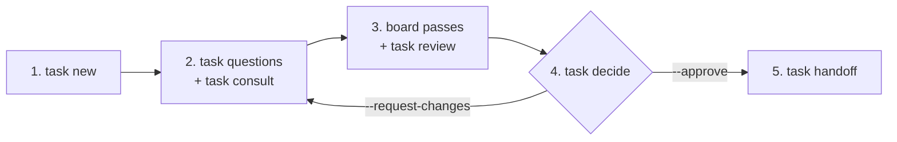

# Task workflow

Every change in an OpenGuildKit project goes through the same five steps. The host agent runs the commands; the person answers the questions and makes the decision.



## 1. Open a task

```bash
openguildkit task new "Show signed-in users the status of their support requests" --id request-status
openguildkit task new --file brief.md          # multi-line brief
```

Without `--id`, the CLI generates `task-` followed by 12 hex characters. IDs use lowercase letters, digits and single hyphens, up to 64 characters. The command fails if `AGENTS.md` is out of date: run `openguildkit sync` first.

## 2. Scope the task

`task questions ID` prints the questionnaire as a JSON array. The agent asks the person, in their language, and confirms any answer it inferred from the brief.

| Key | Question | Choices |
|---|---|---|
| `kind` | What are you asking the team to do? | `feature`, `bug`, `maintenance`, `decision`, `other`, `unsure` |
| `surface` | Which area will this task affect most? | `customer`, `service`, `infrastructure`, `business`, `other`, `unsure` |
| `data` | What is the most sensitive data this task may access or change? | `none`, `internal`, `personal`, `regulated`, `unsure` |
| `research` | What evidence can the boards consult? | `local`, `public`, `unsure` |
| `context` | What acceptance criteria, constraints or other context should the boards know? | Free text |

`context` is optional, except when any answer is `other`.

```json
{
  "kind": "feature",
  "surface": "customer",
  "data": "personal",
  "research": "local",
  "context": "Signed-in users see the status and next step of their own support requests."
}
```

`task consult ID --answers answers.json` validates the answers, selects the boards and prints the consultation request in Markdown. Without `--answers`, the CLI asks the questions in the terminal. `task brief ID` prints the same request again later.

### How boards are selected

Answers route to boards first:

| Answer | Boards |
|---|---|
| `kind: feature` | product, engineering, qa |
| `kind: bug` | engineering, qa |
| `kind: maintenance` | engineering, qa |
| `kind: decision` | product |
| `kind: unsure` | project-management |
| `surface: customer` | product, design, marketing |
| `surface: service` | engineering, performance |
| `surface: infrastructure` | devops, performance |
| `surface: business` | project-management |
| `data: internal`, `personal`, `regulated` or `unsure` | security |

Then each board's `triggers` are matched as whole words in the brief and context, case-insensitively. "Reduce checkout latency" adds `performance`; "RGPD" adds `security`. Only boards enabled in the profile are selected. If nothing matches, `product` reviews the scope, or the first enabled board by ID when `product` is disabled.

Each selected board gets a brief with its purpose, the routing reasons, its expertises, its questions and its source leads. The request also carries a snapshot of the project scope: sector context, stack, resolved rule packs, conventions, checks and the research policy for this task.

## 3. Review through each board

`task template ID` prints the review skeleton with the `consultation_id` and one entry per selected board. Keep that ID to tie the review to the current scope. Each [brain](brains.md) has a set of specialist lenses. The agent records their separate findings, challenges the proposed change, then reconciles the boards and preserves disagreements in the summary. The [request status example](../examples/request-status/review.json) shows a complete review.

Rules enforced by `task review ID --file review.json`:

- `consultation_id` must match the current consultation.
- `summary` and every `recommendation` must contain text.
- There must be exactly one entry per selected board, and no other board.
- `evidence` and `open_questions` are lists of non-empty strings (they can be empty lists).
- For a brain, each specialist needs exactly one finding with an evidence basis. An observed finding cites positions in that board's evidence list. A board records its verdict, confidence, alternative, failure mode, verification and blockers.

Run `openguildkit task challenge ID` to show how the verdicts differ, what each board recommends and which checks can change the decision. The agent shows this brief to the person before implementation.

## 4. Decide

The person runs the command in their own terminal:

```bash
openguildkit task decide request-status --approve --by "Camille Martin" --reason "Read-only scope agreed with support"
```

The CLI prints the brief and the review, then asks the person to type the task ID. Approval fails when stdin is not a terminal, when the typed ID does not match, when the task changed during the decision, when the profile or catalog changed since the consultation, or when `AGENTS.md` is out of date.

If a board flags blockers, the approval prompt asks the decision owner to record how the decision addresses them. After upgrading the board catalog, run `openguildkit sync` and check whether a pending task needs another consultation under the new rules.

To send the task back:

```bash
openguildkit task decide request-status --request-changes --by "Camille Martin" --reason "Include the empty state in scope"
```

This works without a terminal. The next `task consult` archives the previous answers, consultation, review and decision in `rounds`, so the history of the task is kept.

## 5. Hand off

```bash
openguildkit task handoff request-status
```

The handoff exists only for approved tasks whose fingerprint still matches the project. If the profile or catalog changed after approval, the handoff fails and the task cannot be consulted again: open a new task for the same work. It contains the approval (who and why), the approved scope snapshot with the rules in force, and the board review. The agent implements that scope, runs the project checks and brings any scope change back to the person.

## Inspecting a task

`task show ID` prints the full task record as JSON: status, answers, consultation, review, decision, fingerprint and previous rounds.

## Exit codes

| Code | Meaning |
|---|---|
| 0 | Success |
| 1 | Validation or state error (message on stderr, prefixed `OpenGuildKit:`) |
| 2 | Command-line usage error |
| 130 | Cancelled with Ctrl+C |
