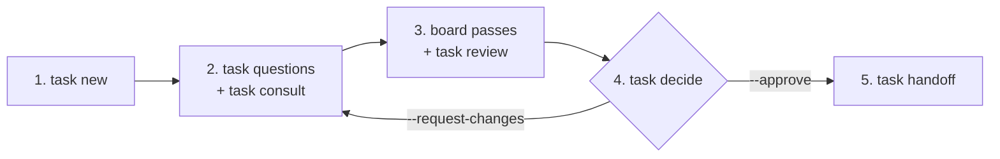

# Task workflow

Every change in an OpenGuildKit project goes through the same five steps. The host agent runs the commands; the person answers the questions and makes the decision.



## 1. Open a task

```bash
openguildkit task new "Show signed-in users the status of their support requests" --id request-status
openguildkit task new --file brief.md          # multi-line brief
```

Without `--id`, the CLI generates `task-` followed by 12 hex characters. IDs use lowercase letters, digits and single hyphens, up to 64 characters. The command fails if `AGENTS.md` is out of date: run `openguildkit sync` first.

## 2. Scope the task

`task questions ID` prints the questionnaire as a JSON array. The agent asks the person, in their language, and confirms any answer it inferred from the brief.

| Key | Question | Choices |
|---|---|---|
| `kind` | What are you asking the team to do? | `feature`, `bug`, `maintenance`, `decision`, `other`, `unsure` |
| `surface` | Which areas will this task affect? Several can apply. | `customer`, `service`, `infrastructure`, `business`, `other`, `unsure` |
| `data` | What is the most sensitive data this task may access or change? | `none`, `internal`, `personal`, `regulated`, `unsure` |
| `research` | What evidence can the boards consult? | `local`, `public`, `unsure` |
| `context` | What acceptance criteria, constraints or other context should the boards know? | Free text |

`context` is optional, except when any answer is `other`. `surface` takes a list, for example `["customer", "service"]` for a change to a screen and the service behind it; a single value is still accepted.

### Follow-up questions and open points

Save the first answers and run `task questions ID --answers answers.json`. The CLI adds the questions that these answers call for and lists the points still open:

| Key | Asked when | Question |
|---|---|---|
| `outcome` | feature, bug, maintenance, other, unsure | The observable result, the expected behaviour and how to reproduce a defect, or what must keep working |
| `affected` | feature, decision, other or unsure work, customer or business areas, personal or regulated data | Who is affected: users, customers, teams or partners |
| `options` | decision | The options on the table and what would make you choose one |

A question is essential for the cases where the boards cannot review without it: the outcome of a feature or a bug, who is affected by a customer-facing change, the options of a decision. A short brief, an `unsure` answer or an unanswered essential question is an **open point**. Open points do not block the consultation: they appear in it, each board says how they affect its recommendation, and the decision brief repeats them. A well-described local bug gets no question about customers or options.

```json
{
  "kind": "feature",
  "surface": "customer",
  "data": "personal",
  "research": "local",
  "context": "Signed-in users see the status and next step of their own support requests."
}
```

`task consult ID --answers answers.json` validates the answers, selects the boards and prints the consultation request in Markdown. Without `--answers`, the CLI asks the questions in the terminal. `task brief ID` prints the same request again later.

### How boards are selected

Answers route to boards first:

| Answer | Boards |
|---|---|
| `kind: feature` | product, engineering, qa |
| `kind: bug` | engineering, qa |
| `kind: maintenance` | engineering, qa |
| `kind: decision` | product |
| `kind: unsure` | project-management |
| `surface: customer` | product, design, marketing |
| `surface: service` | engineering, performance |
| `surface: infrastructure` | devops, performance |
| `surface: business` | project-management |
| `data: internal`, `personal`, `regulated` or `unsure` | security |

Then each board's `triggers` are matched as whole words in the brief and context. Matching ignores case, accents and the kind of apostrophe, accepts a regular plural on each word (`jalon` matches "jalons") and does not look inside hyphenated words ("e-commerce" does not contain `commerce`). When triggers overlap, the longest phrase wins: "performance budget" selects `performance`, not `finance` through `budget`, and "DORA metrics" selects `devops`, not `security` through `dora`. Boards that share the exact same phrase are all selected. "Reduce checkout latency" adds `performance`; "RGPD" adds `security`. Only boards enabled in the profile are selected. If nothing matches, `product` reviews the scope, or the first enabled board by ID when `product` is disabled.

### Preview and adjust the boards

`task route ID --answers answers.json` shows the boards a consultation would select and why, without recording anything. The requester can then change the list for this task:

```bash
openguildkit task consult ID --answers answers.json --add finance --remove marketing --reason "Exports are billed per page"
```

Each addition or removal needs a reason; the consultation records it under `adjustments`. Only boards enabled in the profile can be added.

A project can make some reviews mandatory with `"required_boards": ["security"]` in its profile. These boards join every consultation and cannot be removed; `AGENTS.md` lists them under "Required reviews". When a required board is not enabled for the project, the consultation stops and names it. The requester can then name the person who will review instead, with `--delegate security="Alex Moreau"`: the brief tells the agent to prepare the review for that person, and the review entry carries their name in `reviewer`.

Each selected board gets a brief with its purpose, the routing reasons, its expertises, its questions and its source leads. The request also carries a snapshot of the project scope: sector context, stack, resolved rule packs, conventions, checks and the research policy for this task.

## 3. Review through each board

`task template ID` prints the review skeleton with the `consultation_id` and one entry per selected board. Keep that ID to tie the review to the current scope. Each [brain](brains.md) has a set of specialist lenses. The agent records their separate findings, challenges the proposed change, then reconciles the boards and preserves disagreements in the summary. The [request status example](../examples/request-status/review.json) shows a complete review.

### One pass per board

The host agent can run each board as a separate pass, with a subagent or one after the other:

```bash
openguildkit task pass ID security --mode subagent    # prints the scope, the security brief and the entry to return
openguildkit task submit ID --file security.json     # records that board's entry
openguildkit task progress ID                         # done, failed, started or missing, per board
openguildkit task review ID --summary "Where the boards agree and disagree, and the next step"
```

`task pass` gives each board the project scope, its own brief and its own template entry, nothing from the other boards. `task submit` validates the entry against the template; an invalid entry is recorded as a failed pass with the reason. A pass that was started and never submitted shows as `started`: treat it as interrupted. Run `task pass` again for that board only; the other boards keep their entries. Once every board is done, `task review --summary` assembles the review and records whether the passes ran as subagents, in sequence or both (`execution`). A new consultation starts the passes again. Writing the whole review in one file with `task review --file` still works.

Rules enforced by `task review ID --file review.json`:

- `consultation_id` must match the current consultation.
- `summary` and every `recommendation` must contain text.
- There must be exactly one entry per selected board, and no other board.
- `evidence` and `open_questions` are lists of non-empty strings (they can be empty lists).
- For a brain, each specialist needs exactly one finding with an evidence basis. An observed finding cites positions in that board's evidence list. A board records its verdict, confidence, alternative, failure mode, verification and blockers.

Run `openguildkit task challenge ID` to show how the verdicts differ, what each board recommends and which checks can change the decision. The agent shows this brief to the person before implementation.

## 4. Decide

The person runs the command in their own terminal:

```bash
openguildkit task decide request-status --approve --by "Camille Martin" --reason "Read-only scope agreed with support"
```

The CLI prints the brief and the review, then asks the person to type the task ID. Approval fails when stdin is not a terminal, when the typed ID does not match, when the task changed during the decision, when the profile or catalog changed since the consultation, or when `AGENTS.md` is out of date.

If a board flags blockers, the approval prompt asks the decision owner to record how the decision addresses them. After upgrading the board catalog, run `openguildkit sync` and check whether a pending task needs another consultation under the new rules.

To send the task back:

```bash
openguildkit task decide request-status --request-changes --by "Camille Martin" --reason "Include the empty state in scope"
```

This works without a terminal. The next `task consult` archives the previous answers, consultation, review and decision in `rounds`, so the history of the task is kept.

## 5. Hand off

```bash
openguildkit task handoff request-status
```

The handoff exists only for approved tasks whose fingerprint still matches the project. If the profile or catalog changed after approval, the handoff fails and the task cannot be consulted again: open a new task for the same work. It contains the approval (who and why), the approved scope snapshot with the rules in force, and the board review. The agent implements that scope, runs the project checks and brings any scope change back to the person.

A task answered with `kind: decision` asks for a recommendation. Its handoff is an **approved decision record**: the same approval, scope and review, with an instruction to report the decision and leave the project unchanged. To act on the decision, open a new task that cites it, so the implementation scope gets its own consultation and approval.

## Inspecting a task

`task show ID` prints the full task record as JSON: status, answers, consultation, review, decision, fingerprint and previous rounds.

## Exit codes

| Code | Meaning |
|---|---|
| 0 | Success |
| 1 | Validation or state error (message on stderr, prefixed `OpenGuildKit:`) |
| 2 | Command-line usage error |
| 130 | Cancelled with Ctrl+C |
