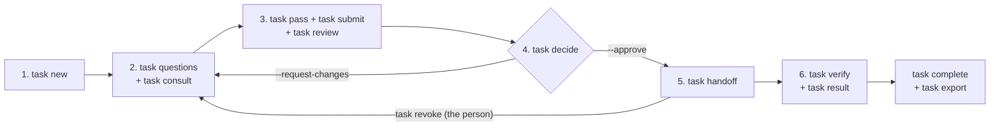

# Task workflow

For: the person who decides on a change and the agent that follows the task path.

Every change in an OpenGuildKit project goes through the same six steps, from the request to the closing.
The host agent runs the commands; the person answers the questions, makes the decision and confirms what is theirs to confirm.
A project can opt in to a [short lane](workflow/short-lane.md) for a change a person declares trivial; it is off until a person turns it on.



## 1. Open a task

```bash
openguildkit task new "Show signed-in users the status of their support requests" --id request-status
openguildkit task new --file brief.md          # multi-line brief
```

`--lane light --paths GLOB...` opens the task in the [short lane](workflow/short-lane.md), in a project that has turned it on.
Without `--id`, the CLI generates `task-` followed by 12 hex characters.
IDs use lowercase letters, digits and single hyphens, up to 64 characters.
The command fails if `AGENTS.md` is out of date: run `openguildkit sync` first.

A brief is kept in the task record, shown to the boards and exported with the decision.
A credential in it, such as an access key or `password=...`, is replaced with a placeholder before the brief is written, and `task new` says so without repeating the value; an email address, a phone number or a bank account number gives a warning.
[tools.md](tools.md#credentials) lists the shapes recognized.

## 2. Scope the task

The agent prints the questionnaire, asks the person the questions and the follow-ups their answers call for, records what stays open, previews the boards and consults them.
[Step 2](workflow/scope-the-task.md) gives the commands and the rules.

## 3. Review through each board

The agent runs one pass per board, records each entry, writes the summary and has the boards answer each other's objections.
[Step 3](workflow/review-through-each-board.md) gives the commands and the rules.

## 4. Decide

The person approves or requests changes at their own terminal, after clearing or waiving each blocker; an approval can stop holding, be withdrawn, or be signed.
[Step 4](workflow/decide.md) gives the commands and the rules.

## 5. Hand off

The approved handoff gives the agent the scope, the conditions and the checks to implement within.
[Step 5](workflow/hand-off.md) gives the commands and the rules.

## 6. Report the results

The agent runs the checks, fills the result file and closes the task, and the record is exported with the change.
[Step 6](workflow/report-the-results.md) gives the commands and the rules.

## Reference pages

Each page below holds one part of the path, read when the task needs it:

- [Delivered diff review](workflow/delivered-diff-review.md): each board of the decision reviews the diff between the approved revision and the delivered one.
- [Evidence changed after it was accepted](workflow/evidence-changed.md): what happens when a file accepted as evidence changes.
- [Dependencies between tasks](workflow/dependencies-between-tasks.md): a task that waits for another.
- [Short lane](workflow/short-lane.md): a shorter path for a change a person declares trivial, off by default.
- [Requester and approver](workflow/requester-and-approver.md): the person who asked for the work does not approve it, off by default.
- [Roles by board](workflow/roles-by-board.md): the blockers of a board cleared only by its members, off by default.
- [Incident response](workflow/incident-response.md): freezing a project and limiting the age of approvals.
- [Dependency alerts](workflow/dependency-alerts.md): the report of a scanner the project already uses, read into the alert register and linked to the task.
- [Following the project's work](workflow/following-the-work.md): what Git shares, reusing the profile, two copies with the same task ID.
- [From a file to its decisions](workflow/from-a-file-to-its-decisions.md): the decisions that cover a file.
- [Several projects at once](workflow/several-projects.md): one line per project, and the inventory of a fleet.
- [Retrospective](workflow/retrospective.md): what the closed tasks teach, and a draft project rule.

## Inspecting a task

`task show ID` prints a screen: the status and decision, the first line of the brief, the boards, the result counts and the next step.
`task show ID --full` prints the full task record as JSON: status, answers, consultation, review, decision, fingerprint and previous rounds; `--json` prints the same record, in the envelope when `OPENGUILDKIT_JSON_ENVELOPE` is 1, and is the form for scripts.
Until 0.17 the record was what `task show ID` printed; `--summary` is still accepted and prints the summary.
For a task that exists here only as an exported record, `task show ID` prints that record, which has no summary, and says so on stderr.
`task show ID --closing` prints only what a completed task left open (its status, who closed it and the open points, grouped), which `task list` names for a task done with reservations: a few hundred bytes, where the whole record of a task with five boards passes 100 KB.

## Exit codes

| Code | Meaning |
|---|---|
| 0 | Success, also when the reader of the output stops early, as `head` does in a pipe: the command ends without a message |
| 1 | Validation or state error (message on stderr, prefixed `OpenGuildKit:`). A command refused in the task's status, such as `task pass` on a draft or `task decide` during the consultation, says what it refuses, the status, and the command that runs next in it |
| 2 | Command-line usage error. Three commands give 2 for another reason: `guard --hook` (an edit is refused), `tools apply` (some tools are connected, others not) and `ci-check` (the evaluation could not run) |
| 130 | Cancelled with Ctrl+C |

Code 1 also covers a project that does not conform and a command that could not evaluate it; the message tells them apart.
[Exit codes](exit-codes.md) lists every command that departs from this table, with its case.

## Where each section went

This page held every section until it was split into the pages of `docs/workflow/`.
A link to one of its old headings lands below, and the line under it gives the page that holds it now.

### Assumptions not confirmed

Now in [Assumptions not confirmed](workflow/scope-the-task.md#assumptions-not-confirmed).

### How boards are selected

Now in [How boards are selected](workflow/scope-the-task.md#how-boards-are-selected).

### When an approval no longer holds

Now in [When an approval no longer holds](workflow/decide.md#when-an-approval-no-longer-holds).

### Signed approvals

Now in [Signed approvals](workflow/decide.md#signed-approvals).

### Certificates of an authority

Now in [Certificates of an authority](workflow/decide.md#certificates-of-an-authority).

### Code owners of the touched paths

Now in [Code owners of the touched paths](workflow/hand-off.md#code-owners-of-the-touched-paths).

### Only the rules that concern the task

Now in [Only the rules that concern the task](workflow/report-the-results.md#only-the-rules-that-concern-the-task).

### Project checks

Now in [Project checks](workflow/report-the-results.md#project-checks).

### Delivered diff review

Now in [Delivered diff review](workflow/delivered-diff-review.md).

### Evidence changed after it was accepted

Now in [Evidence changed after it was accepted](workflow/evidence-changed.md).

### Dependencies between tasks

Now in [Dependencies between tasks](workflow/dependencies-between-tasks.md).

### Short lane

Now in [Short lane](workflow/short-lane.md).

### Requester and approver

Now in [Requester and approver](workflow/requester-and-approver.md).

### Roles by board

Now in [Roles by board](workflow/roles-by-board.md).

### Incident response

Now in [Incident response](workflow/incident-response.md).

### Reuse the profile in another repository

Now in [Reuse the profile in another repository](workflow/following-the-work.md#reuse-the-profile-in-another-repository).

### When two copies use the same task ID

Now in [When two copies use the same task ID](workflow/following-the-work.md#when-two-copies-use-the-same-task-id).

### From a file to its decisions

Now in [From a file to its decisions](workflow/from-a-file-to-its-decisions.md).

### Several projects at once

Now in [Several projects at once](workflow/several-projects.md).

### Retrospective

Now in [Retrospective](workflow/retrospective.md).

### The project

Now in [Retrospective of the project](workflow/retrospective.md#the-project).

### Every month in CI

Now in [Every month in CI](workflow/retrospective.md#every-month-in-ci).
