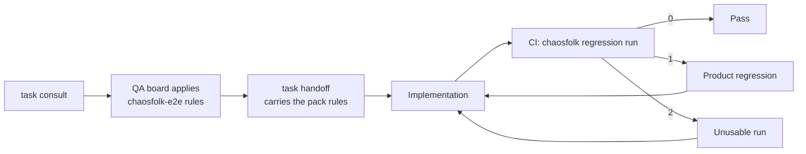

# ChaosFolk end-to-end replays

[ChaosFolk](https://github.com/loukan42/chaosfolk) lets simulated users explore a web app, then replays the failures it found as scenarios, without a model. This integration is optional. It adds the `chaosfolk-e2e` rule pack: the QA board reviews the task's journeys with it, the handoff carries its rules, and CI replays the reviewed scenarios. Projects that do not select it keep their usual tests.

## Pinned version

| | |
|---|---|
| ChaosFolk | commit [`b406600`](https://github.com/loukan42/chaosfolk/commit/b406600b229485cfeb77f54ef6f8f0cf0cd4fc07) on `main` (after 0.8.0, not tagged yet) |
| Python | 3.12 or later for ChaosFolk (OpenGuildKit itself needs 3.11) |
| Pack | `chaosfolk-e2e` 1.1.0 |

```bash
python -m pip install "chaosfolk @ git+https://github.com/loukan42/chaosfolk@b406600b229485cfeb77f54ef6f8f0cf0cd4fc07"
python -m playwright install --with-deps chromium
```

This commit changes how simulated users run. They act through `python -m chaosfolk.user` with their own key, `goto` stays on the tested app's origin, and plain `chaosfolk h01 look` needs the leader token. If your agent had approved `chaosfolk` for simulated users, approve `python -m chaosfolk.user` instead and run `chaosfolk sheets` again. Details: [user isolation release note](https://github.com/loukan42/chaosfolk/blob/b406600b229485cfeb77f54ef6f8f0cf0cd4fc07/docs/release-notes/user-isolation.en.md).

## Turn it on

New project: list ChaosFolk in the stack when you answer `openguildkit init`. The `chaosfolk-e2e` pattern matches it and adds the pack.

Existing project: add `"chaosfolk-e2e"` to `patterns` in `.openguildkit/project.json`, then run:

```bash
openguildkit sync
openguildkit check
```

Preview without changing anything: `openguildkit patterns --id chaosfolk-e2e`.

Adding the pack changes the project fingerprint. Tasks already approved need a new task; reviewed tasks go back through `--request-changes` and a new consultation.

## How it fits the task flow



1. The QA board names the journeys the task touches and the reviewed scenarios that cover them. For a multi-step journey, it asks for the [journey matrix](https://github.com/loukan42/chaosfolk/blob/b406600b229485cfeb77f54ef6f8f0cf0cd4fc07/docs/journey.md) with directed testers before random users.
2. The handoff carries the pack rules, so the implementing agent knows which scenarios must pass.
3. CI installs the pinned version and replays the scenarios against an approved test environment, with synthetic data reset before each trial.
4. After a fix, the same scenario file is replayed and compared with the failing series.

## CI

Adapted from [ChaosFolk's regression guide](https://github.com/loukan42/chaosfolk/blob/b406600b229485cfeb77f54ef6f8f0cf0cd4fc07/docs/regression.md). Replace the app start line with your own.

```yaml
# .github/workflows/chaosfolk.yml
name: ChaosFolk replays
on: [pull_request]
permissions:
  contents: read
jobs:
  replay:
    runs-on: ubuntu-latest
    steps:
      - uses: actions/checkout@v5
      - uses: actions/setup-python@v6
        with:
          python-version: "3.12"
      - run: python -m pip install "chaosfolk @ git+https://github.com/loukan42/chaosfolk@b406600b229485cfeb77f54ef6f8f0cf0cd4fc07"
      - run: python -m playwright install --with-deps chromium
      - run: npm ci && (npm start &) && npx wait-on http://localhost:3000
      - run: chaosfolk regression run qa/scenarios/*.json --output qa-results --times 3
      - uses: actions/upload-artifact@v4
        if: always()
        with:
          name: chaosfolk-results
          path: qa-results
```

| Exit code | Meaning | What the task does |
|---|---|---|
| 0 | Every scenario passed every trial | The check passes |
| 1 | The assertion failed on every trial | Product regression: fix, then replay the same scenario |
| 2 | Invalid scenario, browser that does not start, incomplete or intermittent trials | Not a verdict and not a pass: fix the run, then replay |

`qa-results` holds `junit.xml`, `summary.json` and one `run-*` folder per trial.

## Record the replays in the task

After the handoff, record each replay in the task:

```bash
openguildkit task verify ID --chaosfolk qa-results/summary.json --tool-version b406600
openguildkit task runs ID        # compare the last two replays after a fix
openguildkit task complete ID
```

Each scenario becomes a check `chaosfolk:<scenario file>` with ChaosFolk's own result. A product regression (`failed`) and a run that gave no verdict (`error`) are both recorded as failed checks with their reason, and `task complete` refuses to close the task until a later replay passes. The task keeps every replay with the ChaosFolk version you give and the path of the summary, so the QA board can compare the run before and after a fix. Only the summary path is recorded: screenshots and traces stay in the CI artifact storage.

Start locally with synthetic data against a test environment the project authorizes, then run the same scenario files in CI. Screenshots can show the test app: keep test data synthetic and the raw evidence in your CI artifact storage.

## Limits

- OpenGuildKit does not run ChaosFolk itself: CI or a person runs it, and `task verify --chaosfolk` records its summary.
- Never point ChaosFolk at production. Simulated users click, submit and download for real.

## Upgrading ChaosFolk

When ChaosFolk moves to a new reviewed commit or release:

1. Replace the commit in this guide, in the CI example and in the source links of `src/openguildkit/registry/packs/chaosfolk-e2e.json`. A test checks that they all name the same commit.
2. Read ChaosFolk's changelog for breaking changes and update the pack rules if needed.
3. Bump the pack version (patch for links, minor for a new rule). Projects that use the pack will need a new consultation for pending tasks.
